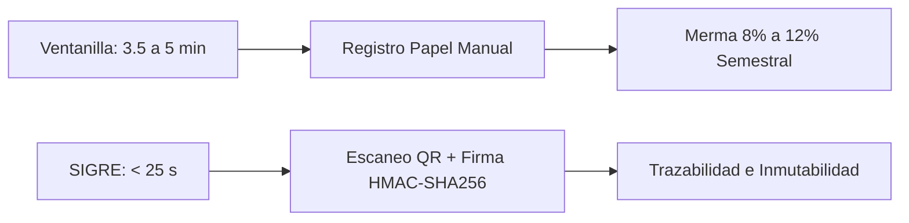
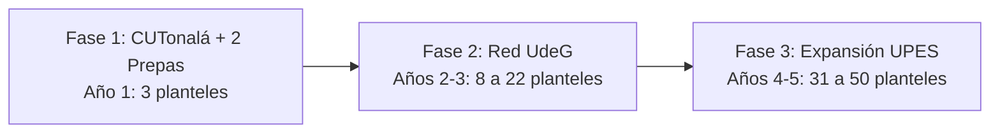
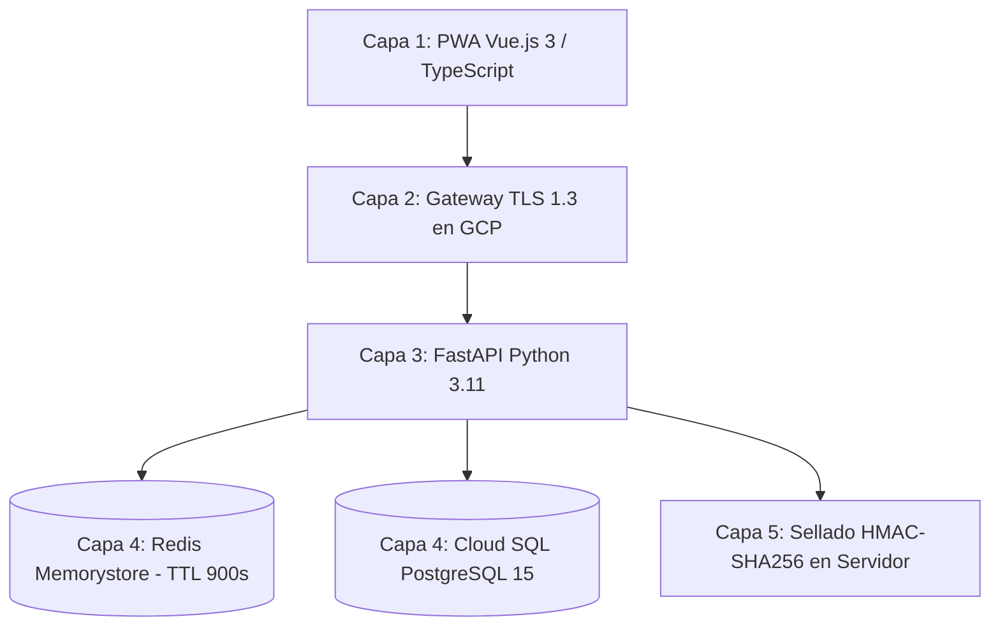
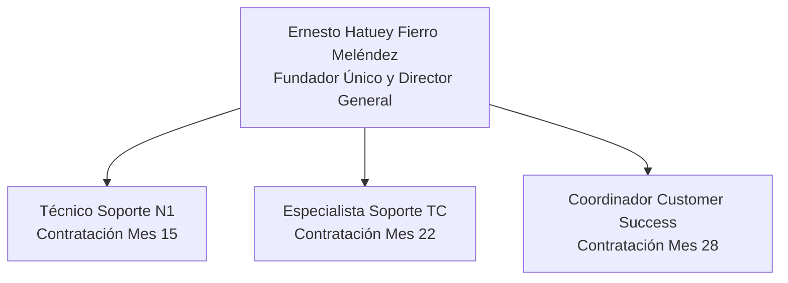
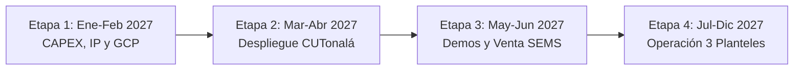
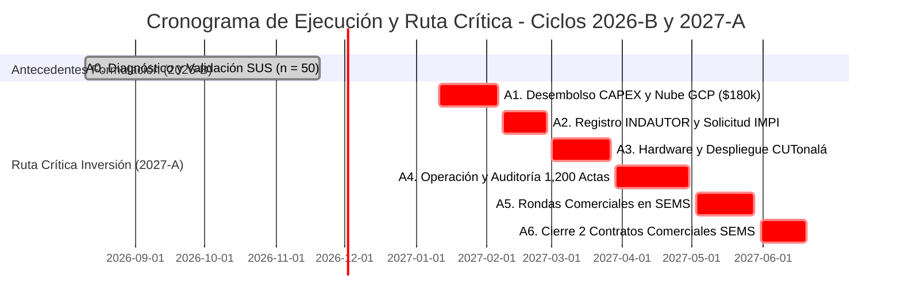

# Propuesta de Inversión SIGRE — Ernesto Hatuey Fierro Meléndez

**Plataforma SaaS de Micro-Custodia y Trazabilidad Transaccional para Almacenes y Laboratorios Escolares**  
*Investment Memorandum & Business Plan — Convocatoria Noviembre de 2026*  
*Materia: Formulación y Evaluación de Proyectos de Inversión (FEPI) | Docente: Mtra. Abril Adriana Angulo Sherman*  
*Centro Universitario de Tonalá (CUTonalá), Universidad de Guadalajara (UdeG)*  
*Fundador Único, Director General y Diseñador de Software: Ernesto Hatuey Fierro Meléndez*

---

### Ficha Técnica Ejecutiva del Proyecto

| Parámetro | Detalle Institucional y Métricas Financieras |
|---|---|
| **Software** | **SIGRE** (Micro-Custodia y Trazabilidad para Almacenes y Laboratorios Escolares) |
| **Fundador** | **Ernesto Hatuey Fierro Meléndez** (Fundador Único, Director General y Diseñador de Software) |
| **Docente** | UdeG — CUTonalá \| FEPI \| Docente: **Mtra. Abril Adriana Angulo Sherman** |
| **CAPEX** | **$180,000.00 MXN** (Inversión pre-semilla financiada mediante capital de riesgo) |
| **Métricas** | **VPN: +$34,442.34 MXN** (@ 15.0% TMAR) \| **TIR: 21.85% anual** \| **Relación B/C: 1.17x** |
| **Payback** | **Payback Simple: Mes 29.9** (2.49 años) \| **Payback Descontado: Mes 33.8** (2.82 años) |
| **Mecanismo** | **Cash Sweep del 75%** (liquidación en **Mes 31.1**; posterior participación del 18% sobre utilidades) |
| **Retorno** | **Trienal: $201,276 MXN (TIR 4.16%)** \| **5 años Base: 20.49%** \| **5 años UPES: 26.51% anual** |
| **Psicometría** | **Escala SUS: 82.85/100 pts** ($n = 50$, DE 10.91, Grado A, percentil 91.4, Alfa 0.892, $p < 0.001$) |
| **Mercado** | Red UdeG (196 planteles). Año 1: 3 planteles; Año 2: 8 planteles; Año 3: 22 planteles (11.2%) |

---

## 1. Problemática, Diagnóstico Empírico y Justificación

### 1.1 El problema operativo: descontrol analógico en ventanillas de almacén
En la Red Universitaria de la UdeG, el préstamo de laptops, proyectores, cables y reactivos se administra mediante libros de actas foliados en papel. Este método manual ocasiona demoras de **3.5 a 5.0 minutos por usuario** durante los cambios de clase (ventanas de 10 minutos), filas continuas en mostrador y una merma proyectada de **$115,000 MXN anuales por plantel** (equivalente al 8% al 12% del stock circulante semestral, estimada con base en 4 semanas de muestreo y bitácoras históricas de CUTonalá) derivada del extravío de accesorios y averías sin deslinde de responsabilidades.

### 1.2 Análisis crítico: la falacia del ERP frente a la micro-custodia de mostrador
Los sistemas ERP institucionales (como SIIAU o Banner) administran el inventario macroinstitucional diferido para compras y auditorías contables, pero no resuelven la **micro-custodia transaccional** en ventanilla en tiempo real (< 25 s). Suponer que un ERP patrimonial cubre el mostrador es una falacia operativa que perpetúa el descontrol en papel sin validez jurídica probatoria ni cadena de custodia individualizada.

### 1.3 Fundamentación empírica: caso base CUTonalá y estudio SUS ($n = 50$)
Durante el ciclo escolar 2026-B se evaluó el prototipo funcional de SIGRE en ventanillas de almacén del **CUTonalá** aplicando la escala estandarizada *System Usability Scale* (SUS; Bangor et al., 2008; Brooke, 1996; Sauro & Lewis, 2012) a una muestra de $n = 50$ usuarios reales: **82.85 puntos promedio** ($DE = 10.91$), ubicándose en Grado A ("Excelente", percentil 91.4) y con una consistencia interna alta (**Alfa de Cronbach de 0.892**).

La prueba $t$ de Student unilateral frente al estándar industrial de 68 puntos (Sauro & Lewis, 2012) confirmó una superioridad altamente significativa: **$t(49) = 9.62, p < 0.001$**; y frente al umbral exigente de excelencia de 80 puntos (Bangor et al., 2008): **$t(49) = 1.848, p = 0.035 < 0.05$** ($\text{IC}_{95\%} = [79.75, 85.95]$ pts). La Tabla 1 detalla la distribución de la muestra evaluada:

| Estamento Evaluado | Muestra ($n$) | Media SUS | Desviación Estándar ($DE$) | Nivel Adjetivo |
|---|---|---|---|---|
| Estudiantes de ingeniería y licenciaturas | 32 | 83.28 pts | 11.21 pts | Grado A (Excelente) |
| Profesores de asignatura y tiempo completo | 12 | 81.25 pts | 9.91 pts | Grado A (Excelente) |
| Personal de almacén y ventanilla | 6 | 83.75 pts | 12.72 pts | Grado A (Excelente) |
| **Muestra Consolidada** | **50** | **82.85 pts** | **10.91 pts** | **Grado A (Percentil 91.4, $p < 0.001$)** |

*Tabla 1. Resultados consolidados de la evaluación psicométrica estandarizada (Escala SUS, n = 50).*

*Figura 1. Flujo operativo analógico frente al flujo digital con trazabilidad de SIGRE.*

  
*Figura 2. Distribución de frecuencias y curva de densidad de puntajes SUS (n = 50) frente a la media de la industria (Sauro & Lewis, 2012).*

### 1.4 Estimación económica del costo de inacción por plantel
El costo anual de la inacción administrativa oscila entre **$90,000 MXN y $140,000 MXN por plantel**, con un punto medio ponderado de **$115,000 MXN anuales** (conforme a la metodología de valoración de costos evitados de Sapag Chain, Sapag Chain & Sapag Puelma, 2014, complementada con cotizaciones de reposición e inventarios locales de CUTonalá). La Tabla 2 desglosa las mermas directas y costos tangibles que el uso de SIGRE mitiga:

| Concepto de Impacto / Ineficiencia | Base de Estimación Anual por Plantel | Costo Directo Anual (MXN) |
|---|---|---|
| **Extravío de accesorios y consumibles** | 20 a 30 reposiciones anuales de cargadores USB-C/adaptadores HDMI @ promedio de $1,000 MXN c/u | $25,000.00 MXN ($20k–$30k) |
| **Daño físico en equipos sin deslinde** | 3 a 4 reparaciones anuales de lámparas/tarjetas lógicas en proyectores o laptops @ $18,333 a $21,250 MXN c/u | $70,000.00 MXN ($55k–$85k) |
| **Gasto operativo en papelería física** | Libretas foliadas, tóner, carpetas y vales de archivo muerto | $20,000.00 MXN ($15k–$25k) |
| **Total Costo Directo de Inacción** | **Pérdida patrimonial tangible y consumibles por plantel** | **$115,000.00 MXN / año ($90k–$140k)** |

*Tabla 2. Estimación analítica del impacto de la inacción administrativa y pérdidas patrimoniales por plantel universitario.*

*Nota:* Adicionalmente, las 280 horas anuales de espera acumulada en filas representan un costo de oportunidad de horas-docente de aproximadamente $39,200 MXN anuales (cálculo: ~8,400 préstamos anuales con un ahorro proyectado de 2 min por transacción = 16,800 min = 280 horas a un costo promedio de $140 MXN/h docente) que la automatización de ventanilla reincorpora al tiempo efectivo de docencia e investigación.

### 1.5 Análisis de alternativas existentes frente a SIGRE
La Tabla 3 compara las alternativas disponibles en el entorno universitario frente a SIGRE:

| Criterio de Selección | Libretas / Papel | ERP Central (SIIAU) | Snipe-IT (Open Source) | Plataforma SIGRE |
|---|---|---|---|---|
| **Tiempo de Despacho** | 3.5 – 5.0 min | No aplicable (sin POS) | 1.5 – 2.5 min | **< 25 segundos** |
| **Micro-custodia Mostrador** | Nula | Inexistente (sólo ERP) | Parcial (TI solamente) | **Total (código + firma)** |
| **Firma Digitalizada** | Manual en papel | No disponible | Limitada (correo; sin firma en mostrador ni offline) | **Nativa (Canvas + HMAC)** |
| **Costo Total (TCO)** | Alto por mermas | > $300k prorrateado | $0 licencia / $35k-$60k TCO | **$24,000 - $48,000 MXN/año** |
| **Modo Offline Contingente** | Inoperante | Inoperante | Requiere conexión | **PWA local con IndexedDB** |

*Tabla 3. Matriz comparativa de alternativas de solución técnica frente a la plataforma SIGRE.*

---

## 2. La Solución, Objetivos y Matriz de Marco Lógico (MML)

### 2.1 Descripción de módulos y propuesta de valor
SIGRE es una solución B2B SaaS diseñada para la **micro-custodia transaccional** en mostrador: 1) Despacho acelerado (< 25 s) vía código de barras o QR institucional; 2) Firma digitalizada sobre Canvas HTML5 con sellado criptográfico HMAC-SHA256 en servidor (Figura 3); 3) Telemetría preventiva de desgaste de activos; 4) Notificaciones multicanal automatizadas ante retrasos:

  
*Figura 3. Interfaz de firma manuscrita digitalizada sobre Canvas HTML5 con sellado criptográfico HMAC-SHA256.*

### 2.2 Objetivos del proyecto
- **Objetivo General:** Desarrollar y comercializar la plataforma SIGRE en la Red Universitaria UdeG para estandarizar la micro-custodia de activos en ventanillas escolares.
- **Objetivo Técnico:** Despachar préstamos en mostrador en menos de 25 segundos con 99.5% de disponibilidad en nube y modo de contingencia offline.
- **Objetivo Comercial:** Captar 3 planteles en el Año 1 (1 piloto sin costo CUTonalá con setup + 2 prepas comerciales a $24,000 MXN), 8 planteles en el Año 2 y 22 planteles al cierre del Año 3 (11.2% de la Red UdeG).
- **Objetivo Financiero:** Recuperar la inversión de $180,000 MXN en el **Mes 31.1** mediante un mecanismo **Cash Sweep del 75%** sobre el FEN, alcanzando rentabilidad operativa anual a partir del Año 2.

### 2.3 Marco Lógico Metodológico (MML) del Proyecto SIGRE
Bajo estándares internacionales de formulación (Ortegón, Pacheco & Prieto, CEPAL, 2015), la Tabla 4 presenta la estructura analítica de la MML:

| Nivel Jerárquico | Resumen Narrativo | Indicadores Verificables | Medios de Verificación | Supuestos y Riesgos |
|---|---|---|---|---|
| **Fin** | Proteger el patrimonio físico de las IES y optimizar tiempos de mostrador. | Reducción $\ge 80\%$ en mermas patrimoniales; reducción de 70% en tiempo de fila. | Auditorías de inventario y actas de entrega-recepción. | Voluntad política de directores para adoptar control digital. |
| **Propósito** | SIGRE operando como estándar de ventanilla en 22 planteles de la Red UdeG al Año 3. | 22 contratos de suscripción vigentes; $\ge 90\%$ de préstamos registrados digitalmente. | Padrón de contratos, reportes de facturación y encuestas SUS. | Cumplimiento del Reglamento de Adquisiciones de la UdeG. |
| **Componentes** | 1. Software PWA en nube. 2. Kits demo con escáner. 3. Módulo de desgaste y telemetría. | 1. Uptime cloud $\ge 99.5\%$. 2. Tiempo de despacho $\le 25$ s. 3. 4 kits operativos desplegados. | Registros de telemetría en GCP, bitácoras de servicio y encuestas de satisfacción. | Conectividad a internet local o activación adecuada del modo offline. |
| **Actividades** | 1. Pulido técnico y registro IP. 2. Piloto en CUTonalá. 3. Rondas comerciales en SEMS. 4. Implementación y soporte. | 1. CAPEX $180,000 MXN ejercido en Año 1. 2. Registro ante INDAUTOR y presentación de solicitud IMPI en Mes 2. 3. 3 planteles afiliados en Año 1. | Estados de cuenta bancarios, títulos de registro marcario y órdenes de compra firmadas. | Desembolso oportuno del capital semilla por el inversionista. |

*Tabla 4. Matriz de Marco Lógico (MML) bajo lineamientos internacionales CEPAL/BID.*

---

## 3. Nicho de Mercado y Estrategia de Escalamiento

### 3.1 Mercado base cautivo: Red Universitaria UdeG
Conforme a la numeralia oficial de la Coordinación General de Planeación y Evaluación (CGPE, corte mayo de 2026), la Red Universitaria de la UdeG cuenta con **196 dependencias académicas**: **19 Centros Universitarios** (7 temáticos metropolitanos: CUAAD, CUCBA, CUCEA, CUCEI, CUCS, CUCSH y CUGuadalajara; 2 centros multitemáticos metropolitanos: CUTonalá y CUTlaquepaque; y 10 centros regionales) y **177 planteles del Sistema de Educación Media Superior (SEMS)** (33 escuelas preparatorias metropolitanas y 144 regionales y módulos).

La meta comercial acumulada de 22 planteles al cierre del Año 3 representa únicamente el **11.22% del mercado cautivo** (Tabla 5 y Figura 4):

| Tipo de Dependencia | Total Red UdeG | Año 1 (Piloto) | Año 2 (Crecimiento) | Año 3 (Madurez) | Penetración Año 3 |
|---|---|---|---|---|---|
| **Centros Universitarios (CUs)** | 19 | 1 (CUTonalá) | 3 centros | 8 centros | 42.1% |
| **Preparatorias SEMS** | 177 | 2 prepas | 5 prepas | 14 prepas | 7.9% |
| **Total Planteles Red UdeG** | **196 planteles** | **3 planteles** | **8 planteles** | **22 planteles** | **11.22%** |

*Tabla 5. Desglose del nicho institucional de la Red Universitaria UdeG y metas comerciales al Año 3.*

A partir del Año 4, SIGRE escalará a Universidades Públicas Estatales (**UPES**) del Centro-Occidente (más de 340 unidades académicas registradas en el catálogo de ANUIES, 2024), proyectando una base instalada acumulada de 31 a 50 planteles (22 planteles consolidados de la Red UdeG más 9 a 28 unidades en UPES regionales; Figura 4):

*Figura 4. Escalamiento institucional progresivo: de la Red UdeG a las IES públicas nacionales.*

---

## 4. Comercialización, Decisores y Servicios

### 4.1 Estructura de decisores y viabilidad burocrática B2G
La comercialización B2G se gestiona directamente con Secretarios Administrativos (en Centros Universitarios) y Directores de Escuela (en Preparatorias SEMS). Conforme a los **Artículos 16 (Fracción IV) y 23 del Reglamento de Adquisiciones, Arrendamientos y Contratación de Servicios de la Universidad de Guadalajara (RAACS, versión vigente Junio 2025)**, los Directores de Preparatoria SEMS están legalmente facultados para autorizar contrataciones y compras por **adjudicación directa** hasta por **37 veces la Unidad de Medida y Actualización (UMA) mensual** ($131,950.14 MXN; INEGI, 2026), y los Titulares de Centros Universitarios hasta por **75 UMA mensuales** ($267,466.50 MXN). Las suscripciones anuales de SIGRE ($24,000 a $48,000 MXN) representan únicamente el 18.2% y 17.9% de dichos techos de adjudicación directa descentralizada, garantizando una contratación ágil y formal sin requerir licitación pública centralizada ni intervención de comités de compras (Tabla 6):

| Nivel de Servicio | Cuota Anual Suscripción | Cobertura Operativa Incluida | Cuota Setup / Configuración |
|---|---|---|---|
| **Prepa SEMS / Laboratorio** | $24,000 MXN ($2,000/mes) | Hasta 2 almacenes, 1,500 usuarios, firmas ilimitadas | $5,000 MXN por plantel |
| **Centro Universitario Estándar** | $48,000 MXN ($4,000/mes) | Hasta 6 almacenes, 8,000 usuarios, módulo de telemetría | $15,000 MXN por centro |
| **Campus Multisede / Enterprise** | $72,000 MXN ($6,000/mes) | Almacenes ilimitados, analítica directiva y soporte prioritario | $25,000 MXN por campus |

*Tabla 6. Estructura de tarifas anuales, cuotas de configuración y cobertura operativa por nivel de servicio.*

*Nota:* Tarifas netas antes de IVA en pesos mexicanos. La cuota de setup aplica únicamente al darse de alta por primera vez. El plan Enterprise está previsto para fases posteriores de consolidación multisede en macro-campus, mientras que la proyección trienal base se sustenta exclusivamente en los planes Prepa SEMS ($24k) y Centro Universitario ($48k).

---

## 5. Especificaciones Técnicas, Desgaste y Contingencia

### 5.1 Arquitectura tecnológica y parámetros de calidad
SIGRE se estructura en 5 capas desacopladas sobre Google Cloud Platform (GCP): Frontend PWA en Vue.js 3 con TypeScript (Capa 1), Gateway perimetral con TLS 1.3 (Capa 2), Backend de microservicios en Python 3.11 con FastAPI (Capa 3), Capa de datos y caché transaccional con PostgreSQL 15 en Cloud SQL y Redis en Memorystore para bloqueos anti-empalme (Capa 4), y Motor de Sellado Criptográfico HMAC-SHA256 (Capa 5; Figura 5 y Tabla 7):

*Figura 5. Diagrama de arquitectura tecnológica en la nube y componentes del sistema.*

| Capa / Módulo | Tecnología Implementada | Estándar de Rendimiento y Calidad |
|---|---|---|
| **Frontend de Mostrador** | Vue.js 3 + TypeScript + Tailwind CSS | Carga inicial < 1.2 s; renderizado de firma < 16 ms |
| **Backend de Servicios** | Python 3.11 + FastAPI (GCP Cloud Run) | Latencia p95 < 45 ms; tolerancia a 50 transacciones/s |
| **Persistencia y Caché** | Cloud SQL PostgreSQL 15 + Redis Memorystore | Consultas concurrentes < 10 ms; integridad ACID |
| **Seguridad de Firma** | Hash HMAC-SHA256 con clave simétrica en servidor | Actas digitales inmutables con sellado de tiempo |
| **Disponibilidad Cloud** | Contenedores Docker en Google Cloud Platform | SLA de disponibilidad del 99.5%; respaldos diarios |

*Tabla 7. Especificaciones técnicas de componentes de software, nube y estándares de seguridad.*

### 5.2 Registro de desgaste individual de activos y prevención de abusos
SIGRE monitorea horas acumuladas de encendido y ciclos de préstamo por número de serie individual, disparando alertas de mantenimiento preventivo al alcanzar el 85% de la vida útil estimada del bien (Figura 6):

  
*Figura 6. Tablero directivo ejecutivo con telemetría de activos y control de inventario en tiempo real.*

### 5.3 Cumplimiento LGPDPPSO, PDI institucional UdeG y contingencia offline
En cumplimiento de la **Ley General de Protección de Datos Personales en Posesión de Sujetos Obligados (LGPDPPSO)** y las directrices de sustentabilidad cero papel del **Plan de Desarrollo Institucional de la Universidad de Guadalajara (PDI 2019–2025: Visión 2030)**, la plataforma almacena el trazo vectorial gráfico de la firma con sello de tiempo sin recabar datos biométricos fisiológicos crudos (como huellas dactilares o escaneo de iris).

Ante contingencias por desconexión de red local, la PWA activa el **modo de micro-custodia offline**: resguarda las transacciones localmente en el motor transaccional *IndexedDB* del navegador con firma temporal y realiza la sincronización atómica con el backend de GCP en cuanto se restablece el enlace.

---

## 6. Organización, Capital Humano y Cronograma

### 6.1 Estructura organizacional y perfiles del equipo inicial
La gestión integral del proyecto está a cargo de **Ernesto Hatuey Fierro Meléndez** como **Fundador Único, Director General y Diseñador de Software**, absorbiendo la arquitectura tecnológica, el despliegue en la nube y la interlocución comercial B2G durante la fase de lanzamiento (Figura 7):

*Figura 7. Organigrama funcional del equipo y fases de escalamiento de personal.*

### 6.2 Plan de escalamiento y nómina escalonada
El crecimiento de la estructura operativa se rige por un esquema de **nómina escalonada** condicionado a gatillos de facturación comercial: Año 1 ($0 nómina fija patronal, con $40,000 MXN asignados a becas de servicio social y apoyo técnico en sitio para los 3 planteles piloto); Año 2 (**$120,000 MXN**: Técnico N1 contratado en Mes 15 por $28,000 MXN, Especialista TC activado en **Mes 22** por $30,000 MXN y honorarios de gestión para el fundador por $62,000 MXN); Año 3 (**$240,000 MXN**: Especialista TC por $120,000 MXN, Customer Success contratado en Mes 28 por $63,000 MXN y estipendio para el fundador por $57,000 MXN). La Tabla 8 resume las condiciones contractuales:

| Periodo Operativo | Puesto / Rol | Gatillo Comercial de Activación | Remuneración Presupuestada |
|---|---|---|---|
| **Año 1 (M1-M12)** | Fundador Único + Becarios | Inversión capital semilla | $0 nómina fija patronal ($40k becas soporte en sitio) |
| **Año 2 (Mes 15)** | Técnico Soporte N1 | 4 planteles activos con cobro | 7 meses @ $4,000 = $28,000 MXN |
| **Año 2 (Mes 22)** | Especialista Soporte TC | 8 planteles activos contratados | 3 meses @ $10,000 = $30,000 MXN |
| **Año 2 (M13-M24)** | Honorarios Fundador | Facturación anual $\ge \$200,000$ | Retribución de gestión: $62,000 MXN |
| **Año 3 (M25-M36)** | Equipo Técnico y CS | 12 planteles activos contratados | Especialista ($120k) + CS ($63k) + Fundador ($57k) = $240,000 MXN |

*Tabla 8. Estructura de crecimiento del equipo técnico y condiciones de activación contractual.*

### 6.3 Fases operativas y cronograma en Ruta Crítica [RC] extendida a 2027-A
La ejecución del proyecto articula dos horizontes complementarios: 1) Los **antecedentes de formulación y validación empírica** cursados durante el ciclo 2026-B (10 ago – 20 nov 2026); y 2) La **ruta crítica de ejercicio de la inversión pre-semilla** durante el ciclo 2027-A (11 ene – 20 jun 2027), desplegada en cuatro etapas operativas (Figura 8 y Tabla 9):

*Figura 8. Esquema secuencial de etapas operativas y metas críticas del primer año.*

| Fase Operativa | Ventana Temporal | Objetivo Principal de Etapa | Entregables Clave Verificables |
|---|---|---|---|
| **Etapa 1** | Ene – Feb 2027 (M1–M2) | Desembolso CAPEX, nube GCP y trámites IP | Infraestructura en GCP, depósito INDAUTOR y solicitud IMPI |
| **Etapa 2** | Mar – Abr 2027 (M3–M4) | Puesta en marcha en ventanillas CUTonalá | 3 terminales en producción, cobro setup ($15k), 1,200 actas |
| **Etapa 3** | May – Jun 2027 (M5–M6) | Demostraciones y cierre comercial SEMS | 2 contratos comerciales firmados ($48k) con prepas SEMS |
| **Etapa 4** | Jul – Dic 2027 (M7–M12) | Operación regular y consolidación Año 1 | **3 planteles activos**, cobro de $63k y auditoría de servicio |

*Tabla 9. Matriz de fases de ejecución operativa y criterios de aceptación (Año 1).*

La programación temporal, dependencias y holguras de la Ruta Crítica [RC] para la inversión del Año 1 (Ciclo 2027-A) se detalla en la Tabla 10 y el Diagrama de Gantt de la Figura 9. Por restricción de recursos humanos al operar inicialmente como fundador único, la actividad **A3** depende secuencialmente de **A2**, ya que el fundador debe blindar legalmente el software y la marca antes de entregar terminales y dossiers en planteles, situando a **A2 formalmente en la Ruta Crítica [RC]** (holgura = 0 semanas):

| Clave | Actividad Operativa (Ciclo 2027-A) | Ventana Calendario | Duración | Dependencia | Holgura | Ruta Crítica |
|---|---|---|---|---|---|---|
| **A0** | Formulación FEPI y validación SUS ($n = 50$) | 10 ago – 20 nov 2026 | 15 sem | Ninguna | 0 sem | Antecedente |
| **A1** | Desembolso CAPEX ($180k) y puesta a punto Cloud GCP | 11 ene – 06 feb 2027 | 4 sem | A0 | 0 sem | **Sí [RC]** |
| **A2** | Depósito obra INDAUTOR y solicitud de marca IMPI | 08 feb – 27 feb 2027 | 3 sem | A1 | 0 sem | **Sí [RC]** |
| **A3** | Compra de hardware demo y puesta a punto en CUTonalá | 01 mar – 27 mar 2027 | 4 sem | A2 | 0 sem | **Sí [RC]** |
| **A4** | Operación mostrador CUTonalá y telemetría de activos | 29 mar – 30 abr 2027 | 5 sem | A3 | 0 sem | **Sí [RC]** |
| **A5** | Rondas comerciales B2G en planteles del SEMS | 03 may – 28 may 2027 | 4 sem | A4 | 0 sem | **Sí [RC]** |
| **A6** | Negociación y formalización de 2 contratos prepas SEMS | 31 may – 20 jun 2027 | 3 sem | A5 | 0 sem | **Sí [RC]** |

*Tabla 10. Cronograma analítico de actividades de inversión, dependencias y Ruta Crítica [RC] (Ciclo 2027-A).*

*Figura 9. Cronograma de ejecución de la inversión pre-semilla en diagrama de Gantt (Ciclos 2026-B y 2027-A).*

---

## 7. Inversiones, Costos, Ingresos y Evaluación Financiera

### 7.1 Presupuesto de inversión inicial (CAPEX): $180,000 MXN
El requerimiento de financiamiento pre-semilla suma **$180,000.00 MXN**, desglosado en la Tabla 11 sin duplicidad frente al OPEX operativo:

| Partida de Inversión | Concepto y Destino del Gasto | Monto Asignado |
|---|---|---|
| **P1. Desarrollo de Software** | Honorarios preoperativos de arquitectura, desarrollo e integración PWA (agosto-noviembre 2026) | $75,000.00 MXN |
| **P2. Entorno Preoperativo Cloud** | Infraestructura de staging, herramientas de desarrollo y dominios | $20,000.00 MXN |
| **P3. Trámites Legales y Propiedad Intelectual** | Registro de obra INDAUTOR y marca IMPI (**$3,126.41 MXN**; IMPI, 2026) | $25,000.00 MXN |
| **P4. Hardware de Mostrador y Dossiers** | 3 escáneres ópticos y tableta (**$13,500 MXN**) + carpetas de ROI (**$6,500 MXN**) | **$20,000.00 MXN** |
| **P5. Fondo de Reserva de Liquidez** | Cojín de tesorería para contingencias y desfases de cobro | $40,000.00 MXN |
| **Total Inversión Inicial (CAPEX)** | **Presupuesto consolidado financiado con capital semilla** | **$180,000.00 MXN** |

*Tabla 11. Estructura analítica de asignación de capital semilla (CAPEX: $180,000 MXN).*

### 7.2 Estructura de costos operativos (OPEX) y proyecciones de ingresos
Los costos operativos suman **$95,000 MXN en Año 1**, **$225,000 MXN en Año 2** y **$426,000 MXN en Año 3**. Los ingresos de Año 1 suman **$63,000 MXN** con **3 planteles** (piloto operativo **CUTonalá** con cuota de setup de $15,000 MXN + **2 contratos comerciales** prepas SEMS a $24,000 MXN = $48,000 MXN, exentas de setup por adopción temprana). A partir del Año 2, CUTonalá formaliza su contratación ordinaria al plan Centro Universitario ($48,000 MXN) tras comprobar el abatimiento de mermas, escalando la facturación a **$309,000 MXN en Año 2** (8 sedes: 3 CUs + 5 prepas, con 5 nuevas altas = $45,000 MXN de setup) y **$840,000 MXN en Año 3** (22 sedes: 8 CUs + 14 prepas, con 14 nuevas altas = $120,000 MXN de setup; Tabla 12 y Figura 10):

| Concepto de Facturación | Año 1 (Piloto 3 sedes) | Año 2 (Crecimiento 8 sedes) | Año 3 (Madurez 22 sedes) |
|---|---|---|---|
| **Planteles en Operación** | **3 planteles (CUTonalá + 2 prepas)** | **8 sedes (3 CUs + 5 prepas)** | **22 sedes (8 CUs + 14 prepas)** |
| Suscripción CUs (@ $48k) | $0 (Piloto sin cuota) | $144,000 MXN (3 CUs) | $384,000 MXN (8 CUs) |
| Suscripción Prepas (@ $24k) | $48,000 MXN (2 prepas) | $120,000 MXN (5 prepas) | $336,000 MXN (14 prepas) |
| Setup por Nuevas Altas | $15,000 MXN (1 setup CU) | $45,000 MXN (2 CUs + 3 prepas) | $120,000 MXN (5 CUs + 9 prepas) |
| **Ingresos Brutos Anuales** | **$63,000.00 MXN** | **$309,000.00 MXN** | **$840,000.00 MXN** |

*Tabla 12. Proyección trienal de facturación e ingresos brutos del proyecto (Pesos MXN).*

```mermaid
xychart-beta
    title "Evolución Financiera Trienal SIGRE (Miles MXN)"
    x-axis ["Año 1 (Piloto)", "Año 2 (Crecimiento)", "Año 3 (Madurez)"]
    y-axis "Monto Anual (Miles MXN)" -50 --> 900
    bar [63, 309, 840]
    bar [95, 225, 426]
    line [-32, 68.4, 289.8]
```

*Figura 10. Comportamiento proyectado de ingresos brutos, costos operativos y Flujo de Efectivo Neto (FEN).*

### 7.3 Estado de Resultados Proforma, Amortización Fiscal y Estructura Operativa
La Tabla 13 presenta el Estado de Resultados Proforma trienal, aplicando la amortización de pérdidas fiscales de ejercicios anteriores conforme al **Artículo 57 de la Ley del Impuesto sobre la Renta (LISR)**:

| Rubro Financiero Proforma | Año 1 (Piloto) | Año 2 (Crecimiento) | Año 3 (Consolidación) |
|---|---|---|---|
| **Ingresos Brutos Totales** | **$63,000.00** | **$309,000.00** | **$840,000.00** |
| (−) Servidores Cloud GCP en Producción | ($18,000.00) | ($35,000.00) | ($65,000.00) |
| (−) Apoyo Técnico en Campo y Nómina Operativa | ($40,000.00) | ($120,000.00) | ($240,000.00) |
| (−) Viáticos y Acompañamiento en Sitio | ($12,000.00) | ($22,000.00) | ($45,000.00) |
| (−) Servicios Contables, Legales y Fiscales | ($15,000.00) | ($24,000.00) | ($36,000.00) |
| (−) Mantenimiento de Software y Seguridad | ($10,000.00) | ($24,000.00) | ($40,000.00) |
| **Total Costos Operativos (OPEX)** | **($95,000)** | **($225,000)** | **($426,000)** |
| **Utilidad de Operación (EBITDA)** | **−$32,000.00** | **+$84,000.00** | **+$414,000.00** |
| (−) Amortización Pérdida Fiscal Año 1 (Art. 57 LISR) | — | ($32,000.00) | — |
| **Base Gravable de ISR** | **$0.00** | **$52,000.00** | **$414,000.00** |
| (−) Impuesto sobre la Renta (ISR 30%) | $0.00 | **($15,600)** | **($124,200)** |
| **Flujo de Efectivo Neto (FEN)** | **−$32,000 MXN** | **+$68,400 MXN** | **+$289,800 MXN** |

*Tabla 13. Estado de Resultados Proforma proyectado a tres años (Cifras en Pesos MXN).*

> [!NOTE]
> **Consistencia Aritmética, Criterio de Estrés Financiero y Tratamiento Fiscal:**  
> En el Año 1, el OPEX de **($95,000 MXN)** (que incluye $40,000 MXN asignados a becas de apoyo a estudiantes de servicio social en sitio para los 3 planteles piloto) genera una pérdida operativa de **−$32,000 MXN** (con ISR de $0). En el Año 2, conforme al Art. 57 de la LISR, dicha pérdida se amortiza reduciendo la base gravable de $84,000 MXN a **$52,000 MXN**, pagando un ISR del 30% por **($15,600 MXN)** y arrojando un FEN neto de **+$68,400 MXN**. En el Año 3, el EBIT de $414,000 MXN tributa **($124,200 MXN)** de ISR, generando un FEN neto de **+$289,800 MXN**. El margen neto pasa de −50.8% en Año 1, al 22.1% en Año 2 y al **34.5% en Año 3** (con un margen operativo EBITDA del **49.3%**). El proyecto alcanza rentabilidad operativa anual a partir del Año 2.

### 7.4 Análisis Financiero de Rentabilidad: Proyección FEN, VPN, TIR y Payback
Fijando una **Tasa Mínima Aceptable de Rendimiento (TMAR) del 15.0% anual** (tasa libre de riesgo Cetes a 364 días en 7.12% más prima por riesgo de 7.88%), la Tabla 14 resume los indicadores de rentabilidad del proyecto:

| Periodo de Evaluación | Flujo de Efectivo Neto (FEN) | Factor Descuento (15.0%) | Valor Actual Descontado (VA) |
|---|---|---|---|
| **Inversión Inicial (Mes 0)** | **($180,000.00 MXN)** | 1.0000 | ($180,000.00 MXN) |
| **Año 1** | **($32,000.00 MXN)** | 0.8696 | ($27,826.09 MXN) |
| **Año 2** | **+$68,400 MXN** | 0.7561 | +$51,720.23 MXN |
| **Año 3** | **+$289,800 MXN** | 0.6575 | +$190,548.20 MXN |
| **Valor Presente Neto (VPN @ 15.0%)** | — | — | **+$34,442.34 MXN** |
| **Tasa Interna de Retorno (TIR)** | — | — | **21.85% anual** |
| **Relación Beneficio / Costo (B/C)** | — | — | **1.17 veces** |
| **Periodo de Recuperación Simple (Payback)** | — | — | **Mes 29.9** (2.49 años) |
| **Periodo de Recuperación Descontado** | — | — | **Mes 33.8** (2.82 años) |

*Tabla 14. Indicadores consolidados de rentabilidad financiera: VPN, TIR, B/C y Periodos de Recuperación.*

### 7.5 Análisis de Sensibilidad Multiescenario y Umbral de Viabilidad
La Tabla 15 evalúa la resiliencia del proyecto ante fluctuaciones en la penetración de mercado al Año 3:

| Escenario Evaluado | Planteles Año 3 | Ingresos Año 3 | FEN Año 3 | VPN (@ 15.0%) | TIR | Payback Simple |
|---|---|---|---|---|---|---|
| **Pesimista (Adopción Parcial)** | **15 planteles** | $570,000 MXN | $168,000 MXN | **−$45,643.13 MXN** | **4.35% anual** | **Mes 34.3** |
| **Base (Meta Planificada)** | **22 planteles** | $840,000 MXN | $289,800 MXN | **+$34,442.34 MXN** | **21.85% anual** | **Mes 29.9** |
| **Optimista (Alta Demanda)** | **30 planteles** | $1,150,000 MXN | $420,000 MXN | **+$120,050.96 MXN** | **36.10% anual** | **Mes 28.1** |

*Tabla 15. Análisis de sensibilidad financiera a tres escenarios y umbral de viabilidad.*

> [!IMPORTANT]
> **Umbral de Viabilidad Financiera (Punto de Equilibrio de la Inversión):**  
> En el escenario pesimista (15 planteles), la TIR de 4.35% no cubre la TMAR del 15% y el VPN resulta negativo. El umbral exacto donde el **VPN iguala a cero a la tasa del 15%** exige un FEN en el Año 3 de **$237,417.50 MXN**, lo que tolera una **caída máxima admisible del 18.1%** respecto a la meta base de FEN ($289,800 MXN). Mediante interpolación paramétrica frente al escenario pesimista, esto equivale a **18.99 planteles**; por ende, afiliar **19 planteles discretos** (sólo el **9.7%** de la Red UdeG de 196 dependencias) sustenta la viabilidad financiera del proyecto conforme a los supuestos del modelo base.

---

## 8. Análisis FODA Institucional y Técnico

  
*Figura 11. Matriz oficial de análisis estratégico FODA de la plataforma SIGRE.*

### Fortalezas (F) y Oportunidades (O)
- **F1. Software propio desarrollado a la medida:** Despacho ágil en ventanilla (< 25 s) con firma manuscrita digitalizada y sellado criptográfico HMAC-SHA256 en servidor.
- **F2. Usabilidad validada empíricamente:** 82.85 puntos en escala SUS ($n = 50$, Grado A "Excelente", percentil 91.4, $p < 0.001$).
- **F3. Eficiencia en infraestructura cloud:** Costos de servidores en GCP de $18,000 MXN en Año 1 con arquitectura de microservicios autoescalables.
- **F4. Cumplimiento normativo:** Apego a la LGPDPPSO y a la directriz de sustentabilidad cero papel del PDI 2019-2025 de la UdeG.
- **O1. Política institucional de austeridad:** Urgencia en las IES públicas por abatir mermas patrimoniales y optimizar recursos físicos.
- **O2. Modelo B2G por Compra Directa (< 1,000 UMA = $117,310 MXN):** Contratación ágil por adjudicación directa sin someterse a licitaciones públicas.
- **O3. Mercado base cautivo en la Red UdeG:** 196 planteles potenciales, donde la meta de 22 sedes al Año 3 representa únicamente el 11.22%.
- **O4. Sustentabilidad comprobada:** Ahorro directo en papelería física y consumibles de **$20,000.00 MXN anuales por plantel** (eliminando libretas foliadas, vales impresos y tóner).

### Debilidades (D) y Amenazas (A)
- **D1. Riesgo de persona clave en etapa semilla:** Concentración inicial en el fundador único, mitigada con estandarización en monorepo, documentación exhaustiva y contratación programada de personal técnico desde el Mes 15.
- **D2. Inexistencia de historial crediticio comercial:** Mitigada mediante el fondeo de capital semilla de $180,000 MXN y la solvencia operativa demostrada por el piloto en CUTonalá.
- **D3. Curva de adopción en personal de ventanilla:** Mitigada con sesiones prácticas de inducción de 90 minutos y acompañamiento humano en sitio.
- **A1. Tiempos burocráticos y dispersión semestral de pagos UdeG:** Riesgo de desfase de liquidez a 30-60 días, cubierto con la reserva de caja de $40,000 MXN del CAPEX.
- **A2. Resistencia al cambio tecnológico en personal de mostrador:** Mitigada demostrando que SIGRE reduce la carga administrativa en mostrador de 4 minutos a menos de 25 segundos sin incrementar la fricción del usuario.
- **A3. Cortes imprevistos en la conectividad local de los planteles:** Mitigados con el modo de micro-custodia offline en PWA con base de datos IndexedDB y sincronización diferida.

---

## 9. Propuesta Formal para el Inversionista de Capital Semilla

### 9.1 Tesis de inversión y oportunidad de mercado
SIGRE representa una oportunidad de inversión B2B SaaS en una industria con alta demanda desatendida, mercado cautivo institucional y márgenes netos del **34.5% en madurez (Año 3)** con EBITDA del **49.3%**. Con una inyección pre-semilla de **$180,000.00 MXN**, se resuelve una merma anual de $115,000 MXN por plantel, viabilizada mediante compras directas sin fricción burocrática.

### 9.2 ¿Cuál es el siguiente paso para que el proyecto siga creciendo?
El capital semilla se destinará de forma inmediata a: 1) Formalizar los registros de marca ante el IMPI y de derechos de autor ante el INDAUTOR; 2) Consolidar la operación en los almacenes de CUTonalá; 3) Adquirir 3 escáneres ópticos y tableta demo para iniciar rondas de presentación en el SEMS y cerrar los primeros contratos comerciales en el ciclo 2027-A.

### 9.3 Estructura formal de inversión, instrumento legal y retorno financiero
La inyección de capital se formalizará mediante un **Contrato de Mutuo con Participación sobre Utilidades Netas**, estipulando un mecanismo de amortización acelerada **Cash Sweep del 75%** sobre el FEN hasta liquidar íntegramente los $180,000 MXN en el **Mes 31.1**, tras lo cual se activará una **participación preferente del 18% sobre utilidades netas**.

- **Año 1 (FEN −$32,000 MXN):** Periodo de gracia preoperativo; el flujo se reinvierte íntegramente en desarrollo.
- **Año 2 (FEN +$68,400 MXN):** El Cash Sweep del 75% entrega **$51,300.00 MXN** al inversionista y **$17,100.00 MXN** al fundador (25%), reduciendo el saldo insoluto de capital a **$128,700.00 MXN**.
- **Año 3 (FEN +$289,800 MXN):** En el **Mes 31.1** (7.1 meses de operación), el inversionista liquida los $128,700.00 MXN de capital restante (Tramo 1: inversionista $128,700.00 MXN, fundador $42,900.00 MXN). En los 4.9 meses posteriores se activa la participación preferente del 18% (Tramo 2: inversionista $21,276.00 MXN, fundador $96,924.00 MXN), totalizando en el año **$149,976.00 MXN** para el inversionista y **$139,824.00 MXN** para el fundador ($149,976 + $139,824 = $289,800 MXN).

El retorno trienal acumulado suma **$201,276.00 MXN** (TIR de 4.16% con capital recuperado al 100%). A un horizonte de **5 años en Escenario Base**, considerando un FEN estabilizado de $377,200 MXN anuales en Años 4 y 5, la participación del 18% rinde **$67,896.00 MXN anuales** al inversionista y **$309,304.00 MXN** al fundador, alcanzando una **TIR del 20.49% anual** (retorno acumulado de **$337,068.00 MXN**, múltiplo de **1.87x** el capital aportado, superando holgadamente la TMAR del 15.0% y Cetes del 7.12%). En **Escenario de Expansión Regional a UPES**, facturando **$1,210,000 MXN ($1.21M)** en Año 4 (31 planteles) y **$1,930,000 MXN ($1.93M)** en Año 5 (50 planteles) con un FEN proyectado de **$587,200 MXN** anuales, la participación del 18% rinde **$105,696.00 MXN anuales**, elevando la **TIR del inversionista al 26.51% anual** (retorno acumulado de **$412,668.00 MXN**, múltiplo de **2.29x**; Tabla 16):

| Periodo de Liquidación | Flujo Inversionista (Base) | Flujo Inversionista (UPES) | Saldo Insoluto Capital | Concepto Económico Percibido |
|---|---|---|---|---|
| **Mes 0 (Inversión)** | **($180,000.00 MXN)** | **($180,000.00 MXN)** | $180,000.00 MXN | Desembolso de capital semilla ($I_0$) |
| **Año 1 (Meses 1–12)** | **$0.00 MXN** | **$0.00 MXN** | $180,000.00 MXN | Periodo de gracia y piloto CUTonalá |
| **Año 2 (Meses 13–24)** | **+$51,300.00 MXN** | **+$51,300.00 MXN** | $128,700.00 MXN | Cash Sweep 75% sobre FEN ($68,400) |
| **Año 3 (Meses 25–36)** | **+$149,976.00 MXN** | **+$149,976.00 MXN** | **$0.00 (Liquidado Mes 31.1)** | Liquidación principal ($128.7k) + Participación 18% ($21.3k) |
| **Año 4 (Meses 37–48)** | **+$67,896.00 MXN** | **+$105,696.00 MXN** | $0.00 MXN | Participación preferente 18% de utilidades netas |
| **Año 5 (Meses 49–60)** | **+$67,896.00 MXN** | **+$105,696.00 MXN** | $0.00 MXN | Participación preferente 18% de utilidades netas |
| **Total Percibido** | **$337,068.00 MXN** | **$412,668.00 MXN** | — | **Múltiplo: 1.87x Base / 2.29x UPES** |
| **TIR Inversionista** | **20.49% anual** | **26.51% anual** | — | **Supera TMAR (15.0%) / Expansión 26.5%** |

*Tabla 16. Flujos de caja proyectados y Tasa Interna de Retorno (TIR) para el inversionista privado.*

---

## 10. Referencias Bibliográficas (Norma APA 7ma Edición)

* ANUIES. (2024). *Anuario estadístico de la educación superior: Región Centro-Occidente*. Asociación Nacional de Universidades e Instituciones de Educación Superior. https://www.anuies.mx/
* Bangor, A., Kortum, P. T., & Miller, J. T. (2008). An empirical evaluation of the System Usability Scale. *International Journal of Human-Computer Interaction*, 24(6), 574–594. https://doi.org/10.1080/10447310802205776
* Brooke, J. (1996). SUS: A 'quick and dirty' usability scale. In P. W. Jordan, B. Thomas, B. A. Weerdmeester, & I. L. McClelland (Eds.), *Usability evaluation in industry* (pp. 189–194). Taylor & Francis.
* CGPE. (2026). *Numeralia institucional de la Red Universitaria (corte mayo de 2026)*. Coordinación General de Planeación y Evaluación, Universidad de Guadalajara.
* IMPI. (2026). *Tarifa por los servicios que presta el Instituto Mexicano de la Propiedad Industrial ($3,126.41 MXN IVA incluido por solicitud de marca)*. Secretaría de Economía. https://www.gob.mx/tramites/ficha/solicitud-de-registro-de-marca-ante-el-impi/IMPI88
* INEGI. (2026). *Valor de la Unidad de Medida y Actualización (UMA) vigente a partir del 1 de febrero de 2026 ($117.31 MXN diarios; $3,566.22 MXN mensuales)*. Instituto Nacional de Estadística y Geografía.
* LGPDPPSO. (2017). *Ley General de Protección de Datos Personales en Posesión de Sujetos Obligados*. Diario Oficial de la Federación, última reforma publicada en 2024.
* LISR. (2026). *Ley del Impuesto sobre la Renta (Artículo 57: Amortización de pérdidas fiscales en los diez ejercicios posteriores)*. Diario Oficial de la Federación.
* Ortegón, E., Pacheco, J. F., & Prieto, A. (2015). *Metodología del marco lógico para la planificación, el seguimiento y la evaluación de proyectos y programas*. Comisión Económica para América Latina y el Caribe (CEPAL) e Instituto Latinoamericano y del Caribe de Planificación Económica y Social (ILPES).
* Sapag Chain, N., Sapag Chain, R., & Sapag Puelma, J. M. (2014). *Preparación y evaluación de proyectos* (6ta ed.). McGraw-Hill Interamericana.
* Sauro, J., & Lewis, J. R. (2012). *Quantifying the user experience: Practical statistics for user research*. Morgan Kaufmann. (Media industrial estandarizada de 68 puntos).
* SEMS. (2024). *Directorio estadístico y operativo de escuelas preparatorias de la Red Universitaria*. Sistema de Educación Media Superior, Universidad de Guadalajara.
* Snipe-IT. (2024). *Snipe-IT open source IT asset management documentation*. Grokability. https://snipe-it.readme.io/docs
* UdeG. (2019). *Plan de Desarrollo Institucional 2019-2025: Visión 2030*. Universidad de Guadalajara. https://www.udg.mx/pdi
* UdeG. (2025). *Reglamento de Adquisiciones, Arrendamientos y Contratación de Servicios de la Universidad de Guadalajara (RAACS, versión vigente Junio 2025: Artículos 16 Fracción IV y 23)*. Secretaría General, Universidad de Guadalajara. https://secgral.udg.mx/sites/default/files/Normatividad_general/RAACS%20(Junio%202025).pdf

## Anexos Técnicos y Evidencia Experimental

### Anexo A. Evidencia Psicométrica y Validación de Usabilidad SUS ($n = 50$)
El estudio de campo en CUTonalá (ciclo escolar 2026-B, cuestionario estandarizado de 10 reactivos en escala Likert de 5 puntos; Brooke, 1996) arrojó una media aritmética de **82.85 puntos** ($DE = 10.91$, $n = 50$, percentil 91.4, Grado A "Excelente") y un coeficiente **Alfa de Cronbach de 0.892**, probando la alta consistencia interna y la superioridad operativa de SIGRE frente al control analógico manual. Las hojas individuales de captura y consentimientos se encuentran archivados en la Coordinación de Carrera de Ingeniería en Ciencias Computacionales del CUTonalá.

### Anexo B. Video Demostrativo E2E y Matriz de Solventación Técnica Metodológica
El repositorio de código fuente del MVP v1.0 y el video demostrativo de extremo a extremo (*End-to-End*) se encuentran disponibles en: `https://github.com/erfierro/sigre-platform-core`.

En la Tabla 17 se sintetiza la solventación técnica integral y autoevaluación metodológica del proyecto frente a los estándares de la materia FEPI:

| Criterio Metodológico Evaluado | Requerimiento de Rigor Técnico | Solventación Implementada en la Propuesta |
|---|---|---|
| **1. Justificación y Costo** | Demostrar cuantitativamente el costo de la inacción administrativa. | Modelo desglosado con pérdidas patrimoniales y papelería que promedian **$115,000 MXN anuales por plantel** (Sección 1.4, Tabla 2). |
| **2. Burocracia B2G** | Fundamentar la viabilidad de contratación por adjudicación directa en la UdeG. | Fundamentación en compras menores y adjudicación directa conforme a los Arts. 16 (Frac. IV) y 23 del RAACS UdeG (< 37 a 75 UMA mensuales; tarifas SIGRE de $24k a $48k; Sección 4.1, Tabla 6). |
| **3. Marco Lógico** | Estructurar la MML canónica con indicadores verificables y medios de control. | Matriz MML completa de 4 niveles bajo estándar internacional CEPAL/BID (Sección 2.3, Tabla 4). |
| **4. Arquitectura y Datos** | Definir stack desacoplado, sellado de firma y privacidad conforme a la ley. | Vue.js 3 + TypeScript, FastAPI en GCP, Cloud SQL PostgreSQL, Redis Memorystore y sellado HMAC sin biométricos crudos (LGPDPPSO; Sec. 5). |
| **5. Organización y Nómina** | Clarificar estructura de fundador único y nómina escalonada sin romper topes. | Fundador único con personal subordinado escalonado en Mes 15 y Mes 22 ($120k Año 2 y $240k Año 3; Sección 6.1 y 6.2, Tabla 8). |
| **6. Proforma y Amortización** | Aplicar el tratamiento fiscal de pérdidas conforme a la ley vigente. | Amortización de pérdida del Año 1 (−$32,000 MXN) en el Año 2 conforme al Art. 57 de la LISR, reduciendo la base a $52,000 MXN (Sección 7.3, Tabla 13). |
| **7. Modelo Inversionista** | Reconciliar el retorno financiero, plazo de recuperación y mecanismo legal. | Contrato de Mutuo con Cash Sweep del 75%, liquidación total en **Mes 31.1** y participación preferente del 18% (TIR 20.49% base / 26.51% UPES; Sec. 9.3, Tabla 16). |

*Tabla 17. Matriz de solventación técnica y autoevaluación metodológica del proyecto FEPI.*
