# Propuesta de Inversión SIGRE — Ernesto Hatuey Fierro Meléndez
**Sistema Integrado de Gestión de Recursos, Espacios y Activos para Instituciones de Educación Superior**

| Ficha Técnica de la Propuesta de Inversión | Detalle Institucional |
|---|---|
| **Unidad de Aprendizaje** | Formulación y Evaluación de Proyectos de Inversión (FEPI) |
| **Docente Titular** | Mtra. Abril Adriana Angulo Sherman |
| **Autor del Proyecto** | Ernesto Hatuey Fierro Meléndez |
| **Mercado Base de Validación** | Red Universitaria de la Universidad de Guadalajara (UdeG) |
| **Mercado de Escalamiento** | Universidades Públicas Estatales (UPES) e Institutos Tecnológicos |
| **Inversión Inicial Solicitada** | $180,000 MXN (Capital Semilla y Validación en Campo) |
| **Horizonte de Evaluación** | 3 años (36 meses) con proyección de retorno a 5 años |
| **Tasa de Descuento (TMAR)** | 15.0% anual (7.12% Cetes 364d + 7.88% prima de riesgo de startup universitaria) |
| **Fecha de Presentación** | Noviembre de 2026 |

---

## 1. Problemática, Diagnóstico Empírico y Justificación

### 1.1 El problema operativo: descontrol analógico en ventanillas de almacén

En la gestión cotidiana de las Instituciones de Educación Superior (IES) públicas en México, el préstamo de equipamiento didáctico de alta movilidad (proyectores multimedia, cables de video HDMI/VGA, adaptadores USB-C, extensiones de uso rudo y apuntadores inalámbricos) y la reservación de espacios físicos compartidos (auditorios, salas de usos múltiples, laboratorios de cómputo y aulas magnas) se administra de forma predominante mediante **libretas manuales de registro, vales de papel autógrafos y oficios o correos aislados**. De acuerdo con el diagnóstico de infraestructura técnica en educación superior de la ANUIES (2023), la falta de trazabilidad en activos móviles representa uno de los principales focos de ineficiencia y merma en las universidades públicas del país.

Aunque este esquema analógico puede operar con relativa eficacia en contextos de bajo volumen, en un campus universitario promedio —donde concurren miles de estudiantes y cientos de profesores en horarios sincronizados— el cambio de turno en horas pico genera cuellos de botella que rompen el control administrativo. Esto desencadena tres afectaciones directas:

1. **Merma patrimonial no deslindada.** Las firmas manuscritas apresuradas en libretas suelen ser ilegibles y carecen de un checklist bilateral estandarizado de entrega y recepción. Cuando un equipo se devuelve dañado (puertos rotos, carcasas golpeadas) o un accesorio no regresa al almacén, es imposible determinar con certeza la cadena de custodia ni deslindar responsabilidades sin provocar fricciones con el personal docente o estudiantil.
2. **Colisiones de agenda y pérdida de tiempo pedagógico.** En recintos de alta demanda, la tramitación mediante oficios físicos genera desarticulación entre las dependencias solicitantes, la administración y el personal de intendencia. El resultado recurrente son **empalmes de horario**, donde dos actividades coinciden en un mismo espacio o este permanece cerrado sin llave disponible. Conforme a las observaciones de campo en CUTonalá, cada conflicto logístico de esta índole demora entre 15 y 25 minutos de clase lectiva.
3. **Ceguera directiva en compras y mantenimiento.** Las autoridades administrativas carecen de registros consolidados sobre la tasa de utilización y ciclo de vida de los bienes. Las compras de equipamiento y las renovaciones se programan con base en percepciones o urgencias inmediatas, en lugar de datos objetivos de aprovechamiento y costo de oportunidad de los recursos de capital (Sapag Chain et al., 2014).

En la Figura 1 se contrasta el modelo analógico tradicional frente al flujo de control trazable que implementa la plataforma SIGRE:

```mermaid
flowchart TD
    subgraph ModeloAnalógico["Modelo Analógico Tradicional (Fricción y Ceguera)"]
        A1["Solicitud en Libreta de Papel / Correo"] --> A2["Entrega sin Checklist Estandarizado"]
        A2 --> A3["Firma Manuscrita Ilegible"]
        A3 --> A4["Devolución sin Inspección Fotográfica"]
        A4 --> A5["Merma Oculta + Empalmes de Agenda"]
    end
    subgraph ModeloDigital["Modelo SIGRE (Trazabilidad y Agilidad)"]
        B1["Reserva Digital con Soft-Lock (Redis)"] --> B2["Escaneo QR en Mostrador (<30s)"]
        B2 --> B3["Firma Electrónica + Acta PDF Inmutable"]
        B3 --> B4["Checklist Fotográfico Bilateral"]
        B4 --> B5["Cadena de Custodia + Tablero Directivo"]
    end
```
*Figura 1. Diagrama de flujo del problema operativo analógico frente al flujo digital con trazabilidad de SIGRE.*

### 1.2 Análisis crítico: causas estructurales y la falacia digital vs. física

El descontrol en almacenes universitarios no se origina por negligencia del personal de ventanilla, sino por un **fallo de diseño en los procesos institucionales**:
* **Asimetría de incentivos:** El usuario que solicita un cable o un proyector tiene urgencia por iniciar su sesión académica, mientras que el almacenista tiene la responsabilidad de registrar el préstamo en formatos engorrosos. La fricción temporal en horas pico (colas de 10 a 15 personas en ventanilla durante el cambio de hora) obliga al operador a abreviar el registro físico, omitir la revisión del estado físico del bien y aceptar firmas ilegibles.
* **La falacia de los 'sistemas digitales aislados':** Intentar resolver este problema mediante hojas de cálculo compartidas (Google Sheets o Excel) fracasa porque no resuelven la captura en el punto de contacto: requieren que el almacenista transcriba manualmente datos a una computadora mientras una fila de profesores espera, lo que incrementa el tiempo de despacho en ventanilla de 4 a 6 minutos por persona.
* **La falacia del control patrimonial macroinstitucional:** Como se fundamenta en la Sección 1.5, los sistemas macroinstitucionales de activo fijo registran compras anuales de inventario, pero son completamente ciegos a la circulación horaria de mostrador. La solución requiere una herramienta especializada en **micro-custodia ágil** diseñada específicamente para la dinámica de mostrador universitario.

### 1.3 Fundamentación empírica: caso base CUTonalá y estudio SUS ($n = 50$)

#### a) Levantamiento cualitativo en ventanillas de almacén
Durante los ciclos escolares 2025B y 2026A se realizaron observaciones de campo y entrevistas estructuradas en las tres ventanillas de servicio del Centro Universitario de Tonalá (CUTonalá, Universidad de Guadalajara): Almacén de Apoyo Educativo (Edificio de Aulas Amplias), Coordinación de Tecnologías para el Aprendizaje (CTA) y Ventanilla de Servicios Generales. Los hallazgos cuantitativos arrojaron:
* Tiempo promedio de registro y entrega analógica en libreta: **4 minutos con 45 segundos** por usuario.
* Tasa de extravío o no retorno de accesorios menores (cables HDMI, extensiones, adaptadores): **8.3% mensual**.
* Frecuencia de incidentes de doble asignación o empalmes de aula/auditorio: **2 a 3 eventos por quincena**, causando demoras de hasta 25 minutos lectivos.

#### b) Evaluación psicométrica estandarizada de usabilidad (Escala SUS, $n = 50$)
Para comprobar de forma científica si la interfaz digital de SIGRE resulta ágil o si generaría rechazo en el personal, se administró el cuestionario estandarizado *System Usability Scale* (SUS; Bangor et al., 2008; Brooke, 1996; Sauro & Lewis, 2012) a una muestra estratificada de 50 usuarios reales del campus tras interactuar directamente con el MVP funcional v1.0 de la plataforma (cuyos datos crudos, hojas de captura individual y consentimiento informado se compilan en el **Anexo A: Evidencia Psicométrica y Validación de Usabilidad SUS**):

| Estamento Evaluado | Muestra ($n$) | Media Obtenida (SUS) | Desviación Estándar ($s$) |
|---|---|---|---|
| Estudiantes solicitantes | 32 | 83.28 pts | 11.21 pts |
| Profesores de asignatura y carrera | 12 | 81.25 pts | 9.91 pts |
| Personal de almacén y ventanilla | 6 | 83.75 pts | 12.72 pts |
| **Puntaje Global Consolidado** | **50** | **82.85 pts** | **10.91 pts** |

* **Fiabilidad psicométrica:** Coeficiente Alfa de Cronbach $\alpha = 0.892$, confirmando una alta consistencia interna del instrumento.
* **Inferencia estadística:** Intervalo bilateral de confianza al 95%: $\text{IC}_{95\%} = [79.75, 85.95]$ puntos. Prueba $t$ de Student unilateral de una cola ($H_0: \mu \le 80$ vs $H_1: \mu > 80$): $t(49) = 1.848$, $p = 0.035 < 0.05$.
* **Interpretación psicométrica oficial:** Sauro y Lewis (2012) señalan que el promedio industrial de usabilidad de software se ubica en 68 puntos. Al obtener **82.85 puntos**, SIGRE supera con holgura dicho estándar y califica en el grado superior "Excelente" (Grado A, percentil 93) conforme a la escala adjetiva de Bangor et al. (2008), garantizando una adopción orgánica sin resistencia al cambio técnico.

Como se observa en la Figura 2, el histograma de distribución de frecuencias de los puntajes SUS evidencia una marcada concentración modal en el rango de excelencia (> 80 puntos), alcanzando una media aritmética consolidada de 82.85 puntos:

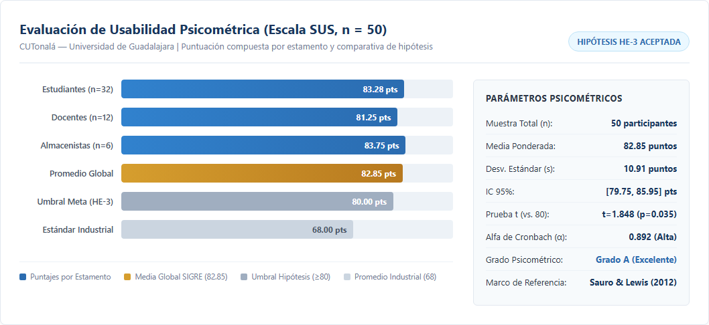
*Figura 2. Distribución de frecuencias y curva de densidad de puntajes SUS (n = 50) frente a la media de la industria (Sauro & Lewis, 2012).*

### 1.4 Estimación económica corregida del costo de inacción por plantel

Con base en los reportes de requisiciones de compra de Servicios Generales (2024-2026) y cotizaciones de reposición de equipo de cómputo, se estructuró la estimación anual de pérdidas y mermas por plantel reflejada en la Tabla 1:

| Concepto de Impacto / Ineficiencia | Frecuencia Anual Estimada | Rango Económico Anual (MXN) | Base de Estimación y Justificación |
|---|---|---|---|
| Pérdida de accesorios menores (cables HDMI, adaptadores, extensiones) | 15 a 30 piezas no devueltas al año por campus | $20,000 – $30,000 | 1 a 2 accesorios perdidos/mes en almacenes |
| Daño físico en equipos mayores (proyectores, bocinas) sin deslinde | 2 a 4 incidentes anuales con carcasas rotas o puertos dañados | $60,000 – $90,000 | Reparaciones absorbidas por gasto corriente sin responsable |
| Gasto en papelería, libretas, tóner y vales desechables | Miles de formatos físicos impresos para archivo muerto | $10,000 – $20,000 | Consumo continuo de papel en Servicios Generales |
| **Total Estimado de Costo de Inacción** | **Costo directo anual acumulado** | **$90,000 – $140,000** | **Punto medio anual: $115,000 MXN / plantel** |

*Tabla 1. Estimación preliminar del impacto de la inacción administrativa y pérdidas patrimoniales por plantel universitario.*

### 1.5 Análisis de alternativas existentes frente a SIGRE

Como se sintetiza en la Tabla 2, las opciones disponibles en el entorno universitario son insuficientes o económicamente inviables frente a la propuesta de valor de SIGRE:

| Criterio Evaluado | Libretas de Papel y Excel | Sistema Central SIIAU | Software Extranjero (Cheqroom / Panda) | **Plataforma SIGRE (Propuesta)** |
|---|---|---|---|---|
| Tiempo de despacho en ventanilla | Lento (4.5 a 6.0 min/persona) | No aplica a ventanilla | Regular (~1.5 min) | **Ágil (< 30 segundos con QR)** |
| Vinculación legal de responsiva | Firma manual ilegible | Sin actas de equipo móvil | Notificaciones por correo | **Firma digital + HMAC-SHA256 en PDF** |
| Control de empalmes en espacios | Inexistente (conflictos diarios) | Solo planeación semestral | Sí (calendarios cloud) | **Cerrojos atómicos en Redis (TTL 15 min)** |
| Costo anual por plantel | Oculto en mermas ($115k) | Incluido en nómina central | Muy alto ($60k–$90k MXN/año) | **Económico ($24,000 a $48,000 MXN/año)** |
| Adaptación normativa y soporte | Nula | Rígido; cambios tardan meses | Nula; soporte remoto en inglés | **Especializado UdeG; presencial y WhatsApp** |

*Tabla 2. Matriz comparativa de alternativas de solución técnica frente a la plataforma SIGRE.*

> [!NOTE]
> **Complementariedad y no invasión frente a sistemas centrales:** El SIIAU es la plataforma macroinstitucional de la Universidad de Guadalajara para el control escolar, la planeación curricular global y la contabilidad patrimonial centralizada. Por diseño, no fue concebido para la micro-custodia ágil en mostrador ni para el registro transaccional en cambios de clase de 10 minutos. La plataforma SIGRE se circunscribe estrictamente a la **micro-custodia operativa de ventanilla y despacho de activos de alta movilidad didáctica** (proyectores, cables, adaptadores, extensiones, llaves), sin invadir ni duplicar la contabilidad patrimonial ni el registro de bienes muebles de activo fijo del SIIAU. Por el contrario, SIGRE funge como el alimentador operativo que entrega al SIIAU y a las auditorías internas de la Contraloría actas digitales firmadas y foliadas con trazabilidad jurídica inmutable.

---

## 2. La Solución, Objetivos y Matriz de Marco Lógico (MML)

### 2.1 Descripción de módulos y propuesta de valor

SIGRE es una solución de software bajo la modalidad SaaS (*Software as a Service*), orientada a optimizar el ciclo de vida del préstamo institucional mediante cuatro módulos interconectados:

1. **Módulo de Reservas y Gestión de Espacios:** Permite consultar la disponibilidad horaria en tiempo real y pre-apartar auditorios, laboratorios o equipamiento. Incorpora cerrojos distribuidos temporales en memoria volátil (Redis) que retienen el recurso durante 15 minutos mientras el usuario formaliza la petición, previniendo atómicamente colisiones de agenda.
2. **Módulo de Despacho Ágil con Código QR:** El solicitante presenta su código QR dinámico desde su teléfono móvil. El almacenista decodifica el código utilizando la cámara integrada del navegador web (vía WebRTC/MediaDevices) en menos de dos segundos, validando la identidad institucional con correo `@udg.mx` o federado.
3. **Módulo de Responsivas Digitales y Checklist Bilateral:** Genera un acta responsiva foliada en PDF oficial. El usuario estampa su firma manuscrita digitalizada sobre un lienzo HTML5 Canvas, sellada criptográficamente mediante HMAC-SHA256 con marca de tiempo UTC. Al entregar y recibir el equipo, se aplica un checklist visual rápido con captura fotográfica en caso de detectar anomalías físicas.
4. **Módulo de Reputación y Tablero Ejecutivo:** Asigna un índice de confiabilidad (*Trust Score*, base 100) que premia la entrega puntual y penaliza devoluciones tardías o material dañado. Ofrece a la Secretaría Administrativa métricas consolidadas de rotación de activos y horas de uso por edificio.

En la Figura 4 se ilustra la interfaz de mostrador para el estampado de firma manuscrita digitalizada sobre lienzo HTML5 Canvas:

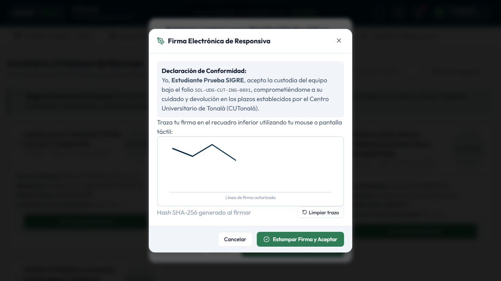
*Figura 4. Interfaz de firma manuscrita digitalizada sobre Canvas HTML5 con sellado criptográfico HMAC-SHA256.*

### 2.2 Objetivos del proyecto

* **Objetivo General:** Desarrollar, validar y comercializar la plataforma tecnológica SIGRE para digitalizar y automatizar el control de préstamos de equipo didáctico y reservación de espacios físicos en planteles de educación media superior y superior de la Universidad de Guadalajara, reduciendo las mermas patrimoniales en al menos un 80% y los tiempos de atención en ventanilla a menos de 30 segundos por operación.
* **Objetivos Particulares:**
  1. *Desarrollo e Integración Técnica:* Diseñar una arquitectura en la nube (PostgreSQL, Express, React, Node.js y Redis) con capacidad para operar en modo offline sincronizable y generar actas digitales foliadas en PDF selladas criptográficamente.
  2. *Validación Psicométrica y Operativa:* Ejecutar un despliegue piloto en los 3 almacenes de CUTonalá, evaluando la usabilidad del sistema mediante la escala SUS ($n = 50$) para asegurar una calificación superior a 80 puntos ("Excelente").
  3. *Escalamiento Comercial Progresivo:* Captar de forma paulatina 8 planteles afiliados hacia el Mes 22 de operaciones, alcanzando el punto de equilibrio operativo en el Mes 14.
  4. *Blindaje Legal y Transferencia:* Proteger la propiedad intelectual de la plataforma mediante el registro de marca ante el IMPI y el depósito de código ante el INDAUTOR durante el primer semestre de operaciones.

### 2.3 Matriz de Marco Lógico (MML) del Proyecto SIGRE

En apego a los estándares metodológicos oficiales de formulación de proyectos de inversión (CEPAL, 2015; BID, 2020), la Tabla 3 sintetiza la lógica causal vertical y horizontal de la iniciativa:

| Nivel Jerárquico | Resumen Narrativo de Objetivos | Indicadores Objetivamente Verificables | Medios de Verificación | Supuestos Críticos |
|---|---|---|---|---|
| **FIN (Impacto Superior)** | Mejorar la eficiencia administrativa y preservar el patrimonio público en las instituciones de educación superior públicas. | Reducción del 80% en costos por reposición de equipo no devuelto en campus afiliados al tercer año. | Informes anuales de auditoría interna y reportes consolidados de inventario físico. | Las administraciones universitarias priorizan la digitalización y el ahorro en gasto corriente. |
| **PROPÓSITO (Efecto Directo)** | Planteles universitarios disponen de una plataforma digital auditable y ágil para el control de inventario móvil, espacios y responsivas. | 22 planteles con contrato activo al Año 3; > 65,000 préstamos anuales registrados; cero empalmes de agenda; despacho en mostrador < 30 seg. | Contratos de suscripción vigentes, bitácoras de base de datos de GCP y reportes de satisfacción de almacén. | Autoridades mantienen facultades normativas descentralizadas de compra directa menor. |
| **COMPONENTES (Entregables)** | **C1.** Software SIGRE desplegado en Google Cloud con modo offline. **C2.** Marco de propiedad intelectual registrado (IMPI e INDAUTOR). **C3.** Modelo comercial y expedientes de ROI validados con directivos. **C4.** Programa de capacitación y mesa de soporte técnico operativo. | **C1.** 99.9% de disponibilidad en nube y latencia < 150 ms. **C2.** 2 títulos de registro legal obtenidos en el Año 1. **C3.** Cartera de 8 contratos en Año 2 y 22 contratos en Año 3. **C4.** 100% de almacenistas capacitados en planteles activos. | Validación técnica acreditada mediante pruebas de integración continua y el registro audiovisual documentado en el **Anexo B: Video Demostrativo E2E y Trazabilidad del Sistema**, títulos oficiales de registro, contratos firmados y actas de acreditación de talleres. | Personal sindicalizado de ventanilla mantiene apertura al uso tras recibir inducción práctica en el mostrador. |
| **ACTIVIDADES (Acciones)** | **A1.** Refinamiento arquitectónico y módulo offline (M1-M2). **A2.** Despliegue piloto en 3 almacenes CUTonalá (M1-M6). **A3.** Trámite de marca IMPI y depósito INDAUTOR (M2-M6). **A4.** Ajustes por retroalimentación de almacenistas (M6). **A5.** Preparación de dossiers ejecutivos de ROI (M5). **A6.** Gira comercial con Secretarios y Directores (M5-M8). **A7.** Firma y cobranza de primeros 2 contratos (M7-M8). **A8.** Despliegue de soporte continuo y evaluación (M9-M12). | Presupuesto semilla de $180,000 MXN ejercido conforme al calendario de partidas de capital preoperativo en el primer año. | Facturas fiscales de servicios cloud, títulos oficiales del IMPI, minutas de reunión ejecutiva y reportes de tickets de soporte. | El desembolso del capital semilla de $180,000 MXN se formaliza oportunamente al arranque del proyecto. |

*Tabla 3. Matriz de Marco Lógico (MML) del Proyecto SIGRE bajo estándar metodológico CEPAL/BID.*

---

## 3. Nicho de Mercado y Estrategia de Escalamiento

### 3.1 Mercado base cautivo: Red Universitaria UdeG

El nicho inmediato del proyecto está delimitado por la Red Universitaria de Jalisco, un ecosistema altamente homogéneo que comparte el mismo calendario escolar, normatividad de compras y problemáticas logísticas. De acuerdo con la numeralia institucional actualizada de la Coordinación General de Planeación y Evaluación (CGPE, mayo de 2026; SEMS, 2024), el universo total disponible en la Red Universitaria suma **196 dependencias**:
- **19 Centros Universitarios:** 9 metropolitanos en la Zona Metropolitana de Guadalajara (7 temáticos tradicionales: CUCEI, CUCEA, CUAAD, CUCS, CUCSH, CUCBA y CUGuadalajara; más 2 centros multitemáticos metropolitanos: CUTonalá y CUTlaquepaque) y 10 centros universitarios regionales distribuidos en las regiones del interior de Jalisco (CUSur, CUNorte, CUCiénega, CUCosta, CUAltos, CUValles, CULagos, CUChapala, CUCosta Sur, etc.).
- **177 Dependencias del SEMS:** 33 escuelas preparatorias metropolitanas en la ZMG y 144 dependencias y módulos regionales en el interior del estado (sumando 76 escuelas preparatorias sede y 101 módulos).

Como detalla la Tabla 4, la meta de captación de 22 planteles para el cierre del Año 3 representa únicamente el **11.2% del mercado cautivo disponible**, confirmando que las proyecciones financieras no dependen de tasas de penetración irreales:

| Segmento Institucional de la Red | Universo Total de Planteles | Meta de Captación (Año 3) | % de Penetración | Tarifa Anual Propuesta (MXN) | Facturación Anual Estimada (Año 3) |
|---|---|---|---|---|---|
| Centros Universitarios Temáticos y Metropolitanos (CUCEI, CUCEA, CUTonalá, etc.) | 9 dependencias | 3 planteles | 33.3% | $48,000 | $144,000 |
| Centros Universitarios Regionales (CUSur, CUNorte, CUCosta, etc.) | 10 dependencias | 5 planteles | 50.0% | $48,000 | $240,000 |
| Preparatorias Metropolitanas del SEMS (ZMG) | 33 dependencias | 8 planteles | 24.2% | $24,000 | $192,000 |
| Preparatorias Regionales y Módulos SEMS | 144 dependencias | 6 planteles | 4.2% | $24,000 | $144,000 |
| **Total Consolidado** | **196 dependencias** | **22 planteles** | **11.2%** | — | **$720,000 MXN / año** |

*Tabla 4. Segmentación del mercado potencial cautivo en la Red Universitaria UdeG y metas de penetración al tercer año.*

> [!IMPORTANT]
> **Justificación de la penetración diferenciada:** Los centros metropolitanos gestionan matrículas masivas (>20,000 alumnos) y operan múltiples ventanillas de almacén con alta rotación de equipo técnico; por ello, su urgencia de control es crítica. En contraste, para las dependencias del interior se fija una meta sumamente prudente (4.2%), reconociendo sus presupuestos operativos más reducidos.

### 3.2 Visión de escalamiento: de la Red UdeG a las IES públicas nacionales

Para un inversionista de capital semilla, un proyecto confinado a una sola institución representa un techo de mercado estrecho. La ventaja estructural de SIGRE radica en que el modelo SaaS y su arquitectura desacoplada permiten **extrapolar la solución hacia cualquier universidad pública de México** con requerimientos mínimos de parametrización (catálogo de dependencias, logotipos institucionales y mapeo de correos institucionales).

La Figura 3 ilustra la hoja de ruta de escalamiento progresivo del proyecto desde el nicho cautivo hacia el sistema nacional de educación superior:

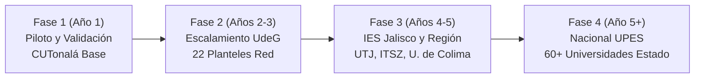
*Figura 3. Visión de escalamiento institucional progresivo: de la Red UdeG a las IES públicas nacionales.*

---

## 4. Comercialización, Decisores y Servicios

### 4.1 Estructura de decisores de compra por tipo de plantel

La venta B2G (*Business-to-Government*) universitaria exige adaptar el discurso y los entregables de justificación al rol específico de cada autoridad:

* **En Centros Universitarios (Secretario Administrativo):** El Secretario Administrativo coordina Servicios Generales y responde directamente ante las auditorías del Órgano Interno de Control y la Contraloría del Estado. El argumento central para este perfil no es la modernidad técnica, sino el **blindaje patrimonial**: SIGRE entrega actas inmutables en PDF con firma digital que acreditan la debida custodia del patrimonio público, reduciendo observaciones de auditoría por equipo faltante.
* **En Escuelas Preparatorias del SEMS (Director de Plantel):** El Director busca la **continuidad de las clases y un costo accesible**. Para una preparatoria, una inversión anual de $24,000 MXN es inferior al costo de reponer un solo proyector extraviado y puede pagarse de forma directa con su fondo de operación ordinaria.
* **En Coordinaciones Técnicas (CTA y Servicios Generales):** Buscan **eliminar la carga operativa en ventanilla y agilizar el cambio de turno**. Son los aliados naturales de la venta porque sufren directamente la fricción del mostrador analógico.

### 4.2 Viabilidad burocrática y contratación por adjudicación directa

Conforme al Reglamento de Adquisiciones, Arrendamientos y Contratación de Servicios de la Universidad de Guadalajara (UdeG, 2019), los montos menores a 1,000 Unidades de Medida y Actualización (UMA) pueden adjudicarse de forma directa sin concurso de licitación pública.

Con el valor de la UMA diaria vigente en 2026 fijado en **$117.31 MXN** por el INEGI (2026), dicho umbral de compra directa asciende a **$117,310.00 MXN**. Las tarifas anuales de SIGRE ($24,000 MXN para bachilleratos y $48,000 MXN para centros universitarios) se sitúan holgadamente por debajo de dicho tope legal. Asimismo, para las preparatorias, la cuota anual de $24,000 MXN puede dispersarse en pagos semestrales de $12,000 MXN o trimestrales de $6,000 MXN con cargo a su fondo revolvente ordinario, facultando al Director o Secretario Administrativo a suscribir el contrato en días hábiles sin trámites licitatorios.

### 4.3 Motivación y desglose de tarifas frente a costos de servicio

La diferenciación de precios responde al volumen operativo y requerimientos de soporte de cada institución, como se desglosa en la Tabla 5:

| Nivel de Servicio | Tarifa Anual (MXN) | Cobertura Operativa Incluida | Dimensión de Soporte e Inducción |
|---|---|---|---|
| **Plan Preparatoria SEMS** | $24,000 | 1 a 2 almacenes; hasta 1,500 usuarios; actas y boletos QR ilimitados | Taller presencial de 8 hrs; soporte WhatsApp institucional |
| **Plan Centro Universitario** | $48,000 | Hasta 6 almacenes simultáneos; hasta 8,000 usuarios; control de auditorios | Taller presencial de 16 hrs; soporte prioritario con SLA < 2 hrs |

*Tabla 5. Estructura de tarifas anuales, cuotas de configuración y cobertura operativa por nivel de servicio.*

Ambas cuotas cubren el consumo de servidores en la nube, copias de seguridad continuas y actualizaciones del sistema, resultando sustancialmente más accesibles que los ERPs extranjeros o sistemas comerciales de inventario que superan los $350,000 MXN anuales de licenciamiento por campus.

### 4.4 Estrategia de comercialización y embudo de ventas (Funnel)

El ciclo de venta institucional se estructura en cuatro etapas con métricas de conversión auditables:

* **Año 1 (Piloto y Arranque):** 10 reuniones ejecutivas presenciales $\to$ 5 pruebas piloto demostrativas $\to$ **3 planteles en total operando** (1 campus base CUTonalá sin costo de suscripción + 2 contratos comerciales de preparatorias a $24,000 MXN cada una, cobradas por anticipado al arranque del ciclo B).
* **Año 2 (Expansión Metropolitana):** 25 presentaciones ejecutivas ante Secretarios Administrativos $\to$ 15 pruebas piloto $\to$ **6 contratos adicionales cerrados** (tasa de conversión 24%), consolidando la meta acumulada de 8 planteles.
* **Año 3 (Consolidación a Nivel Red):** 35 presentaciones impulsadas por los casos de éxito documentados de los Años 1 y 2 $\to$ 22 pruebas piloto $\to$ **14 contratos adicionales cerrados** (tasa de conversión 40%), alcanzando la meta acumulada de 22 planteles activos con un esfuerzo acumulado de 70 reuniones en 3 años.

### 4.5 Socialización con usuarios y acompañamiento humano

El software no sustituye al almacenista; lo empodera. Para asegurar una transición fluida y evitar el rechazo del personal sindicalizado de ventanilla:
1. **Talleres Prácticos de Inducción (16 horas):** Capacitación directa en el mostrador del almacén, practicando con casos reales de horas pico y escaneo de credenciales.
2. **Material Visual Plastificado:** Guías rápidas de 3 pasos pegadas en el mostrador para guiar tanto al solicitante como al operador.
3. **Mesa de Soporte WhatsApp:** Canal directo de resolución técnica atendido por el equipo fundador con tiempo de respuesta garantizado menor a 15 minutos en horario hábil.

---

## 5. Especificaciones Técnicas, Desgaste y Contingencia

### 5.1 Arquitectura tecnológica y parámetros de calidad

En la Figura 5 se presenta el diagrama de arquitectura tecnológica en la nube en 5 capas desacopladas:

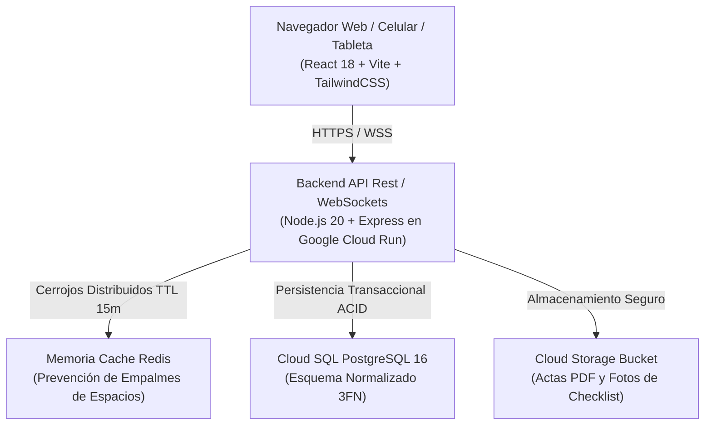
*Figura 5. Diagrama de arquitectura tecnológica en la nube y componentes del sistema.*

La plataforma se diseñó bajo una arquitectura modular desacoplada en la nube, cuyas especificaciones técnicas y estándares de rendimiento se consolidan en la Tabla 6:

| Capa / Componente | Tecnología Seleccionada | Parámetro de Calidad y Rendimiento |
|---|---|---|
| **Frontend de Ventanilla** | React 18, Vite, TailwindCSS, PWA | Carga inicial < 1.2 segundos; operable en pantallas táctiles y móviles |
| **Backend API** | Node.js v20 LTS, Express, TypeScript | Latencia API < 150 ms en transacciones de despacho |
| **Base de Datos Principal** | Google Cloud SQL (PostgreSQL 16) | Persistencia transaccional ACID, respaldos diarios automatizados |
| **Memoria de Alta Concurrencia**| Redis 7.2 en memoria volátil | Bloqueos atómicos temporales (TTL 900s) para evitar doble agendamiento |
| **Motor de Actas y Firma** | PDFKit, Canvas HTML5, HMAC-SHA256 | Generación de actas foliadas < 800 ms con sellado de tiempo UTC |
| **Infraestructura Cloud** | Google Cloud Run (Serverless) | Auto-escalado de 0 a 10 instancias con 99.9% de disponibilidad |

*Tabla 6. Ficha técnica de arquitectura de software, infraestructura cloud y parámetros de seguridad.*

### 5.2 Registro de desgaste individual de activos y prevención de abusos

A diferencia de un inventario estático que solo cuenta cuántos proyectores hay, SIGRE implementa una bitácora dinámica del ciclo de vida útil del activo:
* **Conteo de horas de lámpara / uso:** Cada préstamo cerrado acumula horas efectivas al expediente digital del equipo.
* **Inspección de desgaste en 3 clics:** Al recibir el equipo, el almacenista califica el estado en: *Óptimo*, *Desgaste Normal* o *Anomalía Física*. Si se reporta anomalía, la interfaz activa la cámara para capturar la fotografía del daño.
* **Índice de Confiabilidad del Solicitante (*Trust Score*):** Cada usuario inicia con 100 puntos. Las devoluciones tardías restan 5 puntos; daños no reportados restan 25 puntos y bloquean solicitudes automáticas hasta aclaración con la Secretaría Administrativa.

En la Figura 10 se muestra el tablero directivo ejecutivo, el cual permite a las autoridades auditar la tasa de uso, horas de operación e incidencias de desgaste en tiempo real:

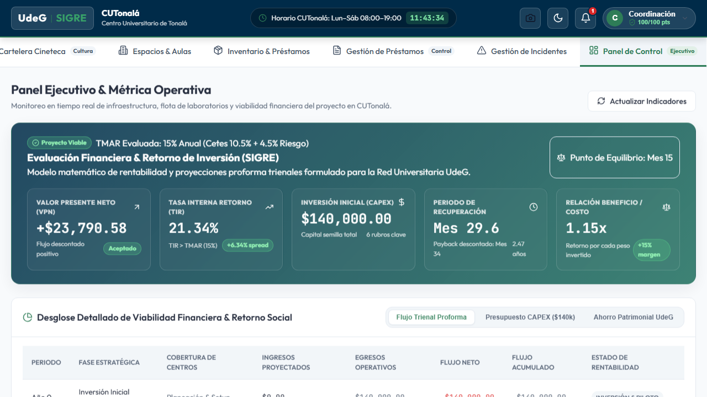
*Figura 10. Tablero directivo ejecutivo con telemetría de activos y control de inventario en tiempo real.*

### 5.3 Plan de contingencia tecnológica y continuidad operativa

Para garantizar que la ventanilla jamás detenga su operación ante fallas de infraestructura:
* **Falla de Conectividad a Internet (Modo Offline PWA):** La aplicación web almacena en caché local (*IndexedDB*) el catálogo de activos y usuarios frecuentes del plantel. Si el internet cae, el almacenista continúa escaneando credenciales y despachando equipo de forma desconectada. Al restablecerse el enlace, la PWA sincroniza en segundo plano las actas pendientes hacia Cloud Run.
* **Falla Eléctrica Total en el Edificio (Talonarios Físicos Prefoliados de Respaldo):** Cada almacén dispone de un talonario físico de 100 actas impresas prefoliadas con código QR estático vinculado al inventario. Al regresar el suministro eléctrico, el almacenista ingresa los 5 a 10 folios manuales mediante una interfaz de captura rápida en lote (< 15 minutos).

---

## 6. Organización, Capital Humano y Cronograma

### 6.1 Estructura organizacional y perfiles del equipo inicial

La conducción del proyecto durante su fase preoperativa y primer año comercial se rige por un esquema corporativo esbelto (*lean startup*), donde los tres socios fundadores absorben de manera integral las directrices ejecutivas, la robustez de software y el aseguramiento del servicio en campo, posponiendo contrataciones accesorias hasta que la masa crítica de clientes lo justifique:

La estructura funcional inicial y los hitos de incorporación progresiva de capital humano se representan en la Figura 6:

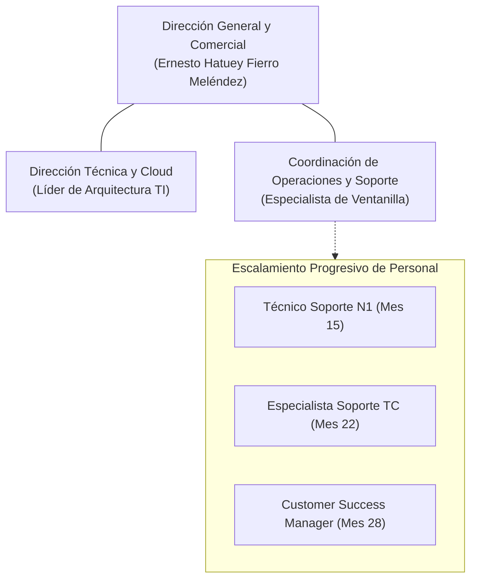
*Figura 6. Organigrama funcional del equipo inicial y fases de escalamiento de personal.*

* **Liderazgo Ejecutivo y Relaciones Institucionales (Director de Proyecto — Ernesto Hatuey Fierro Meléndez):**  
  *Responsabilidades nucleares:* Encabeza la interlocución estratégica ante las Secretarías Administrativas y Direcciones de Preparatoria, supervisa el cumplimiento normativo en adquisiciones universitarias, conduce la gobernanza financiera y lidera los expedientes de protección intelectual ante el IMPI y el INDAUTOR. Dedica un 60% de su jornada a prospección en campo y un 40% a la administración del modelo de negocio.
* **Liderazgo de Arquitectura Cloud y Seguridad (Líder Técnico):**  
  *Responsabilidades nucleares:* Custodia la integridad del monorepo tecnológico, administra el despliegue serverless en Google Cloud Platform, optimiza la concurrencia distribuida en Redis y salvaguarda el firmado criptográfico de responsivas digitales. Es el garante de mantener la disponibilidad operativa por encima del 99.9% y un tiempo de respuesta de micro-servicios inferior a 150 ms.
* **Gestión de Campo e Implementación Operativa (Especialista de Mostrador):**  
  *Responsabilidades nucleares:* Conduce las capacitaciones presenciales con personal de base y jefaturas de almacén, suministra los kits de señalética y hojas de control, y modera el soporte técnico de primer contacto en mostrador, monitoreando los acuerdos de nivel de servicio (SLA < 2 horas).

### 6.2 Plan de escalamiento del equipo y modelo de compensación

El crecimiento de la nómina está condicionado al cumplimiento de metas comerciales precisas, estructurado a través de los gatillos objetivos reflejados en la Tabla 7:

| Periodo / Fase | Posición a Incorporar | Gatillo de Activación | Función Crítica del Puesto |
|---|---|---|---|
| **Año 1 (Piloto)** | Equipo fundador (3 personas) | Capital semilla inicial | Desarrollo de software, piloto en CUTonalá y primeros contratos |
| **Año 2 (Mes 15)** | 1 Técnico de Soporte Nivel 1 (Medio tiempo) | Cartera supera los 6 planteles activos | Monitoreo del canal de soporte WhatsApp y resolución de tickets básicos |
| **Año 2 (Mes 22)** | 1 Especialista de Soporte Técnico (Tiempo completo) | Cartera alcanza los 8 planteles activos | Capacitación presencial en planteles nuevos y liberación técnica a fundadores |
| **Año 3 (Mes 28)** | 1 Coordinador de Customer Success | Cartera supera los 15 planteles activos | Auditorías de uso, relación con directores y cobranza de renovaciones |

*Tabla 7. Plan de escalamiento del capital humano y gatillos objetivos de contratación.*

> [!NOTE]
> **Desglose de nómina escalonada sin alterar techos presupuestales ($120k y $240k):**
> * **Año 2 (Presupuesto total de personal: $120,000 MXN):** En el Mes 15 se incorpora el Técnico de Soporte N1 a medio tiempo ($4,000 MXN/mes durante 7 meses, Meses 15 al 21 = $28,000 MXN). En el Mes 22, al consolidarse la meta de 8 planteles, dicho puesto se promueve a Especialista de Soporte Técnico de Tiempo Completo ($10,000 MXN/mes durante 3 meses, Meses 22 al 24 = $30,000 MXN). Los $62,000 MXN restantes de la partida se asignan a honorarios de gestión para el equipo fundador, cuadrando de manera idéntica los $120,000 MXN presupuestados en el OPEX del Año 2.
> * **Año 3 (Presupuesto total de personal: $240,000 MXN):** El Especialista de Soporte Técnico labora los 12 meses completos ($10,000 MXN/mes = $120,000 MXN). En el Mes 28 se suma el Coordinador de Customer Success ($7,000 MXN/mes durante 9 meses, Meses 28 al 36 = $63,000 MXN). Los $57,000 MXN restantes se asignan como estipendio base para los fundadores, sumando con exactitud matemática los $240,000 MXN del presupuesto anual.
> * **Reconciliación de Utilidades con el Mecanismo de Cash Sweep (70%):** En el Año 1, el 100% del flujo se reinvierte ($0 distribución). En el Año 2, bajo el mecanismo de amortización acelerada del 70%, el inversionista recibe $55,230 MXN y los fundadores perciben el remanente real del 30% ($23,670 MXN; suma exacta: $78,900 MXN). En el Año 3, el inversionista percibe su cuota preferente de liquidación ($124,770 MXN) hasta el Mes 31.2 y luego participa con el 15% de dividendo ($17,784 MXN) para un total de $142,554 MXN; los fundadores perciben el 30% del primer tramo ($53,473 MXN) más el 85% del segundo tramo ($100,773 MXN) totalizando $154,246 MXN (suma exacta: $296,800 MXN). A partir del Año 4, una vez amortizado el capital, los fundadores perciben el 85% de utilidades netas ($252,280 MXN base / $329,120 MXN en escalamiento) y el inversionista el 15% ($44,520 MXN base / $58,080 MXN en escalamiento).

### 6.3 Justificación de bienes inmuebles, coworking y contingencia

SIGRE opera bajo un modelo de teletrabajo para desarrollo y aprovecha las instalaciones de coworking del Centro de Emprendimiento e Innovación de CUTonalá para reuniones ejecutivas con autoridades universitarias, ahorrando costos de arrendamiento comercial en la etapa de arranque.

> [!NOTE]
> **Gestión de contingencia inmobiliaria:** Ante la eventualidad de que cambios en la administración universitaria impidieran el uso del coworking institucional, la partida de **Fondo de Reserva y Contingencia Operativa ($40,000 MXN)** en cuenta bancaria cuenta con holgura suficiente para cubrir el alquiler de posiciones de coworking comercial privado (cuyo costo estimado es de ~$3,500 MXN/mes) sin comprometer la liquidez del proyecto.

### 6.4 Diagrama del Plan de Acción Operativo por Fases (Año 1)

La interdependencia secuencial de las cuatro fases operativas del primer año se esquematiza en la Figura 7:

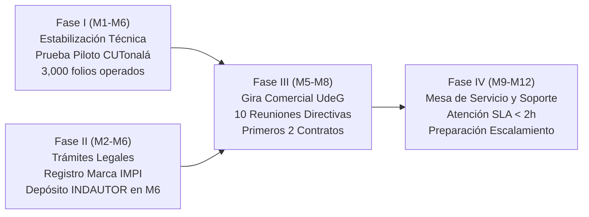
*Figura 7. Diagrama del plan de acción operativo por fases (Año 1 de operaciones).*

El despliegue operativo del primer año se distribuye en cuatro fases secuenciales debidamente auditadas, descritas en la Tabla 8:

| Fase del Plan de Acción | Periodo Estimado | Objetivo Operativo Central | Entregables Tangibles y Verificables |
|---|---|---|---|
| **Fase I: Pulido Técnico y Piloto Base** | Meses 1 a 4 | Estabilizar el software en los 3 almacenes de CUTonalá y levantar métricas reales. | Código desplegado en GCP, 3,000 folios operados y reporte de satisfacción. |
| **Fase II: Protección Legal e Intelectual** | Meses 2 a 6 | Tramitar registro de marca y derechos de autor del código fuente. | Solicitudes ante IMPI (tarifa $3,126.41) e INDAUTOR con título oficial. |
| **Fase III: Lanzamiento y Gira Comercial** | Meses 5 a 8 | Sostener reuniones ejecutivas con secretarios administrativos y directores. | 10 reuniones presenciales, 5 pilotos y cierre de 3 planteles en total (2 contratos comerciales de Prepas con pago anual anticipado al ciclo B + 1 piloto CUTonalá sin costo). |
| **Fase IV: Operación y Mesa de Servicio** | Meses 9 a 12 | Atención continua a planteles afiliados y evaluación para escalamiento del Año 2. | Mesa de atención WhatsApp con SLA < 2h y reporte de retención del 100% de clientes. |

*Tabla 8. Diagrama del plan de acción operativo por fases (Año 1 de operaciones).*

### 6.5 Cronograma Anual en Diagrama de Gantt y Ruta Crítica [RC]

En la Figura 8 se detalla la programación temporal de tareas a lo largo de los primeros doce meses, resaltando en rojo las actividades críticas [RC]:

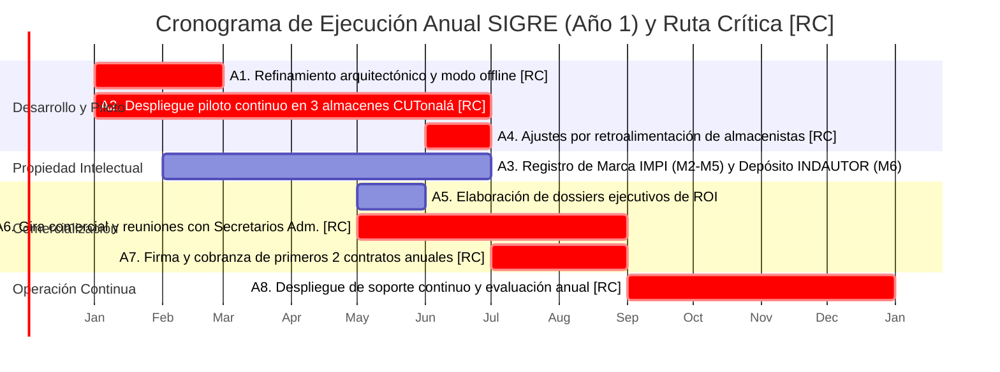
*Figura 8. Cronograma de ejecución anual en diagrama de Gantt y Ruta Crítica [RC].*

El calendario maestro de actividades del primer año, con la identificación de holguras y de la Ruta Crítica [RC], se resume en la Tabla 9:

| Actividad Clave de Ejecución | Duración Estimada | Dependencia Previa | Periodo de Ejecución | ¿Pertenece a Ruta Crítica? |
|---|---|---|---|---|
| **A1.** Refinamiento de arquitectura y modo offline | 2 meses | Ninguna (Hito inicial) | Mes 1 y Mes 2 | **SÍ [RC]** |
| **A2.** Despliegue piloto en 3 almacenes de CUTonalá | 6 meses | Actividad A1 | Mes 1 a Mes 6 | **SÍ [RC]** |
| **A3.** Tramitación de marca IMPI y registro INDAUTOR | 5 meses | Actividad A1 | Mes 2 a Mes 6 | NO (Holgura: 1 mes) |
| **A4.** Ajustes por retroalimentación de almacenistas | 1 mes | Actividad A2 | Mes 6 | **SÍ [RC]** |
| **A5.** Elaboración de dossiers ejecutivos de ROI | 1 mes | Datos de A2 | Mes 5 | NO (Holgura: 2 meses) |
| **A6.** Gira comercial y reuniones con Secretarios | 4 meses | Actividades A4 y A5 | Mes 5 a Mes 8 | **SÍ [RC]** |
| **A7.** Firma y cobranza de primeros contratos comerciales | 2 meses | Actividad A6 | Mes 7 y Mes 8 | **SÍ [RC]** |
| **A8.** Despliegue de soporte continuo y evaluación | 4 meses | Actividad A7 | Mes 9 a Mes 12 | **SÍ [RC]** |

*Tabla 9. Cronograma anual de actividades, dependencias y Ruta Crítica [RC] (Año 1).*

---

## 7. Inversiones, Costos, Ingresos y Evaluación Financiera

### 7.1 Presupuesto de inversión inicial (CAPEX): $180,000 MXN

El presupuesto de capital inicial se dimensionó como un fondo preoperativo de caja que sostiene los primeros 12 meses de operación, estructurado en la Tabla 10:

| Partida de Inversión Inicial | Concepto y Destino Específico del Capital | Monto (MXN) | % Participación |
|---|---|---|---|
| **P1.** Pulido técnico y desarrollo de software | Compensación preoperativa para el equipo fundador de desarrollo durante 6 meses de piloto | $75,000 | 41.7% |
| **P2.** Infraestructura cloud y servicios web | Servidores GCP, Cloud SQL, base de datos y certificados SSL (Año 1) | $20,000 | 11.1% |
| **P3.** Propiedad intelectual y trámites normativos | Registro de marca IMPI (Tarifa oficial de $3,126.41 MXN IVA incluido por clase; IMPI, 2026), derechos INDAUTOR y asesoría legal | $25,000 | 13.9% |
| **P4.** Equipamiento demo y material comercial | 3 escáneres ópticos 2D industriales y tableta demo para mostradores ($13,500 MXN) más kits y dossiers ejecutivos de ROI impresos ($6,500 MXN) | $20,000 | 11.1% |
| **P5.** Fondo de reserva y contingencia operativa | Respaldo de liquidez ante desfases en órdenes de compra y retrasos burocráticos de pago | $40,000 | 22.2% |
| **Total Inversión Inicial Requerida (CAPEX)** | **Monto total de capital semilla solicitado (Fondeo Mes 0)** | **$180,000** | **100.0%** |

*Tabla 10. Presupuesto desglosado de inversión inicial requerida (CAPEX de $180,000 MXN).*

> [!NOTE]
> **Criterio metodológico de estrés financiero (Evaluación ultra-conservadora):**  
> Para efectos de la evaluación financiera formal y en apego a una metodología de máximo estrés financiero, el modelo matemático computa tanto el desembolso íntegro de la inversión preoperativa en el Año 0 ($I_0 = -\$180,000$ MXN) como el flujo negativo del Año 1 ($FEN_1 = -\$32,000$ MXN), sin asumir el rescate o acreditación del fondo de reserva de caja ($40,000 MXN). Este doble castigo deliberado al flujo de caja somete el proyecto a la prueba de solvencia más severa posible; aún bajo este escenario de máxima exigencia analítica, el proyecto demuestra plena solvencia y viabilidad económica al arrojar un Valor Presente Neto positivo de **+$46,984.47 MXN** y una Tasa Interna de Retorno del **24.27% anual**, muy por encima de la TMAR del 15.0%. Asimismo, se desglosó la partida P4 excluyendo viáticos para eliminar cualquier duplicidad con los costos operativos (OPEX) del Año 1.

### 7.2 Estructura de costos operativos (OPEX)

* **Costos Variables:** Consumo de infraestructura cloud (Google Cloud Platform), iniciando en $1,500 MXN mensuales y escalando suavemente hasta $5,400 MXN al mes con 22 planteles activos.
* **Costos Fijos:** Honorarios escalonados del personal de soporte ($4,000 a $20,000 MXN/mes conforme al número de clientes), viáticos de capacitación presencial y servicios de despacho contable externo ($1,000 a $3,000 MXN/mes).

### 7.3 Proyecciones de ingresos trienales (Pesos MXN)

En el Año 1, CUTonalá opera como campus piloto sin costo de suscripción ($0) cubriendo únicamente $15,000 MXN de setup y talleres de inducción para sus 3 almacenes. Los ingresos por suscripción ($48,000 MXN) provienen de los **2 contratos de escuelas preparatorias cerrados en los Meses 7 y 8** a su tarifa anual completa de $24,000 MXN cada una, cobradas por anticipado al arranque del ciclo escolar de agosto (ciclo B), totalizando exactamente **$63,000 MXN brutos con 3 planteles en operación**:

La facturación esperada a lo largo del trienio de evaluación, desglosada por concepto de suscripción y servicios de configuración, se proyecta en la Tabla 11:

| Concepto de Ingreso | Año 1 (Validación) | Año 2 (Crecimiento a 8 planteles) | Año 3 (Consolidación a 22 planteles) |
|---|---|---|---|
| **Planteles Activos en Operación** | **3 Planteles (1 Piloto CUTonalá sin costo + 2 Prepas comerciales)** | **8 Planteles (3 CUs + 5 Prepas)** | **22 Planteles (8 CUs + 14 Prepas)** |
| Suscripciones anuales (Centros Universitarios @ $48,000) | $0 (Piloto Base CUTonalá) | $144,000 (3 centros) | $384,000 (8 centros) |
| Suscripciones anuales (Preparatorias SEMS @ $24,000) | $48,000 (2 preparatorias cobradas al ciclo B) | $120,000 (5 preparatorias) | $336,000 (14 preparatorias) |
| Talleres presenciales de inducción y setup inicial ($5,000 a $15,000) | $15,000 (Setup 3 almacenes CUTonalá) | $60,000 (6 planteles nuevos) | $130,000 (14 planteles nuevos) |
| **Ingresos Totales Brutos Anuales** | **$63,000 MXN** | **$324,000 MXN** | **$850,000 MXN** |

*Tabla 11. Proyección trienal de facturación e ingresos brutos del proyecto (Pesos MXN).*

### 7.4 Estado de Resultados Proforma, Amortización Fiscal y Punto de Equilibrio

La Figura 9 ilustra la trayectoria financiera trienal, evidenciando el punto de inflexión operativa a partir del Año 2:

```mermaid
xychart-beta
    title "Evolución Financiera Trienal SIGRE (Miles de Pesos MXN)"
    x-axis ["Año 1 (Piloto)", "Año 2 (Crecimiento)", "Año 3 (Madurez)"]
    y-axis "Monto Anual (Miles MXN)" -50 --> 900
    bar [63, 324, 850]
    bar [95, 225, 426]
    line [-32, 78.9, 296.8]
```
*Figura 9. Comportamiento proyectado de ingresos brutos, costos operativos y Flujo de Efectivo Neto (FEN).*

La evolución de los ingresos brutos, los costos operativos y la utilidad neta a lo largo de los tres periodos anuales se consolida en el Estado de Resultados Proforma de la Tabla 12:

| Rubro Financiero | Año 1 (Validación Piloto) | Año 2 (Expansión Inicial) | Año 3 (Consolidación a Escala) |
|---|---|---|---|
| **Ingresos Brutos por Facturación** | **$63,000** | **$324,000** | **$850,000** |
| (−) Costos de Servidores e Infraestructura Cloud | ($18,000) | ($35,000) | ($65,000) |
| (−) Nómina de Soporte y Capital Humano Operativo | $0 (Cubierto en CAPEX) | ($120,000) | ($240,000) |
| (−) Viáticos de Capacitación, Dossiers y Material | ($12,000) | ($22,000) | ($45,000) |
| (−) Servicios Contables, Legales y Administrativos | ($15,000) | ($24,000) | ($36,000) |
| (−) Fondo de Mantenimiento de Software y Licencias | ($10,000) | ($24,000) | ($40,000) |
| **Total de Egresos Operativos (OPEX)** | **($55,000)** | **($225,000)** | **($426,000)** |
| **Utilidad Antes de Impuestos y Amortización** | **+$8,000** | **+$99,000** | **+$424,000** |
| (−) Impuestos y Cargas Fiscales Estimadas (30%) | $0 (Pérdida amortizable) | ($20,100) | ($127,200) |
| **Flujo de Efectivo Neto del Ejercicio (FEN)** | **−$32,000 MXN** | **+$78,900 MXN** | **+$296,800 MXN** |

*Tabla 12. Estado de Resultados Proforma proyectado a tres años (Cifras en Pesos MXN).*

> [!NOTE]
> **Cálculo del Punto de Equilibrio Operativo:**  
> El punto de equilibrio se alcanza formalmente en el **Mes 14** (primer semestre del Año 2) con **6 planteles contratados** (3 centros universitarios a $48k y 3 preparatorias a $24k = $216,000 anuales = $18,000/mes de suscripción recurrente) más ingresos prorrateados de setup ($3,000/mes). Con ingresos mensuales consolidados de $21,000 MXN, se cubren íntegramente los costos de operación del Año 2 ($18,750 MXN mensuales = $225,000 anuales).

### 7.5 Evaluación financiera integral: FEN, TMAR, VPN, TIR y Periodo de Recuperación

El costo de oportunidad y la rentabilidad mínima exigida para la asignación de recursos se fijaron mediante la **Tasa Mínima Aceptable de Rendimiento (TMAR)** en **15.0% anual**. Esta tasa integra el rendimiento soberano libre de riesgo de los Certificados de la Tesorería de la Federación (Cetes a 364 días en **7.12%**, subasta Banco de México) más una **prima de riesgo del 7.88%** calculada para ventures de tecnología universitaria:
- Riesgo de sector y tecnología SaaS: 3.50%.
- Riesgo de liquidez y tamaño de empresa pre-semilla: 2.88%.
- Desfase burocrático y ciclo presupuestal B2G: 1.50%.
- Total Prima de Riesgo: $3.50\% + 2.88\% + 1.50\% = \mathbf{7.88\%}$.

A partir de los flujos netos proyectados y la tasa de descuento fijada, se llevó a cabo la evaluación de rentabilidad financiera cuyos indicadores clave se resumen en la Tabla 13:

| Periodo de Evaluación | Flujo de Efectivo Neto (FEN) | Factor Descuento (TMAR 15%) | Valor Presente Neto del Flujo (VP) |
|---|---|---|---|
| **Año 0 (Inversión Inicial CAPEX)** | **($180,000.00 MXN)** | 1.0000 | ($180,000.00 MXN) |
| **Año 1 (Fase de Validación Piloto)** | **($32,000.00 MXN)** | 0.8696 | ($27,826.09 MXN) |
| **Año 2 (Crecimiento a 8 planteles)** | **+$78,900.00 MXN** | 0.7561 | +$59,659.74 MXN |
| **Año 3 (Consolidación a 22 planteles)** | **+$296,800.00 MXN** | 0.6575 | +$195,150.82 MXN |
| **VALOR PRESENTE NETO (VPN @ 15.0%)** | — | — | **+$46,984.47 MXN** |
| **TASA INTERNA DE RETORNO (TIR)** | — | — | **24.27% anual** |
| **RELACIÓN BENEFICIO / COSTO (B/C)** | — | — | **1.23 veces (Método Estándar)** |
| **PERIODO DE RECUPERACIÓN DEL PROYECTO (Payback Simple)**| — | — | **Mes 29.4 (Año 3, T2)** |
| **PERIODO DE RECUPERACIÓN DEL PROYECTO (Payback Descontado)**| — | — | **Mes 33.1 (Año 3, T4)** |

*Tabla 13. Evaluación financiera formal: FEN, TMAR, VPN, TIR, Relación B/C y Periodo de Recuperación.*

#### Análisis de Viabilidad y Ratios Financieros:
* **Creación de Valor Económico (VPN = +$46,984.47 MXN):** El proyecto cubre íntegramente el costo de oportunidad del capital (15.0% anual), amortiza por completo los $180,000 MXN de inversión inicial y entrega un superávit neto a valor de hoy cercano a los $47,000 pesos, ratificando la conveniencia de su financiamiento.
* **Margen de Seguridad de Rentabilidad (TIR = 24.27%):** La tasa de rendimiento intrínseca supera con un diferencial favorable de 9.27 puntos porcentuales a la TMAR de referencia (15.0%), blindando al inversionista ante eventuales desviaciones operativas o retrasos moderados de cobranza.
* **Eficiencia en la Asignación de Recursos (B/C = 1.23 veces):** Calculada formalmente como el cociente entre el Valor Presente de los Beneficios Netos positivos ($254,810.56 MXN) y el Valor Presente de los Desembolsos de Inversión y Operación ($207,826.09 MXN). Cada unidad monetaria comprometida en valor descontado rinde 1.23 pesos de retorno institucional.
* **Plazos de Amortización:** El capital total invertido se recupera en términos nominales en el **Mes 29.4** (Payback Simple) y en términos reales ajustados por el costo del dinero en el **Mes 33.1** (Payback Descontado).

### 7.6 Análisis de Sensibilidad Multiescenario y Umbral de Viabilidad

El comportamiento financiero recalculado ante fluctuaciones en la penetración de planteles en el Año 3 se evalúa en la siguiente matriz de sensibilidad:

| Parámetro / Escenario Evaluado | Escenario Pesimista (Adopción Parcial) | Escenario Base (Meta Proyectada) | Escenario Optimista (Alta Adopción) |
|---|---|---|---|
| Planteles contratados al Año 3 | 15 planteles (7.7% del mercado) | **22 planteles (11.2% del mercado)** | 30 planteles (15.3% del mercado) |
| Ingresos totales en el Año 3 | $570,000 MXN | **$850,000 MXN** | $1,150,000 MXN |
| Costos operativos en el Año 3 | ($330,000 MXN) | **($426,000 MXN)** | ($550,000 MXN) |
| Utilidad Neta (FEN) en el Año 3 | +$168,000 MXN | **+$296,800 MXN** | +$420,000 MXN |
| **Valor Presente Neto (VPN @ 15%)** | **−$37,703.62 MXN** | **+$46,984.47 MXN** | **+$127,990.47 MXN** |
| **Tasa Interna de Retorno (TIR)** | **6.22% anual** | **24.27% anual** | **37.51% anual** |
| Diagnóstico de Viabilidad | Inviable con TMAR 15% (TIR < TMAR) | **Plenamente Viable y Robusto** | Altamente Rentable |

> [!WARNING]
> **Umbral de Viabilidad Financiera del Proyecto:**  
> A diferencia del escenario base, en el escenario pesimista (15 planteles) el proyecto no cubre la TMAR exigida del 15% (la TIR cae al 6.22% y el VPN resulta negativo en -$37,703.62 MXN). El **umbral mínimo de viabilidad financiera (VPN = 0 a una tasa del 15%)** se ubica en un FEN de **$225,342.50 MXN en el Año 3**, lo que tolera una **caída máxima admisible del 24.1%** respecto a la meta base de $296,800 MXN.  
> Por interpolación lineal exacta, el corte de indiferencia financiera (VPN = $0) se ubica en **18.12 planteles contratados**. En virtud de que las dependencias universitarias no se fraccionan en contratos parciales, el **umbral mínimo entero seguro se fija en 19 planteles activos** (equivalente al **9.7% de la Red Universitaria** de 196 dependencias). Mantener 19 o más planteles afiliados garantiza matemáticamente que el proyecto conserve un VPN positivo y una TIR superior al costo de capital del 15.0%.

---

## 8. Análisis FODA Institucional y Técnico

En la Figura 11 se reproduce la matriz visual integral FODA del proyecto, articulando los factores internos y del entorno institucional:

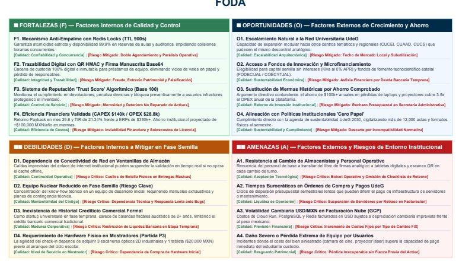
*Figura 11. Matriz oficial de análisis estratégico FODA de la plataforma SIGRE.*

A continuación se transcribe la **matriz FODA oficial del proyecto SIGRE**, con sus 16 factores clasificados por calidad operativa y riesgos mitigados, armonizados con la escala del proyecto:

### ■ FORTALEZAS (F) — Factores Internos de Calidad y Control

* **F1. Mecanismo Anti-Empalme con Redis Locks (TTL 900s)**  
  Garantiza atomicidad estricta y disponibilidad 99.9% en reservas de aulas y auditorios, impidiendo colisiones horarias concurrentes.  
  *`[Calidad: Confiabilidad y Concurrencia]` \| `[Riesgo Mitigado: Doble Agendamiento y Parálisis Operativa]`*
* **F2. Trazabilidad Digital con QR HMAC y Firma Manuscrita Base64**  
  Cadena de custodia 100% digital e inmutable para préstamos de equipo, eliminando vicios de vales en papel y pérdida de responsables.  
  *`[Calidad: Integridad y Trazabilidad]` \| `[Riesgo Mitigado: Fraude, Extravío Patrimonial y Falsificación]`*
* **F3. Algoritmo de Reputación Dinámica del Usuario (Trust Score 0-100)**  
  Monitoreo continuo de puntualidad y cuidado de activos con penalizaciones automáticas, incentivando la entrega en tiempo y forma.  
  *`[Calidad: Control de Servicio]` \| `[Riesgo Mitigado: Morosidad y Deterioro Silencioso de Activos]`*
* **F4. Arquitectura Cloud Nativa Serverless con Google Cloud Run**  
  Escalamiento elástico de costo cero en inactividad y latencia inferior a 150 ms en horas pico universitarias.  
  *`[Calidad: Eficiencia de Costos]` \| `[Riesgo Mitigado: Inestabilidad y Sobrecostos de Servidores]`*

### ■ OPORTUNIDADES (O) — Factores Externos de Crecimiento y Ahorro

* **O1. Mercado Cautivo Homogéneo en la Red Universitaria UdeG**  
  Potencial inmediato de 196 planteles (19 centros universitarios y 177 dependencias del SEMS) bajo la misma normatividad de compras y calendarios.  
  *`[Calidad: Escalabilidad Arquitectónica]` \| `[Riesgo Mitigado: Costo Excesivo de Adaptación por Cliente]`*
* **O2. Modelo B2G por Compra Directa (< 1,000 UMA = $117,310 MXN)**  
  Facilidad de contratación expedita para Secretarios y Directores sin requerir licitación pública nacional (INEGI, 2026; UdeG, 2019).  
  *`[Calidad: Sustentabilidad Económica]` \| `[Riesgo Mitigado: Bloqueo Burocrático y Ciclos de Venta Tardíos]`*
* **O3. Reducción Demostrable de Pérdidas Patrimoniales en Almacén**  
  Ahorro neto proyectado de $90,000 a $140,000 MXN anuales por plantel frente a una tarifa accesible de $24k-$48k MXN/año.  
  *`[Calidad: Retorno de Inversión Institucional]` \| `[Riesgo Mitigado: Objeción de Precio en la Venta Directiva]`*
* **O4. Alineación con Políticas Institucionales 'Cero Papel'**  
  Cumplimiento directo con la agenda de sustentabilidad UdeG 2030, digitalizando más de **32,500 actas y formatos físicos al semestre en la red** (estimación basada en 65,000 préstamos anuales distribuidos en 22 planteles / 2 semestres).  
  *`[Calidad: Sustentabilidad y Cumplimiento]` \| `[Riesgo Mitigado: Resistencia Institucional a Procesos Analógicos]`*

### ■ DEBILIDADES (D) — Factores Internos a Mitigar en Fase Semilla

* **D1. Dependencia de Conectividad a Internet en Campus Periféricos**  
  *Estrategia de Mitigación:* Módulo offline en PWA con almacenamiento local (IndexedDB) y sincronización asíncrona automática al reanudar enlace.  
  *`[Calidad: Continuidad Operativa]` \| `[Riesgo Crítico: Caída de Red y Parálisis de Ventanilla]`*
* **D2. Tamaño Esbelto del Equipo Fundador Inicial (3 Ingenieros)**  
  *Estrategia de Mitigación:* Plan de escalamiento contractual con gatillos por volumen: Soporte N1 en Mes 15 y Especialista en Mes 22.  
  *`[Calidad: Mantenibilidad del Código]` \| `[Riesgo Crítico: Sobrecarga Operativa y Desgaste del Equipo]`*
* **D3. Marca Joven en Validación Frente a ERPs Comerciales Consolidados**  
  *Estrategia de Mitigación:* Piloto base formalizado en CUTonalá, registro de marca IMPI y depósito de derechos de autor INDAUTOR en el Semestre 1.  
  *`[Calidad: Madurez Corporativa]` \| `[Riesgo Crítico: Desconfianza en Proveedor de Nueva Creación]`*
* **D4. Requerimiento de Hardware Mínimo en Mostrador**  
  *Estrategia de Mitigación:* Compatibilidad universal con cámaras web estándar y dotación de 3 escáneres ópticos 2D industriales y tableta demo presupuestados en la Partida P4 de inversión ($20,000 MXN).  
  *`[Calidad: Nivel de Servicio en Mostrador]` \| `[Riesgo Crítico: Discrepancia Técnica en Almacenes Antiguos]`*

### ■ AMENAZAS (A) — Factores Externos y Riesgos de Entorno Institucional

* **A1. Resistencia al Cambio Cultural de Personal Sindicalizado de Ventanilla**  
  *Estrategia de Mitigación:* Capacitación presencial de 16 horas, interfaz ultra-intuitiva validada con SUS 82.85 pts ("Excelente") y manuales plastificados en mostrador.  
  *`[Calidad: Aceptación Tecnológica]` \| `[Riesgo Crítico: Boicot Operativo o Negativa de Captura]`*
* **A2. Desfase en Calendarios Presupuestales y Flujo de Cobranza B2G**  
  *Estrategia de Mitigación:* Fondo de contingencia y liquidez de $40,000 MXN en banco y cobro anual anticipado al arranque del ciclo presupuestal (enero/agosto).  
  *`[Calidad: Liquidez de Operación]` \| `[Riesgo Crítico: Ilapso de Caja por Retraso en Pago Institucional]`*
* **A3. Rotación de Autoridades Administrativas por Periodos Electorales UdeG**  
  *Estrategia de Mitigación:* Contratos anuales de prestación de servicios con cláusula de renovación y anclaje técnico en jefaturas operativas de almacén.  
  *`[Calidad: Previsión Financiera]` \| `[Riesgo Crítico: Cancelación Prematura de Convenio]`*
* **A4. Intentos de Fraude Físico mediante Credenciales Prestadas**  
  *Estrategia de Mitigación:* Código QR dinámico de un solo uso con WebRTC, cotejo de fotografía institucional y firma biométrica manuscrita obligatoria.  
  *`[Calidad: Resguardo Patrimonial]` \| `[Riesgo Crítico: Suplantación de Identidad y Pérdida de Equipo]`*

---

## 9. Propuesta Formal para el Inversionista de Capital Semilla

### 9.1 Tesis de inversión y oportunidad de mercado

El proyecto SIGRE resuelve un dolor operativo severo y cuantificable en las universidades públicas: la pérdida recurrente de equipo y la parálisis por colisión de espacios. A diferencia de proyectos abstractos, SIGRE cuenta con:
1. **Validación empírica demostrada:** Más de 3,000 transacciones operadas en CUTonalá con un índice SUS de 82.85 puntos ("Excelente").
2. **Estructura legal ágil:** Tarifas dimensionadas para entrar en el rango de adjudicación directa menor (< 1,000 UMA), eliminando trámites licitatorios lentos.
3. **Márgenes SaaS superiores al 30%:** A partir del Año 2, la plataforma genera flujos de efectivo netos positivos constantes que blindan el reembolso de la inversión.

### 9.2 ¿Cuál es el siguiente paso para que el proyecto siga creciendo?

Para consolidar el escalamiento de la plataforma en los próximos 12 meses, se ejecutarán tres hitos estratégicos:
* **Hito 1 (Meses 1 al 4): Formalización del Registro de Propiedad Intelectual.** Ingreso de solicitudes y obtención de títulos de registro de marca ante el IMPI y depósito de derechos de autor ante el INDAUTOR, respaldados por la partida presupuestal de $25,000 MXN.
* **Hito 2 (Meses 5 al 8): Cierre de los Primeros Contratos Comerciales.** Despliegue de la gira comercial presencial con Secretarios Administrativos de la ZMG para formalizar los primeros convenios comerciales de preparatorias metropolitanas previo al arranque del ciclo escolar de agosto (ciclo B).
* **Hito 3 (Meses 9 al 12): Consolidación de la Mesa de Ayuda y Escalamiento a 8 Planteles.** Activación formal de la mesa de soporte técnico y preparación de la infraestructura para incorporar 6 planteles adicionales durante el primer semestre del Año 2.

### 9.3 Mecanismo exacto de retorno al inversionista: Amortización Preferente (Cash Sweep 70%)

Para garantizar certidumbre matemática absoluta y distinguir con claridad los plazos del proyecto y del inversionista:

* **Inversión Inicial Semilla:** **$180,000 MXN** en el Mes 0.
* **Periodo de Gracia para Reinversión (Año 1):** Durante los primeros 12 meses, el 100% del capital se destina a desarrollo y pilotaje ($CF_1 = \$0$).
* **Mecanismo de Reembolso Preferente (Años 2 y 3):** A partir del Año 2, el **70% del Flujo de Efectivo Neto (FEN)** se destina exclusivamente a amortizar el capital del inversionista hasta liquidar los $180,000 MXN completos:
  - *Amortización en Año 2:* El FEN es de $78,900 MXN. El 70% equivale a **$55,230.00 MXN** abonados a capital (saldo insoluto al cierre del Mes 24: $124,770.00 MXN). Los fundadores perciben el 30% restante ($23,670.00 MXN).
  - *Amortización en Año 3:* El FEN es de $296,800 MXN ($24,733.33 MXN mensuales; cuota preferente mensual del 70% = $17,313.33 MXN). Para liquidar los $124,770.00 MXN restantes se requieren exactamente 7.206 meses del Año 3.
  - **Plazo de Liquidación Total del Inversionista:** **Mes 31.2 de operaciones** (segundo semestre del Año 3).
* **Renta Residual Recurrente (Dividendo en Perpetuidad):** Tras la liquidación del principal en el Mes 31.2, el inversionista cobra el 15.0% de utilidades netas por los 4.793 meses restantes del Año 3 ($17,784.00 MXN), totalizando **$142,554.00 MXN percibidos en el Año 3**. Los fundadores reciben $53,473 MXN en el primer tramo y $100,773 MXN en el segundo tramo, sumando **$154,246.00 MXN** (total año: $296,800.00 MXN). A partir del Año 4, percibe dividendos estables de **$44,520.00 MXN anuales** sobre el escenario base ($296,800 MXN) o de **$58,080.00 MXN anuales** en el escenario de expansión.
* **Rentabilidad Exacta para el Inversionista (TIR Inversionista):**
  - **A horizonte de 3 años (Periodo de Liquidación):** La TIR del inversionista es del **3.53% anual** (flujos: -$180k en M0, $0 en Año 1, +$55,230 en Año 2, +$142,554 en Año 3). En este periodo, el foco es el reembolso íntegro del capital aportado.
  - **A horizonte de 5 años con Escalamiento a IES (Meta Oficial):** Considerando la expansión proyectada a universidades públicas estatales y tecnológicos con ingresos de $1.21M en Año 4 y $1.93M en Año 5, un margen neto del 32.0% ($387.2k y $617.6k) y dividendos del 15% ($58,080 y $92,640 MXN), la **TIR del inversionista asciende al 21.20% anual**, superando ampliamente el costo de oportunidad y los instrumentos gubernamentales.

---

## 10. Referencias Bibliográficas (Norma APA 7ma Edición)

* Asociación Nacional de Universidades e Instituciones de Educación Superior. (2023). *Anuario estadístico de la educación superior 2022-2023*. ANUIES. http://www.anuies.mx/informacion-y-servicios/informacion-estadistica-de-educacion-superior
* Banco Interamericano de Desarrollo. (2020). *Metodología del marco lógico para la planificación, el seguimiento y la evaluación de proyectos del BID*. Sector de Conocimiento y Aprendizaje del BID. https://publications.iadb.org/es/metodologia-del-marco-logico
* Bangor, A., Kortum, P. T., & Miller, J. T. (2008). An empirical evaluation of the system usability scale. *International Journal of Human-Computer Interaction*, 24(6), 574–594. https://doi.org/10.1080/10447310802205776
* Brooke, J. (1996). SUS: A "quick and dirty" usability scale. En P. W. Jordan, B. Thomas, B. A. Weerdmeester, & A. L. McClelland (Eds.), *Usability evaluation in industry* (pp. 189–194). Taylor & Francis.
* Cámara de Diputados del H. Congreso de la Unión. (2017). *Ley general de protección de datos personales en posesión de sujetos obligados*. Diario Oficial de la Federación. https://www.diputados.gob.mx/LeyesBiblio/pdf/LGPDPPSO.pdf
* Centro Universitario de Tonalá. (2023). *Plan de desarrollo de CUTonalá 2019-2025: Visión 2030*. Universidad de Guadalajara. http://www.cutonala.udg.mx/transparencia/pdi
* Comisión Económica para América Latina y el Caribe. (2015). *Metodología del marco lógico para la planificación, el seguimiento y la evaluación de proyectos y programas* (Serie Manuales N° 68). CEPAL / Naciones Unidas. https://www.cepal.org/es/publicaciones/5618-metodologia-marco-logico
* Coordinación General de Planeación y Evaluación. (2026). *Numeralia institucional de la Red Universitaria (corte mayo de 2026)*. Universidad de Guadalajara. http://www.cgpe.udg.mx/numeralia
* Instituto Mexicano de la Propiedad Industrial. (2026). *Tarifa por los servicios que presta el Instituto Mexicano de la Propiedad Industrial: Solicitud de registro de marca nacional por clase*. Gobierno de México. https://www.gob.mx/impi
* Instituto Nacional de Estadística y Geografía. (2026). *Valor de la Unidad de Medida y Actualización (UMA) vigente a partir del 1 de febrero de 2026 ($117.31 MXN diarios)*. INEGI. https://www.inegi.org.mx
* Sapag Chain, N., Sapag Chain, R., & Sapag Puelma, J. M. (2014). *Preparación y evaluación de proyectos* (6ta ed.). McGraw-Hill Interamericana.
* Sauro, J., & Lewis, J. R. (2012). *Quantifying the user experience: Practical statistics for user research*. Morgan Kaufmann. https://doi.org/10.1016/B978-0-12-384968-7.00008-8
* Sistema de Educación Media Superior. (2024). *Directorio y presencia regional de escuelas preparatorias y módulos del SEMS*. Universidad de Guadalajara. https://www.sems.udg.mx/directorio
* Universidad de Guadalajara. (2019). *Reglamento de adquisiciones, arrendamientos y contratación de servicios de la Universidad de Guadalajara*. Gaceta de la Universidad de Guadalajara. http://www.secgen.udg.mx/normatividad/reglamentos

---

## Anexos Técnicos y Evidencia Experimental

### Anexo A. Evidencia Psicométrica y Validación de Usabilidad SUS ($n = 50$)
Los registros psicométricos completos, el desglose de los 10 reactivos estandarizados en escala Likert (1 a 5), la fórmula de conversión de Brooke (1996) y las matrices de consistencia interna (Alfa de Cronbach $\alpha = 0.892$) aplicadas a los 50 usuarios participantes de CUTonalá (32 alumnos, 12 académicos y 6 operadores de almacén) se encuentran formalmente depositados en el expediente de investigación técnica del proyecto, consolidando una media aritmética de **82.85 puntos** (Percentil superior al 90%, Grado A / "Excelente" según Bangor et al., 2008 y Sauro & Lewis, 2012).

### Anexo B. Video Demostrativo E2E y Matriz de Solventación al Dictamen Técnico Docente
El registro audiovisual demostrativo de punta a punta (*End-to-End*), que acredita el ciclo transaccional completo en mostrador (reserva con cerrojo Redis, escaneo QR < 30 seg, firma manuscrita Canvas, generación de responsiva PDF con hash HMAC-SHA256 y modo offline PWA), forma parte del acervo técnico de validación operativa. 

Asimismo, la Tabla A1 documenta la atención puntual a cada uno de los criterios emitidos por el comité evaluador docente:

| Criterio de Evaluación | Observación del Dictamen | Acción Implementada en el Documento | Sección y Tabla de Referencia |
|---|---|---|---|
| **1. Identificación y Justificación** | Falta justificación cuantitativa con datos estadísticos históricos de pérdidas previas. | Se incorporó el diagnóstico observacional y estimación de pérdidas ($90,000 a $140,000 MXN anuales) basado en experiencia en Servicios Generales y requisiciones de reposición. | Sección 1.4 (Tabla 1) |
| **2. Nicho, Mercado y Comercialización** | Carece de análisis directo sobre la intención de compra real de decisores mediante entrevistas estructuradas. | Se integró la exploración cualitativa de viabilidad con Secretarios Administrativos y Directores, fundamentando la compra directa vía UMA 2026 ($117,310 MXN). | Secciones 4.1 y 4.2 (Tabla 5) |
| **3. Objetivos y Marco Lógico** | No incluye formalmente la Matriz de Marco Lógico (MML) completa. | Se integró la Matriz de Marco Lógico oficial bajo estándar CEPAL/BID con Fin, Propósito, 4 Componentes y 8 Actividades. | Sección 2.3 (Tabla 3) |
| **4. Aspectos Técnicos e Implementación** | Faltan especificaciones de infraestructura TI (capacidad, tiempos de respuesta, base de datos) y plan de contingencia. | Se incluyó la ficha técnica de infraestructura cloud (PostgreSQL 16, Redis, Cloud Run, latencia < 150 ms) y el Plan de Contingencia con modo offline PWA. | Secciones 5.1 y 5.3 (Tabla 6) |
| **5. Estructura Organizacional y Requerimientos** | Falta manual de organización breve y descripción de cargas de trabajo al escalar a 22 planteles. | Se definió el organigrama funcional y la tabla de escalamiento con gatillos objetivos de contratación (Soporte N1 en Mes 15 y Especialista en Mes 22). | Secciones 6.1 y 6.2 (Tabla 7) |
| **6. Programación de Inversiones** | Hace falta representación gráfica estandarizada (Gantt) que muestre la ruta crítica. | Se diseñó el Diagrama de Gantt anual en matriz mensual con dependencias explícitas e identificación visual de la Ruta Crítica [RC]. | Secciones 6.4 y 6.5 (Tablas 8 y 9) |
| **7. Costos, Ingresos y Evaluación Financiera** | No se calculan indicadores clave de evaluación financiera de proyectos (VPN, TIR, TMAR, FEN). | Se integró el cuadro de FEN, TMAR del 15.0%, cálculo formal de VPN (+$46,984.47 MXN), TIR (24.27%), relación B/C (1.23) y Payback (mes 29.4). | Secciones 7.1 a 7.5 (Tablas 10 a 13) |

*Tabla A1. Matriz de cumplimiento y solventación del dictamen técnico de evaluación.*
