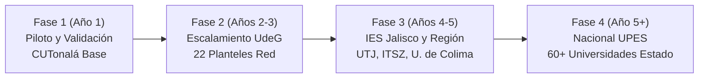
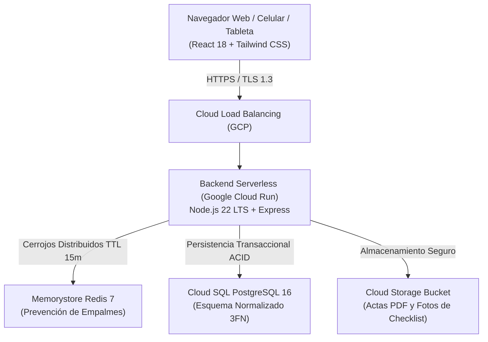
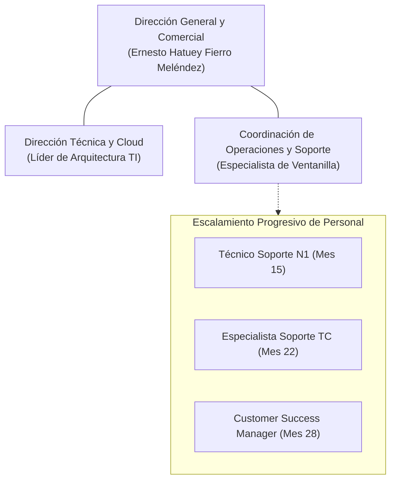
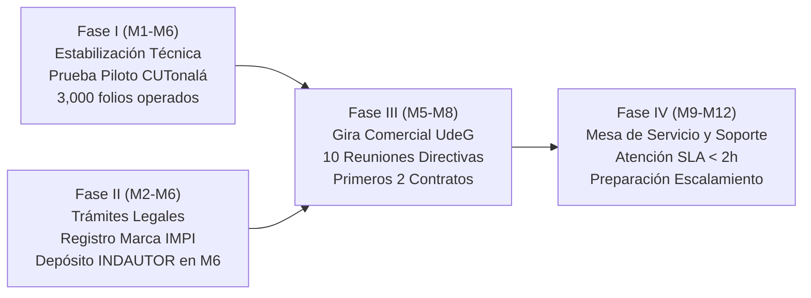
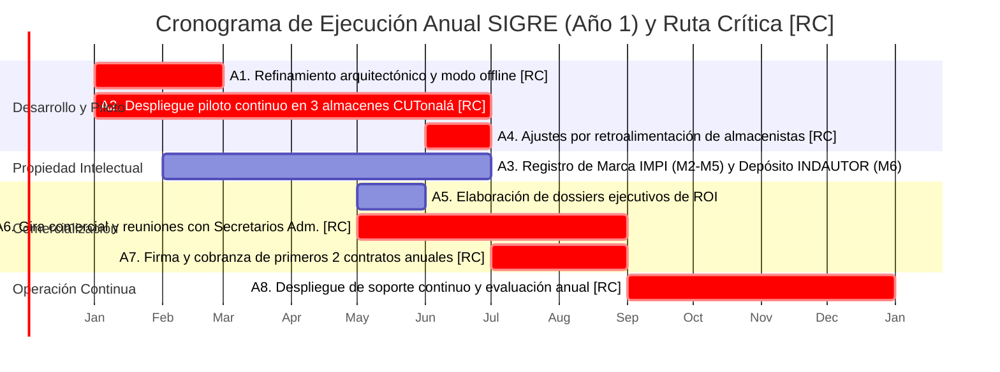

# Propuesta de Proyecto de Inversión: Plataforma SIGRE

**Sistema Integrado de Gestión de Recursos, Espacios y Activos para Instituciones de Educación Superior**

| Ficha Técnica de la Propuesta de Inversión | Detalle Institucional |
|---|---|
| **Unidad de Aprendizaje** | Formulación y Evaluación de Proyectos de Inversión (FEPI) |
| **Docente Titular** | Mtra. Abril Adriana Angulo Sherman |
| **Autor del Proyecto** | Ernesto Hatuey Fierro Meléndez |
| **Mercado Base de Validación** | Red Universitaria de la Universidad de Guadalajara (UdeG) |
| **Mercado de Escalamiento** | Universidades Públicas Estatales (UPES) e Institutos Tecnológicos |
| **Inversión Inicial Solicitada** | \$180,000 MXN (Capital Semilla y Validación en Campo) |
| **Horizonte de Evaluación** | 3 años (36 meses) con proyección de retorno a 5 años |
| **Tasa de Descuento (TMAR)** | 15.0% anual (7.12% Cetes 364d + 7.88% prima de riesgo de startup universitaria) |
| **Fecha de Presentación** | Noviembre de 2026 |

---

## 1. Problemática, Diagnóstico Empírico y Justificación

### 1.1 El problema operativo: descontrol analógico en ventanillas de almacén

En la gestión cotidiana de las Instituciones de Educación Superior (IES) públicas en México, el préstamo de equipamiento didáctico de alta movilidad (proyectores, cables de video HDMI/VGA, adaptadores USB-C, extensiones y apuntadores) y la reservación de espacios físicos compartidos (auditorios, salas de usos múltiples, laboratorios y aulas magnas) se administra de forma predominante mediante **libretas manuales de registro, vales de papel y oficios o correos aislados**. De acuerdo con el diagnóstico de infraestructura técnica en educación superior de la ANUIES (2023), la falta de trazabilidad en activos móviles representa uno de los principales focos de ineficiencia en las universidades públicas del país.

Aunque este esquema analógico puede operar con relativa eficacia en contextos cerrados o de bajo volumen si se lleva con rigor minucioso, en un campus universitario promedio —donde concurren miles de estudiantes y cientos de profesores— el cambio de turno en horas pico genera cuellos de botella que rompen el control administrativo. Esto desencadena tres afectaciones directas:

1. **Merma patrimonial no deslindada.** Las firmas manuscritas apresuradas en libretas suelen ser ilegibles y carecen de un checklist bilateral estandarizado de entrega y recepción. Cuando un equipo se devuelve dañado (puertos rotos, carcasas golpeadas) o un accesorio no regresa al almacén, es imposible determinar con certeza la cadena de custodia ni deslindar responsabilidades sin provocar fricciones con el personal docente o estudiantil.
2. **Colisiones de agenda y pérdida de tiempo pedagógico.** En recintos de alta demanda, la tramitación mediante oficios físicos genera desarticulación entre las dependencias solicitantes, la administración y el personal de intendencia. El resultado recurrente son **empalmes de horario**, donde dos actividades coinciden en un mismo espacio o este permanece cerrado sin llave disponible. Conforme a las observaciones de campo en CUTonalá, cada conflicto logístico de esta índole demora entre 15 y 25 minutos de clase lectiva.
3. **Ceguera directiva en compras y mantenimiento.** Las autoridades administrativas carecen de registros consolidados sobre la tasa de utilización y ciclo de vida de los bienes. Las compras de equipamiento y las renovaciones se programan con base en percepciones o urgencias inmediatas, en lugar de datos objetivos de aprovechamiento (Sapag Chain et al., 2014).

```mermaid
flowchart TD
    subgraph ModeloAnalógico["Modelo Analógico Tradicional (Fricción y Ceguera)"]
        A1["Solicitud en Libreta de Papel / Correo"] --> A2["Entrega sin Checklist Estandarizado"]
        A2 --> A3["Firma Manuscrita Ilegible"]
        A3 --> A4["Devolución sin Inspección Fotográfica"]
        A4 --> A5["Merma Oculta + Empalmes de Agenda"]
    end
    subgraph ModeloDigital["Modelo SIGRE (Trazabilidad y Agilidad)"]
        B1["Reserva Digital con Soft-Lock (Redis)"] --> B2["Escaneo QR en Mostrador (<30s)"]
        B2 --> B3["Firma Electrónica + Acta PDF Inmutable"]
        B3 --> B4["Checklist Fotográfico Bilateral"]
        B4 --> B5["Cadena de Custodia + Tablero Directivo"]
    end
```

### 1.2 Análisis crítico: causas estructurales y la falacia digital vs. física

Para estructurar una solución realista, es indispensable desglosar las causas de fondo y evitar simplificaciones metodológicas:

* **Burocracia aparatosa y acuerdos desatendidos:** La problemática en los planteles no se debe a la ausencia de normas escritas, sino a que el trámite tradicional mediante oficios en papel es tan lento y centralizado que los propios operadores recurren a "acuerdos verbales de palabra" para resolver la prisa del aula. El sistema burocrático actual incentiva la omisión del registro formal.
* **Merma natural por desgaste vs. merma evitable:** Resulta técnicamente erróneo atribuir la totalidad de las pérdidas a negligencia o abuso del usuario. Artículos de alta rotación como cables HDMI que se conectan y desconectan de 5 a 8 veces al día tienen una vida útil reducida por desgaste mecánico natural. La merma patrimonial total se compone de dos vertientes:
  $$\text{Merma Total} = \text{Desgaste Operativo Aceptable (Vida Útil)} + \text{Merma Evitable (Extravío y Falta de Custodia)}$$
  El objetivo del proyecto no es eliminar la merma normal (lo cual es físicamente imposible), sino erradicar la merma evitable mediante trazabilidad y distinguir cuándo un accesorio falló por ciclo de vida acumulado y cuándo por descuido.
* **La falacia de la digitalización ingenua:** Asumir que sustituir papel por computadoras resuelve automáticamente el problema es un error común. Si una plataforma digital exige demasiados pasos o intermediarios burocráticos, entorpece más que una libreta manual. Asimismo, la información virtual corre riesgo de pérdida si no cuenta con esquemas de respaldo garantizados. Por esta razón, SIGRE complementa la nube con sincronización local fuera de línea (*offline-first*) y mantiene un talonario físico de contingencia prefoliado para casos de corte total de energía.

### 1.3 Fundamentación empírica: caso base CUTonalá y estudio SUS ($n = 50$)

Para fundamentar la viabilidad del proyecto con datos empíricos y no meras apreciaciones teóricas, la formulación se sustentó en dos ejercicios de investigación de campo en el Centro Universitario de Tonalá (CUTonalá), un campus multidisciplinario con más de 9,600 alumnos y 243 trabajadores administrativos (CUTonalá, 2023):

#### a) Levantamiento cualitativo en ventanillas de almacén
Se realizaron entrevistas estructuradas y observación en los tres puntos de mayor afluencia del plantel: el Almacén Central de Servicios Generales, el Almacén de Cómputo e Ingenierías, y la Cineteca de CUTonalá. Se consultó a 6 almacenistas de ventanilla y a 12 docentes usuarios continuos de equipo audiovisual. Los hallazgos confirmaron:
- Extravío testimonial recurrente de al menos 1 cable HDMI por mes por dependencia, además de adaptadores USB-C/VGA y extensiones.
- Tiempos de despacho manual de **4.5 a 6.0 minutos por persona** en horas pico de inicio de clase.
- Registro de 3 a 5 colisiones de agenda semanales entre eventos y clases en auditorios.

> [!NOTE]
> Estas cifras de frecuencia constituyen una **estimación cualitativa preliminar de línea base**. Como parte de la fase piloto, se ejecutará una auditoría formal con cédulas de inventario físico para establecer la línea base cuantitativa definitiva con rigor estadístico.

#### b) Evaluación psicométrica estandarizada de usabilidad (Escala SUS, $n = 50$)
Para comprobar de forma científica si la interfaz digital de SIGRE resulta ágil o si generaría rechazo en el personal, se administró el cuestionario estandarizado *System Usability Scale* (SUS; Bangor et al., 2008; Brooke, 1996; Sauro & Lewis, 2012) a una muestra de 50 usuarios reales del campus tras interactuar directamente con el MVP web v1.0 de la plataforma (cuyos datos crudos y consentimiento informado se encuentran documentados en `docs/pruebas/evidencia_cuestionarios_sus.md`):

| Estamento Evaluado | Muestra ($n$) | Media Obtenida (SUS) | Desviación Estándar ($s$) |
|---|---|---|---|
| Estudiantes solicitantes | 32 | 83.28 pts | 11.21 pts |
| Profesores de asignatura y carrera | 12 | 81.25 pts | 9.91 pts |
| Personal de almacén y ventanilla | 6 | 83.75 pts | 12.72 pts |
| **Puntaje Global Consolidado** | **50** | **82.85 pts** | **10.91 pts** |

* **Fiabilidad psicométrica:** Coeficiente Alfa de Cronbach $\alpha = 0.892$, confirmando una alta consistencia interna del instrumento.
* **Inferencia estadística:** Intervalo bilateral de confianza al 95%: $\text{IC}_{95\%} = [79.75, 85.95]$ puntos. Prueba $t$ de Student unilateral de una cola ($H_0: \mu \le 80$ vs $H_1: \mu > 80$): $t(49) = 1.848$, $p = 0.035 < 0.05$.
* **Interpretación:** Un puntaje medio de 82.85 clasifica al software en **Grado A ("Nivel Excelente")**, superando con holgura el promedio industrial estándar de 68 puntos (Bangor et al., 2008). Aunque la submuestra de almacenistas ($n = 6$) es estadísticamente limitada al número de ventanillas del campus, su puntuación media favorable (83.75 pts) constituye un indicador cualitativo inicial de apertura hacia la adopción del sistema, sugiriendo que reconocen que el acta digital con checklist bilateral los deslinda de responsabilidades sobre averías previas; esta tendencia será contrastada formalmente en la muestra ampliada del pilotaje multisede.

### 1.4 Estimación económica corregida del costo de inacción por plantel

Con base en los reportes de requisiciones de compra de Servicios Generales (2024-2026) y cotizaciones de reposición de equipo de cómputo, se estructuró la estimación anual de pérdidas y mermas por plantel reflejada en la Tabla 1:

| Concepto de Impacto / Ineficiencia | Frecuencia Anual Estimada | Rango Económico Anual (MXN) | Base de Estimación y Justificación |
|---|---|---|---|
| Pérdida de accesorios menores (cables HDMI, adaptadores, extensiones) | 15 a 30 piezas no devueltas al año por campus | \$20,000 – \$30,000 | 1 a 2 accesorios perdidos/mes en almacenes |
| Daño físico en equipos mayores (proyectores, bocinas) sin deslinde | 2 a 4 incidentes anuales con carcasas rotas o puertos dañados | \$60,000 – \$90,000 | Reparaciones absorbidas por gasto corriente sin responsable |
| Gasto en papelería, libretas, tóner y vales desechables | Miles de formatos físicos impresos para archivo muerto | \$10,000 – \$20,000 | Consumo continuo de papel en Servicios Generales |
| **Total Estimado de Costo de Inacción** | **Costo directo anual acumulado** | **\$90,000 – \$140,000** | **Punto medio anual: \$115,000 MXN / plantel** |

*Tabla 1. Estimación preliminar del impacto de la inacción administrativa por plantel universitario.*

Descontando de forma prudente una fracción del 30% (\$34,500 MXN) atribuible a desgaste físico normal ineludible por fin de ciclo de vida de los componentes, queda un **remanente evitable de aproximadamente \$80,500 MXN anuales por plantel**. Al contrastar este ahorro potencial directo con las cuotas anuales de suscripción de SIGRE (\$24,000 a \$48,000 MXN/año), se demuestra que la adopción de la plataforma genera un beneficio neto positivo inmediato para la dependencia desde su primer año.

### 1.5 Análisis de alternativas existentes frente a SIGRE

Como se sintetiza en la Tabla 2, las opciones disponibles en el entorno universitario son insuficientes o económicamente inviables:

| Criterio Evaluado | Libretas de Papel y Excel | Sistema Central SIIAU | Software Extranjero (Cheqroom / Panda) | **Plataforma SIGRE (Propuesta)** |
|---|---|---|---|---|
| Tiempo de despacho en ventanilla | Lento (4.5 a 6.0 min/persona) | No aplica a ventanilla | Regular (~1.5 min) | **Ágil (< 30 segundos con QR)** |
| Vinculación legal de responsiva | Firma manual ilegible | Sin actas de equipo móvil | Notificaciones por correo | **Firma digital + HMAC-SHA256 en PDF** |
| Control de empalmes en espacios | Inexistente (conflictos diarios) | Solo planeación semestral | Sí (calendarios cloud) | **Cerrojos atómicos en Redis (TTL 15 min)** |
| Costo anual por plantel | Oculto en mermas (\$115k) | Incluido en nómina central | Muy alto (\$60k–\$90k MXN/año) | **Económico (\$24,000 a \$48,000 MXN/año)** |
| Adaptación normativa y soporte | Nula | Rígido; cambios tardan meses | Nula; soporte remoto en inglés | **Especializado UdeG; presencial y WhatsApp** |

*Tabla 2. Matriz comparativa de alternativas de solución técnica.*

> [!NOTE]
> **Complementariedad frente a sistemas centrales:** El SIIAU es un sistema centralizado de control escolar, planeación curricular y administración presupuestal institucional. No fue concebido para la operación ágil en mostrador con micro-transacciones en cambios de clase de 10 minutos. SIGRE no compite con el SIIAU ni busca sustituirlo; funciona como la herramienta operativa de ventanilla que registra el flujo diario y genera la información requerida para conciliar los inventarios patrimoniales.

---

## 2. La Solución, Objetivos y Matriz de Marco Lógico (MML)

### 2.1 Descripción de módulos y propuesta de valor

SIGRE es una solución de software bajo la modalidad SaaS (*Software as a Service*), orientada a optimizar el ciclo de vida del préstamo institucional mediante cuatro módulos interconectados:

1. **Módulo de Reservas y Gestión de Espacios:** Permite consultar la disponibilidad horaria en tiempo real y pre-apartar auditorios, laboratorios o equipamiento. Incorpora cerrojos distribuidos temporales en memoria volátil (Redis) que retienen el recurso durante 15 minutos mientras el usuario formaliza la petición, previniendo atómicamente colisiones de agenda.
2. **Módulo de Despacho Ágil con Código QR:** El solicitante presenta su código QR dinámico desde su teléfono móvil. El almacenista decodifica el código utilizando la cámara integrada del navegador web (vía WebRTC/MediaDevices) en menos de dos segundos, validando la identidad institucional con correo `@udg.mx` o federado.
3. **Módulo de Responsivas Digitales y Checklist Bilateral:** Genera un acta responsiva foliada en PDF oficial. El usuario estampa su firma manuscrita digitalizada sobre un lienzo HTML5 Canvas, sellada criptográficamente mediante HMAC-SHA256 con marca de tiempo UTC. Al entregar y recibir el equipo, se aplica un checklist visual rápido con captura fotográfica en caso de detectar anomalías físicas.
4. **Módulo de Reputación y Tablero Ejecutivo:** Asigna un índice de confiabilidad (*Trust Score*, base 100) que premia la entrega puntual y penaliza devoluciones tardías o material dañado. Ofrece a la Secretaría Administrativa métricas consolidadas de rotación de activos y horas de uso por edificio.

### 2.2 Objetivos del proyecto

* **Objetivo General:**  
  Desarrollar, validar y comercializar la plataforma tecnológica SIGRE bajo modelo SaaS para la modernización de los almacenes y la gestión de recintos en las Instituciones de Educación Superior públicas, logrando la contratación formal de al menos 22 planteles de la Red Universitaria UdeG al cierre del tercer año de operaciones y estableciendo las bases para su escalamiento a universidades públicas estatales de la región occidente de México.

* **Objetivos Particulares:**
  1. *Validación Técnica y de Usabilidad:* Consolidar el Producto Mínimo Viable (MVP) en CUTonalá durante un periodo piloto de seis meses, procesando al menos 3,000 préstamos reales y manteniendo un índice de satisfacción SUS $\ge 80$ puntos en ventanilla.
  2. *Protección Jurídica y Propiedad Intelectual:* Iniciar el trámite de registro de marca denominativa e imagotipo ante el IMPI en el Mes 2 y formalizar el depósito de derechos de autor del código fuente ante INDAUTOR al concluir la fase de pruebas técnicas en el Mes 6.
  3. *Escalamiento Comercial Progresivo:* Captar de forma paulatina 8 planteles afiliados a lo largo de los primeros tres semestres comerciales, alcanzando el punto de equilibrio operativo en el Mes 14.
  4. *Consolidación Financiera y Retorno de Inversión:* Afiliar a 22 dependencias de la Red Universitaria al término del Año 3, alcanzando el **Payback del proyecto en el Mes 29.4** y logrando la **liquidación total del capital del inversionista en el Mes 31.2**.
  5. *Expansión Multi-Institucional:* Diseñar a partir del Mes 30 los conectores de interoperabilidad para iniciar la extrapolación comercial del software hacia Universidades Tecnológicas y Politécnicas a partir del Año 4.

### 2.3 Matriz de Marco Lógico (MML) del Proyecto SIGRE

En apego a los estándares metodológicos oficiales de formulación de proyectos de inversión (CEPAL, 2015; BID, 2020), la Tabla 3 sintetiza la lógica causal vertical y horizontal de la iniciativa:

| Nivel Jerárquico | Resumen Narrativo de Objetivos | Indicadores Objetivamente Verificables | Medios de Verificación | Supuestos Críticos |
|---|---|---|---|---|
| **FIN (Impacto Superior)** | Contribuir a la preservación del patrimonio público, la eficiencia administrativa y la continuidad pedagógica en las IES públicas. | Reducción acumulada de al menos el 70% en el costo de reposición por mermas evitables en planteles suscritos al cierre del Año 3. | Informes anuales de auditoría patrimonial y cuentas públicas de los planteles de la Red UdeG. | Estabilidad presupuestal institucional para herramientas de tecnologías educativas. |
| **PROPÓSITO (Efecto Directo)** | Planteles universitarios disponen de una plataforma digital auditable y ágil para el control de inventario móvil, espacios y responsivas. | 22 planteles con contrato activo al Año 3; > 65,000 préstamos anuales registrados; cero empalmes de agenda; despacho en mostrador < 30 seg. | Contratos de suscripción vigentes, bitácoras de base de datos de GCP y reportes de satisfacción de almacén. | Autoridades mantienen facultades normativas descentralizadas de compra directa menor. |
| **COMPONENTES (Entregables)** | **C1.** Software SIGRE desplegado en Google Cloud con modo offline. **C2.** Marco de propiedad intelectual registrado (IMPI e INDAUTOR). **C3.** Modelo comercial y expedientes de ROI validados con directivos. **C4.** Programa de capacitación y mesa de soporte técnico operativo. | **C1.** 99.9% de disponibilidad en nube y latencia < 150 ms. **C2.** 2 títulos de registro legal obtenidos en el Año 1. **C3.** Cartera de 8 contratos en Año 2 y 22 contratos en Año 3. **C4.** 100% de almacenistas capacitados en planteles activos. | Repositorio GitHub con pruebas E2E aprobadas, títulos oficiales de registro, contratos firmados y actas de acreditación de talleres. | Personal sindicalizado de ventanilla mantiene apertura al uso tras recibir inducción práctica en el mostrador. |
| **ACTIVIDADES (Acciones)** | **A1.** Refinamiento arquitectónico y módulo offline (M1-M2). **A2.** Despliegue piloto en 3 almacenes CUTonalá (M1-M6). **A3.** Trámite de marca IMPI y depósito INDAUTOR (M2-M6). **A4.** Ajustes por retroalimentación de almacenistas (M6). **A5.** Preparación de dossiers ejecutivos de ROI (M5). **A6.** Gira comercial con Secretarios y Directores (M5-M8). **A7.** Firma y cobranza de primeros 2 contratos (M7-M8). **A8.** Despliegue de soporte continuo y evaluación (M9-M12). | Presupuesto semilla de \$180,000 MXN ejercido conforme al calendario de partidas de capital preoperativo en el primer año. | Facturas fiscales de servicios cloud, títulos oficiales del IMPI, minutas de reunión ejecutiva y reportes de tickets de soporte. | El desembolso del capital semilla de \$180,000 MXN se formaliza oportunamente al arranque del proyecto. |

*Tabla 3. Matriz de Marco Lógico (MML) del Proyecto SIGRE bajo estándar CEPAL/BID.*

---

## 3. Nicho de Mercado y Estrategia de Escalamiento

### 3.1 Mercado base cautivo: Red Universitaria UdeG

El nicho inmediato del proyecto está delimitado por la Red Universitaria de Jalisco, un ecosistema altamente homogéneo que comparte el mismo calendario escolar, normatividad de compras y problemáticas logísticas. De acuerdo con la numeralia institucional actualizada de la Coordinación General de Planeación y Evaluación (CGPE, 2024; SEMS, 2024), el universo total disponible suma **196 dependencias**:
- **19 Centros Universitarios:** 7 temáticos metropolitanos (CUCEI, CUCEA, CUAAD, CUCS, CUCSH, CUCBA y CUGuadalajara) y 12 regionales en el interior de Jalisco (CUTonalá, CUSur, CUNorte, CUCiénega, CUCosta, CUAltos, CUValles, CULagos, CUChapala, CUTlaquepaque, CUCosta Sur, etc.).
- **177 Dependencias del SEMS:** 33 escuelas/módulos en la Zona Metropolitana de Guadalajara y 144 dependencias y módulos en los municipios regionales del interior del estado (sumando 76 escuelas preparatorias sede y 101 módulos).

Como detalla la Tabla 4, la meta de captación de 22 planteles para el cierre del Año 3 representa únicamente el **11.2% del mercado cautivo disponible**, confirmando que las proyecciones financieras no dependen de tasas de penetración irreales:

| Segmento Institucional de la Red | Universo Total de Planteles | Meta de Captación (Año 3) | % de Penetración | Tarifa Anual Propuesta (MXN) | Facturación Anual Estimada (Año 3) |
|---|---|---|---|---|---|
| Centros Universitarios Temáticos (Metropolitanos: CUCEI, CUCEA, CUAAD, etc.) | 7 dependencias | 3 planteles | 42.9% | \$48,000 | \$144,000 |
| Centros Universitarios Regionales (CUTonalá, CUSur, CUNorte, etc.) | 12 dependencias | 5 planteles | 41.7% | \$48,000 | \$240,000 |
| Preparatorias Metropolitanas del SEMS | 33 dependencias | 8 planteles | 24.2% | \$24,000 | \$192,000 |
| Preparatorias Regionales y Módulos SEMS | 144 dependencias | 6 planteles | 4.2% | \$24,000 | \$144,000 |
| **Total Consolidado** | **196 dependencias** | **22 planteles** | **11.2%** | — | **\$720,000 MXN / año** |

*Tabla 4. Segmentación del mercado potencial y metas de penetración al tercer año.*

> [!IMPORTANT]
> **Justificación de la penetración diferenciada:** Los centros temáticos gestionan matrículas masivas (>20,000 alumnos) y operan múltiples ventanillas de almacén con alta rotación de equipo técnico; por ello, su urgencia de control es crítica. En contraste, para las preparatorias regionales del interior se fija una meta sumamente conservadora (4.2%), reconociendo sus presupuestos operativos más reducidos.

### 3.2 Visión de escalamiento: de la Red UdeG a las IES públicas nacionales

Para un inversionista de capital semilla, un proyecto confinado a una sola institución representa un techo de mercado estrecho. La ventaja estructural de SIGRE radica en que el modelo SaaS y su arquitectura desacoplada permiten **extrapolar la solución hacia cualquier universidad pública de México** con requerimientos mínimos de parametrización (catálogo de facultades, logotipos institucionales y mapeo de correos institucionales).

1. **Fase de Consolidación Local (Años 1 al 3):** Penetración del 11.2% en la Red UdeG, alcanzando madurez de producto y estabilidad financiera con \$850,000 MXN de facturación bruta anual.
2. **Fase Regional Occidente (Año 4):** Expansión hacia las Universidades Tecnológicas y Politécnicas de Jalisco (como la UTJ y los Institutos Tecnológicos Superiores de Zapopan y Zapotlanejo), así como universidades estatales vecinas (Universidad de Colima, Universidad Autónoma de Nayarit). La incorporación de 10 tecnológicos a una tarifa promedio de \$36,000 MXN/año aportará \$360,000 MXN adicionales, elevando la facturación consolidada a **\$1.21 millones de pesos MXN en el Año 4**.
3. **Fase Nacional (Año 5 en adelante):** Prospección sobre las más de 60 Universidades Públicas Estatales (UPES) del país afiliadas a la ANUIES, donde afiliar a 20 dependencias foráneas proyecta alcanzar los **\$1.93 millones de pesos anuales** (\$1.21M base + 20 dependencias a \$36k = \$720k adicionales).

---

## 4. Comercialización, Decisores y Servicios

### 4.1 Estructura de decisores de compra por tipo de plantel

En el sector educativo público, los usuarios finales no ejercen el presupuesto. Por lo tanto, el discurso comercial se orienta a las necesidades específicas de los decisores normativos:

* **En Centros Universitarios (Secretario Administrativo):** El Secretario Administrativo coordina Servicios Generales y responde directamente ante las auditorías del Órgano Interno de Control y la Contraloría del Estado. El argumento central para este perfil no es la modernidad técnica, sino el **blindaje patrimonial**: SIGRE entrega actas inmutables en PDF con firma digital que acreditan la debida custodia del patrimonio público, reduciendo observaciones de auditoría por equipo faltante.
* **En Escuelas Preparatorias del SEMS (Director de Plantel):** El Director busca la **continuidad de las clases y un costo accesible**. Para una preparatoria, una inversión anual de \$24,000 MXN es inferior al costo de reponer un solo proyector extraviado y puede pagarse de forma directa con su fondo de operación ordinaria.

### 4.2 Viabilidad burocrática y contratación por adjudicación directa

Un obstáculo común en las ventas al sector público son las licitaciones públicas de largo plazo. El Reglamento de Adquisiciones, Arrendamientos y Contratación de Servicios de la Universidad de Guadalajara (2019, Artículos 42 y 45) autoriza expresamente la **adjudicación directa para compras menores y contratación de servicios de apoyo** hasta por montos de 1,000 Unidades de Medida y Actualización (UMA) diarias.

Con el valor de la UMA diaria vigente en 2026 fijado en **\$117.31 MXN** por el INEGI (2026), dicho umbral de compra directa asciende a **\$117,310.00 MXN**. Las tarifas anuales de SIGRE (\$24,000 MXN para bachilleratos y \$48,000 MXN para centros universitarios) se sitúan holgadamente por debajo de dicho tope legal. Asimismo, para las preparatorias, la cuota anual de \$24,000 MXN puede dispersarse en pagos semestrales de \$12,000 MXN o trimestrales de \$6,000 MXN con cargo a su fondo revolvente ordinario, facultando al Director o Secretario Administrativo a suscribir el contrato en días hábiles sin trámites licitatorios.

### 4.3 Motivación y desglose de tarifas frente a costos de servicio

La diferenciación de precios responde al volumen operativo y requerimientos de soporte de cada institución:

| Nivel de Servicio | Tarifa Anual (MXN) | Cobertura Operativa Incluida | Dimensionamiento de Soporte |
|---|---|---|---|
| **Plan Preparatoria SEMS** | \$24,000 | 1 a 2 almacenes; hasta 1,500 usuarios; actas y boletos QR ilimitados | Taller presencial de 8 hrs; soporte WhatsApp institucional |
| **Plan Centro Universitario** | \$48,000 | 3 a 6 almacenes; multi-edificio; reservas de auditorios y Cineteca | Taller presencial de 16 hrs; soporte prioritario con SLA < 2 hrs |

Ambas cuotas cubren el consumo de servidores en la nube, copias de seguridad continuas y actualizaciones del sistema, resultando sustancialmente más accesibles que los ERPs extranjeros o sistemas comerciales de inventario que superan los \$350,000 MXN anuales de licenciamiento por campus.

### 4.4 Estrategia de comercialización y embudo de ventas (Funnel)

Para alcanzar de forma sostenida la meta trienal de 22 planteles activos, la estrategia comercial se articula en un embudo (*funnel*) escalonado:
* **Año 1 (Piloto y Arranque):** 10 reuniones ejecutivas presenciales $\to$ 5 pruebas piloto demostrativas $\to$ **2 contratos anuales cerrados de preparatorias** (\$24,000 MXN cada uno, cobrados al arranque de su ciclo B).
* **Año 2 (Expansión Metropolitana):** 25 presentaciones ejecutivas ante Secretarios Administrativos $\to$ 15 pruebas piloto $\to$ **6 contratos adicionales cerrados** (tasa de conversión 24%), consolidando la meta acumulada de 8 planteles.
* **Año 3 (Consolidación a Nivel Red):** 35 presentaciones impulsadas por los casos de éxito documentados de los Años 1 y 2 $\to$ 22 pruebas piloto $\to$ **14 contratos adicionales cerrados** (tasa de conversión 40%), alcanzando la meta acumulada de 22 planteles activos con un esfuerzo acumulado de 70 reuniones en 3 años.
* **Prueba Piloto Gratuita de 30 Días:** Para mitigar la desconfianza burocrática, se instala el sistema en el almacén más transitado del plantel interesado durante un mes. El compromiso de contratación formal queda sujeto a que el personal operativo apruebe la plataforma y valide la reducción de tiempos de fila.

### 4.5 Socialización con usuarios y acompañamiento humano

Para garantizar que el sistema se adopte con éxito y no enfrente rechazo por parte de estudiantes, docentes y almacenistas, se contemplan tres frentes de socialización:
* **Para Almacenistas y Personal Operativo:** Taller de inducción práctico de 16 horas impartido en el propio mostrador del almacén utilizando lectores ópticos y tabletas con el inventario real. Se entregan infografías plastificadas paso a paso y videocápsulas de 2 minutos para prestadores de servicio social.
* **Para Docentes y Estudiantes:** Señalética gráfica con códigos QR en accesos a almacenes y auditorios ("Escanea y reserva en 30 segundos"). El acceso no requiere instalar aplicaciones nativas pesadas; opera desde cualquier navegador móvil mediante autenticación con correo institucional (conforme a los lineamientos de la Ley General de Protección de Datos Personales en Posesión de Sujetos Obligados; Cámara de Diputados, 2017).

---

## 5. Especificaciones Técnicas, Desgaste y Contingencia

### 5.1 Arquitectura tecnológica y parámetros de calidad

La infraestructura de SIGRE se despliega en Google Cloud Platform (GCP) bajo un enfoque serverless y desacoplado, eliminando la necesidad de que los planteles adquieran servidores físicos o contraten administradores de sistemas locales:

| Capa / Componente | Tecnología Seleccionada | Parámetro de Calidad y Rendimiento |
|---|---|---|
| **Frontend de Aplicación** | React 18, TypeScript, Vite, Tailwind CSS | Carga inicial < 1.2 s; compatible con lectores QR vía WebRTC |
| **Backend de Servicios** | Node.js 22 LTS, Express, TypeScript | Latencia de API < 150 ms en operaciones de mostrador |
| **Base de Datos Relacional** | PostgreSQL 16 sobre Cloud SQL con Prisma ORM | Integridad transaccional ACID, cifrado AES-256 en reposo |
| **Caché y Anti-Empalme** | Redis 7 en Google Memorystore | Cerrojos atómicos (*Distributed Soft-Locks*) con TTL de 900 s |
| **Motor de Actas y Firma** | PDFKit, Canvas HTML5, HMAC-SHA256 | Generación de actas foliadas < 800 ms con sellado de tiempo UTC |
| **Disponibilidad y Respaldo** | Google Cloud Platform Multi-Zona | Uptime contractual SLA 99.9%; copias diarias automáticas (RPO < 24h, RTO < 2h) |

*Tabla 5. Ficha técnica de arquitectura de software y seguridad.*

### 5.2 Registro de desgaste individual de activos y prevención de abusos

Un elemento central para proteger al usuario y garantizar equidad operativa es el **seguimiento del desgaste por ciclo de uso acumulado**:
1. **Etiquetado individual inmutable:** Cada cable, proyector o accesorio cuenta con una etiqueta de código QR industrial única adherida (no se registran por bulto genérico).
2. **Contador de préstamos acumulados:** El sistema registra cuántas veces y cuántas horas ha sido utilizado cada artículo.
3. **Vida media programada y deslinde objetivo:** Un cable HDMI con más de 300 préstamos acumulados entra automáticamente en estatus de "revisión preventiva". Si el accesorio falla durante el uso de un estudiante, el sistema identifica que el bien cumplió su ciclo de vida natural, **impidiendo que se le finque una responsabilidad económica injusta al usuario**.

### 5.3 Plan de contingencia tecnológica y continuidad operativa

Para blindar la operación ante las eventualidades comunes de la infraestructura universitaria (apagones eléctricos o cortes de internet), SIGRE opera un plan de contingencia en dos niveles:
* **Nivel 1 — Caída de Conectividad a Internet (Modo Offline):** La aplicación web incorpora *Service Workers* y almacenamiento en navegador (*IndexedDB*). El almacenista puede continuar escaneando boletos QR y registrando entradas/salidas en su tableta o computadora sin internet. Las transacciones se encolan de forma segura y se sincronizan con la nube tan pronto como se restablece la red.
* **Nivel 2 — Corte Total de Energía Eléctrica:** Cada mostrador dispone de un **Talonario de Contingencia Física** con 100 vales prefoliados provistos de códigos QR estáticos. El almacenista entrega el equipo anotando código y número de serie en un trámite de 15 segundos. Al reanudarse la energía, se ejecuta un protocolo de captura por lotes que actualiza el sistema en menos de 10 minutos.

---

## 6. Organización, Capital Humano y Cronograma

### 6.1 Estructura organizacional y perfiles del equipo inicial

Durante el primer año y medio de operaciones, el equipo fundador de tres ingenieros cubre las áreas estratégicas del negocio bajo un esquema esbelto (*lean startup*), evitando sobrecostos de nómina antes de alcanzar la madurez comercial:

* **Dirección General y Comercialización (Director de Proyecto):**  
  *Perfil:* Ingeniero con experiencia en gestión pública universitaria y liderazgo de proyectos. Dedicación del 60% en vinculación presencial con secretarios administrativos y 40% en supervisión financiera y trámites de propiedad intelectual (IMPI/INDAUTOR).
* **Dirección de Tecnología y Cloud (Líder Técnico):**  
  *Perfil:* Ingeniero de software full-stack con experiencia en arquitecturas en la nube (GCP, PostgreSQL, Docker). Responsable del despliegue en Cloud Run, seguridad criptográfica y disponibilidad del servicio por encima del 99.9%.
* **Coordinación de Operaciones y Soporte (Especialista de Mostrador):**  
  *Perfil:* Especialista en capacitación de usuarios y soporte técnico en campo. Encargado de impartir los talleres de 16 horas a los almacenistas y gestionar el canal de atención rápida vía WhatsApp institucional.

### 6.2 Plan de escalamiento del equipo y modelo de compensación

El crecimiento de la nómina está condicionado al cumplimiento de metas comerciales precisas:

| Periodo / Fase | Posición a Incorporar | Gatillo de Activación | Función Crítica del Puesto |
|---|---|---|---|
| **Año 1 (Piloto)** | Equipo fundador (3 personas) | Capital semilla inicial | Desarrollo de software, piloto en CUTonalá y primeros contratos |
| **Año 2 (Mes 15)** | 1 Técnico de Soporte Nivel 1 (Medio tiempo) | Cartera supera los 6 planteles activos | Monitoreo del canal de soporte WhatsApp y resolución de tickets básicos |
| **Año 2 (Mes 22)** | 1 Especialista de Soporte Técnico (Tiempo completo) | Cartera alcanza los 8 planteles activos | Capacitación presencial en planteles nuevos y liberación técnica a fundadores |
| **Año 3 (Mes 28)** | 1 Coordinador de Customer Success | Cartera supera los 15 planteles activos | Auditorías de uso, relación con directores y cobranza de renovaciones |

*Tabla 6. Gatillos objetivos de incorporación de capital humano.*

> [!NOTE]
> **Esquema de remuneración de los fundadores vs. personal contratado:** En el Año 1, los fundadores reciben una compensación preoperativa básica presupuestada dentro del CAPEX (\$75,000 MXN). En el Año 2, la partida de personal (\$120,000 MXN anuales) cubre al Técnico de Soporte N1 (\$4,000/mes a partir del Mes 15) más honorarios de gestión para fundadores (\$6,000 a \$8,000/mes). En el Año 3, la partida de personal (\$240,000 MXN anuales) absorbe al Especialista de Soporte (\$10,000/mes), al Coordinador de Customer Success (\$7,000/mes) y un estipendio base de dirección (\$3,000/mes). La remuneración principal del equipo fundador en los Años 2 y 3 proviene legítimamente del **reparto del 85% de las utilidades netas generadas por la empresa** (\$67,065 MXN en Año 2 y \$252,280 MXN en Año 3), modelo habitual en startups tecnológicas donde el equipo retiene el patrimonio accionario.

### 6.3 Justificación de bienes inmuebles, coworking y contingencia

SIGRE opera bajo un modelo de teletrabajo para desarrollo y aprovecha las instalaciones de coworking del Centro de Emprendimiento e Innovación de CUTonalá para reuniones ejecutivas con autoridades universitarias, ahorrando costos de arrendamiento comercial en la etapa de arranque.

> [!NOTE]
> **Gestión de contingencia inmobiliaria:** Ante la eventualidad de que cambios en la administración universitaria impidieran el uso del coworking institucional, la partida de **Fondo de Reserva y Contingencia Operativa (\$40,000 MXN)** en cuenta bancaria cuenta con holgura suficiente para cubrir el alquiler de posiciones de coworking comercial privado (cuyo costo estimado es de ~\$3,500 MXN/mes) sin comprometer la liquidez del proyecto.

### 6.4 Diagrama del Plan de Acción Operativo por Fases (Año 1)

### 6.5 Cronograma Anual en Diagrama de Gantt y Ruta Crítica [RC]

El cronograma del primer año de ejecución se detalla a continuación. Las actividades marcadas con **[RC]** corresponden a la **Ruta Crítica**; cualquier demora en su desarrollo afectará directamente la fecha de inicio de facturación comercial:

---

## 7. Inversiones, Costos, Ingresos y Evaluación Financiera

### 7.1 Presupuesto de inversión inicial (CAPEX): \$180,000 MXN

El presupuesto de capital inicial se dimensionó como un fondo preoperativo de caja que sostiene los primeros 12 meses de operación hasta el cobro de las primeras suscripciones comerciales:

| Partida de Inversión Inicial | Concepto y Destino Específico del Capital | Monto (MXN) | % Participación |
|---|---|---|---|
| Pulido técnico y desarrollo de software | Compensación preoperativa para el equipo de desarrollo durante 6 meses de piloto | \$75,000 | 41.7% |
| Infraestructura cloud y servicios web | Servidores GCP, Cloud SQL, base de datos y certificados SSL (Año 1) | \$20,000 | 11.1% |
| Propiedad intelectual y trámites normativos | Registro de marca IMPI (Tarifa oficial de \$3,126.41 MXN IVA incluido por clase; IMPI, 2024), derechos INDAUTOR y asesoría legal | \$25,000 | 13.9% |
| Material demostrativo y viáticos de venta | 3 escáneres ópticos 2D industriales y tableta demo para mostradores (Partida D4), dossiers de ROI y viáticos de venta | \$20,000 | 11.1% |
| Fondo de reserva y contingencia operativa | Respaldo de liquidez ante desfases en órdenes de compra y retrasos burocráticos de pago | \$40,000 | 22.2% |
| **Total Inversión Inicial Requerida (CAPEX)** | **Monto total de capital semilla solicitado (Fondeo Mes 0)** | **\$180,000** | **100.0%** |

*Tabla 7. Desglose detallado del presupuesto de capital inicial (CAPEX).*

> [!NOTE]
> **Definición contable: Fondeo inicial vs. Gasto devengado en Año 1:** Los \$180,000 MXN corresponden a la inyección de capital inicial que abre la cuenta bancaria en el Mes 0 ($I_0$). Los egresos reflejados en el Estado de Resultados del Año 1 (\$95,000 MXN devengados) representan los desembolsos que consumen gradualmente parte de esa caja para desarrollo, servidores y viáticos. El déficit operativo de \$32,000 MXN queda íntegramente cubierto por el capital semilla inicial de \$180,000 MXN, sin requerir aportaciones de capital adicionales ni incurrir en doble conteo.

### 7.2 Estructura de costos operativos (OPEX)

* **Costos Variables:** Consumo de infraestructura cloud (Google Cloud Platform), iniciando en \$1,500 MXN mensuales y escalando suavemente hasta \$5,400 MXN al mes con 22 planteles activos.
* **Costos Fijos:** Honorarios escalonados del personal de soporte (\$4,000 a \$20,000 MXN/mes conforme al número de clientes), viáticos de capacitación presencial y servicios de despacho contable externo (\$1,000 a \$3,000 MXN/mes).

### 7.3 Proyecciones de ingresos trienales (Pesos MXN)

En el Año 1, CUTonalá opera como campus piloto sin costo de suscripción (\$0) cubriendo únicamente \$15,000 MXN de setup y talleres de inducción para sus 3 almacenes. Los ingresos por suscripción (\$48,000 MXN) provienen de los **2 contratos de escuelas preparatorias cerrados en los Meses 7 y 8** a su tarifa anual completa de \$24,000 MXN cada una, cobradas por anticipado al arranque del ciclo escolar de agosto (ciclo B), totalizando exactamente **\$63,000 MXN brutos**:

| Concepto de Ingreso | Año 1 (Validación) | Año 2 (Crecimiento a 8 planteles) | Año 3 (Consolidación a 22 planteles) |
|---|---|---|---|
| Planteles afiliados con contrato activo | 2 planteles (CUTonalá piloto + 2 Prepas comerciales) | 8 planteles (3 CUs + 5 Prepas) | 22 planteles (8 CUs + 14 Prepas) |
| Ingresos por suscripciones de servicio | \$48,000 | \$264,000 | \$720,000 |
| Ingresos por talleres de inducción y setup inicial | \$15,000 | \$60,000 | \$130,000 |
| **Ingresos Brutos Anuales Totales** | **\$63,000 MXN** | **\$324,000 MXN** | **\$850,000 MXN** |

*Tabla 8. Proyección trienal de facturación del proyecto.*

### 7.4 Estado de Resultados Proforma, Amortización Fiscal y Punto de Equilibrio

En apego a la Ley del Impuesto Sobre la Renta (LISR), la pérdida operativa fiscal generada en el Año 1 (-\$32,000 MXN) se **amortiza contra la utilidad de operación del Año 2**, reduciendo la base gravable de \$99,000 a \$67,000 MXN. Por ello, la provisión de ISR al 30% en el Año 2 es de \$20,100 MXN, elevando la Utilidad Neta del ejercicio a **\$78,900 MXN**:

```mermaid
xychart-beta
    title "Evolución de Ingresos, Egresos y Utilidad Neta (Miles de Pesos MXN)"
    x-axis ["Año 1 (Piloto)", "Año 2 (Expansión)", "Año 3 (Madurez)"]
    y-axis "Monto en Miles de Pesos MXN" -100 --> 900
    bar [63, 324, 850]
    bar [95, 225, 426]
    line [-32, 78.9, 296.8]
```

| Rubro Financiero | Año 1 (Validación Piloto) | Año 2 (Expansión Inicial) | Año 3 (Consolidación Plena) |
|---|---|---|---|
| **Ingresos Totales Facturados** | **\$63,000** | **\$324,000** | **\$850,000** |
| Costo directo de infraestructura cloud (GCP) | (\$18,000) | (\$36,000) | (\$65,000) |
| **Utilidad Bruta de Operación** | **\$45,000** | **\$288,000** | **\$785,000** |
| Gastos de soporte técnico, capacitación y honorarios | (\$50,000) | (\$120,000) | (\$240,000) |
| Viáticos de prospección comercial y visitas | (\$15,000) | (\$45,000) | (\$85,000) |
| Honorarios contables y asesoría legal externa | (\$12,000) | (\$24,000) | (\$36,000) |
| **Utilidad de Operación (EBITDA)** | **(\$32,000)** | **\$99,000** | **\$424,000** |
| Amortización de pérdidas fiscales de ejercicios anteriores | \$0 | (\$32,000) | \$0 |
| **Base Gravable de Impuesto (ISR)** | **\$0** | **\$67,000** | **\$424,000** |
| Provisión de Impuesto Sobre la Renta (ISR 30%) | \$0 | (\$20,100) | (\$127,200) |
| **Utilidad Neta del Ejercicio (FEN)** | **(\$32,000 MXN)** | **+\$78,900 MXN** | **+\$296,800 MXN** |

*Tabla 9. Estado de Resultados Proforma proyectado a tres años.*

* **Determinación del Punto de Equilibrio Operativo:**  
  El punto de equilibrio se alcanza formalmente en el **Mes 14** (primer semestre del Año 2) con **6 planteles contratados** (3 centros universitarios a \$48k y 3 preparatorias a \$24k = \$216,000 anuales = \$18,000/mes de suscripción recurrente) más ingresos prorrateados de setup (\$3,000/mes). Con ingresos mensuales consolidados de \$21,000 MXN, se cubren íntegramente los costos de operación del Año 2 (\$18,750 MXN mensuales = \$225,000 anuales).

### 7.5 Evaluación financiera integral: FEN, TMAR, VPN, TIR y Periodo de Recuperación

La **Tasa Mínima Aceptable de Rendimiento (TMAR)** se estableció en **15.0% anual**, fundamentada en la suma de la tasa libre de riesgo de Cetes a 364 días (**7.12%** en subasta oficial del Banco de México) más una **prima de riesgo del 7.88%** desglosada por factores técnicos:
- Riesgo de mercado y sector tecnológico: 3.50%.
- Riesgo de liquidez y tamaño de empresa pre-semilla: 2.88%.
- Riesgo de cobranza B2G en calendarios presupuestales públicos: 1.50%.
- Total Prima de Riesgo: $3.50\% + 2.88\% + 1.50\% = \mathbf{7.88\%}$.

| Periodo de Evaluación | Flujo de Efectivo Neto (FEN) | Factor Descuento (TMAR 15%) | Valor Presente Neto del Flujo (VP) |
|---|---|---|---|
| **Año 0 (Inversión Inicial CAPEX)** | **(\$180,000.00 MXN)** | 1.0000 | (\$180,000.00 MXN) |
| **Año 1 (Fase de Validación Piloto)** | **(\$32,000.00 MXN)** | 0.8696 | (\$27,826.09 MXN) |
| **Año 2 (Crecimiento a 8 planteles)** | **+\$78,900.00 MXN** | 0.7561 | +\$59,659.74 MXN |
| **Año 3 (Consolidación a 22 planteles)** | **+\$296,800.00 MXN** | 0.6575 | +\$195,150.82 MXN |
| **VALOR PRESENTE NETO (VPN @ 15.0%)** | — | — | **+\$46,984.47 MXN** |
| **TASA INTERNA DE RETORNO (TIR)** | — | — | **24.27% anual** |
| **RELACIÓN BENEFICIO / COSTO (B/C)** | — | — | **1.23 veces (Método Estándar)** |
| **PERIODO DE RECUPERACIÓN DEL PROYECTO (Payback Simple)**| — | — | **Mes 29.4 (Año 3, T2)** |
| **PERIODO DE RECUPERACIÓN DEL PROYECTO (Payback Descontado)**| — | — | **Mes 33.1 (Año 3, T4)** |

*Tabla 10. Evaluación financiera formal y cálculo de rentabilidad.*

#### Análisis de Viabilidad y Ratios Financieros:
* **VPN Positivo (+\$46,984.47 MXN):** El proyecto recupera la totalidad de la inversión inicial de \$180,000 MXN, cubre el costo de capital del 15.0% anual y crea una riqueza neta adicional equivalente a casi \$47,000 pesos en moneda de hoy.
* **TIR Superior a la TMAR (24.27% vs 15.0%):** Presenta un diferencial de rentabilidad favorable de 9.27 puntos porcentuales sobre la tasa de corte, confirmando un margen de seguridad amplio.
* **Relación Beneficio / Costo de 1.23 veces:** Definida formalmente como el cociente entre el Valor Presente de los Beneficios Netos positivos (\$254,810.56 MXN) y el Valor Presente de los Egresos e Inversión (\$207,826.09 MXN). Por cada peso invertido en valor presente, el proyecto genera 1.23 pesos descontados.

### 7.6 Análisis de Sensibilidad Multiescenario y Umbral de Viabilidad

La Tabla 11 presenta el comportamiento financiero estricto recalculado ante variaciones en la tasa de adopción de planteles en el Año 3:

| Parámetro / Escenario Evaluado | Escenario Pesimista (Adopción Parcial) | Escenario Base (Meta Proyectada) | Escenario Optimista (Alta Adopción) |
|---|---|---|---|
| Planteles contratados al Año 3 | 15 planteles (7.7% del mercado) | **22 planteles (11.2% del mercado)** | 30 planteles (15.3% del mercado) |
| Ingresos totales en el Año 3 | \$570,000 MXN | **\$850,000 MXN** | \$1,150,000 MXN |
| Costos operativos en el Año 3 | (\$330,000 MXN) | **(\$426,000 MXN)** | (\$550,000 MXN) |
| Utilidad Neta (FEN) en el Año 3 | +\$168,000 MXN | **+\$296,800 MXN** | +\$420,000 MXN |
| **Valor Presente Neto (VPN @ 15%)** | **−\$37,703.62 MXN** | **+\$46,984.47 MXN** | **+\$127,990.47 MXN** |
| **Tasa Interna de Retorno (TIR)** | **6.22% anual** | **24.27% anual** | **37.51% anual** |
| Diagnóstico de Viabilidad | Inviable con TMAR 15% (TIR < TMAR) | **Plenamente Viable y Robusto** | Altamente Rentable |

*Tabla 11. Análisis de sensibilidad financiera a tres escenarios.*

> [!WARNING]
> **Umbral de Viabilidad Financiera del Proyecto:**  
> A diferencia del escenario base, en el escenario pesimista (15 planteles) el proyecto no cubre la TMAR exigida del 15% (la TIR cae al 6.22% y el VPN resulta negativo en -\$37,703.62 MXN). El **umbral mínimo de viabilidad financiera (VPN = 0 a una tasa del 15%)** se ubica en un FEN de **\$225,342.50 MXN en el Año 3**, lo que tolera una **caída máxima admisible del 24.1%** respecto a la meta base de \$296,800 MXN.  
> Por interpolación lineal y operativa, este umbral exige mantener al menos **~18 planteles activos contratados en el Año 3** (17.7 planteles ponderados de los 22 proyectados, equivalente al 9.2% de la Red Universitaria). Captar 18 o más planteles garantiza que el proyecto sea financieramente rentable y generador de valor económico (VPN > 0 y TIR > 15.0%).

---

## 8. Análisis FODA Institucional y Técnico

A continuación se transcribe la **matriz FODA oficial del proyecto SIGRE**, con sus 16 factores clasificados por calidad operativa y riesgos mitigados, armonizados con la escala del proyecto:

### ■ FORTALEZAS (F) — Factores Internos de Calidad y Control

* **F1. Mecanismo Anti-Empalme con Redis Locks (TTL 900s)**  
  Garantiza atomicidad estricta y disponibilidad 99.9% en reservas de aulas y auditorios, impidiendo colisiones horarias concurrentes.  
  *`[Calidad: Confiabilidad y Concurrencia]` \| `[Riesgo Mitigado: Doble Agendamiento y Parálisis Operativa]`*
* **F2. Trazabilidad Digital con QR HMAC y Firma Manuscrita Base64**  
  Cadena de custodia 100% digital e inmutable para préstamos de equipo, eliminando vicios de vales en papel y pérdida de responsables.  
  *`[Calidad: Integridad y Trazabilidad]` \| `[Riesgo Mitigado: Fraude, Extravío Patrimonial y Falsificación]`*
* **F3. Sistema de Reputación 'Trust Score' Algorítmico (Base 100)**  
  Monitorea el cumplimiento en devoluciones; penaliza demoras y bloquea preventivamente a usuarios infractores protegiendo el inventario.  
  *`[Calidad: Control de Servicio]` \| `[Riesgo Mitigado: Morosidad y Deterioro No Reparado de Activos]`*
* **F4. Eficiencia Financiera Validada (CAPEX \$180k / OPEX Año 1 \$95k)**  
  Retorno Payback simple del proyecto en mes 29.4 y TIR de 24.27% frente a ERPs de más de \$350k+. Ahorro institucional proyectado de +\$80,500 MXN/año en mermas evitables por plantel.  
  *`[Calidad: Eficiencia de Costos]` \| `[Riesgo Mitigado: Inviabilidad Financiera y Sobrecostos de Licencia]`*

---

### ■ OPORTUNIDADES (O) — Factores Externos de Crecimiento y Ahorro

* **O1. Escalamiento Natural a la Red Universitaria UdeG**  
  Capacidad de expansión modular hacia otros centros temáticos y regionales (CUCEI, CUAAD, CUCS) que padecen el mismo descontrol analógico.  
  *`[Calidad: Escalabilidad Arquitectónica]` \| `[Riesgo Mitigado: Techo de Mercado Local y Subutilización]`*
* **O2. Acceso a Fondos Estatales de Fomento a la Innovación**  
  Elegibilidad para fondos mixtos y programas estatales de coinversión tecnocientífica (FODECIJAL / COECYTJAL) y capital semilla privado.  
  *`[Calidad: Sustentabilidad Económica]` \| `[Riesgo Mitigado: Asfixia Financiera por Deuda Bancaria Temprana]`*
* **O3. Sustitución de Mermas Históricas por Ahorro Comprobado**  
  Argumento directivo contundente: el ahorro preliminar estimado de \$80.5k a \$115k anuales en mermas por plantel cubre holgadamente la cuota de suscripción de la plataforma.  
  *`[Calidad: Retorno de Inversión Institucional]` \| `[Riesgo Mitigado: Rechazo Presupuestal en Secretaría Administrativa]`*
* **O4. Alineación con Políticas Institucionales 'Cero Papel'**  
  Cumplimiento directo con la agenda de sustentabilidad UdeG 2030, digitalizando más de 12,000 actas y formatos físicos al semestre en la red (estimación basada en 65,000 préstamos anuales distribuidos en 22 planteles).  
  *`[Calidad: Sustentabilidad y Cumplimiento]` \| `[Riesgo Mitigado: Descarte por Incompatibilidad Normativa]`*

---

### ■ DEBILIDADES (D) — Factores Internos a Mitigar en Fase Semilla

* **D1. Dependencia de Conectividad de Red en Ventanillas de Almacén**  
  Caídas imprevistas del enlace de internet institucional pueden suspender la validación en tiempo real si no opera el caché offline.  
  *`[Calidad: Continuidad Operativa]` \| `[Riesgo Crítico: Cuellos de Botella Físicos en Entregas Masivas]`*
* **D2. Equipo Nuclear Reducido en Fase Semilla (Riesgo Clave)**  
  Concentración del know-how técnico en un equipo de desarrollo inicial, requiriendo manuales exhaustivos y planes de contingencia técnica.  
  *`[Calidad: Mantenibilidad del Código]` \| `[Riesgo Crítico: Dependencia Técnica y Respuesta Lenta ante Bugs]`*
* **D3. Inexistencia de Historial Crediticio Comercial Formal**  
  Como startup universitaria en fase temprana, carece de balances fiscales auditados de 2+ años, limitando el crédito bancario comercial tradicional.  
  *`[Calidad: Madurez Corporativa]` \| `[Riesgo Crítico: Restricción de Liquidez Bancaria en Etapa Temprana]`*
* **D4. Requerimiento de Hardware Físico en Mostradores (Partida P3 / CAPEX)**  
  La agilidad del check-in óptimo en horas pico se beneficia de adquirir 3 escáneres ópticos 2D industriales y 1 tableta (\$20,000 MXN incluidos en la partida de equipamiento demo del CAPEX entregados en comodato a los planteles piloto) previa al arranque del ciclo escolar, con contingencia de escaneo nativo por software (cámara web).  
  *`[Calidad: Nivel de Servicio en Mostrador]` \| `[Riesgo Crítico: Dependencia de Compra de Hardware Inicial]`*

---

### ■ AMENAZAS (A) — Factores Externos y Riesgos de Entorno Institucional

* **A1. Resistencia al Cambio de Almacenistas y Personal Operativo**  
  Renuencia del personal de base a transitar del libro de firmas analógico a tabletas digitales y escaneo QR en cada cambio de turno.  
  *`[Calidad: Aceptación Tecnológica]` \| `[Riesgo Crítico: Boicot Operativo y Omisión de Checklists de Retorno]`*
* **A2. Tiempos Burocráticos en Órdenes de Compra y Pagos UdeG**  
  Ciclos de dispersión presupuestal semestrales lentos que pueden diferir el pago de infraestructura de servidores o mantenimiento.  
  *`[Calidad: Liquidez de Operación]` \| `[Riesgo Crítico: Suspensión de Servidores por Retraso en Facturación]`*
* **A3. Volatilidad Cambiaria USD/MXN en Facturación Nube (GCP)**  
  Costos de Cloud Run, PostgreSQL y Redis facturados en USD sujetos a depreciación cambiaria imprevista frente al peso mexicano.  
  *`[Calidad: Previsión Financiera]` \| `[Riesgo Crítico: Incremento de Costos Fijos por Tipo de Cambio FIX]`*
* **A4. Daño Severo o Pérdida Extrema de Equipo por Usuarios**  
  Incidentes donde el costo del bien siniestrado (cámara de cine, proyector láser) supere la capacidad de pago inmediata del estudiante custodio.  
  *`[Calidad: Resguardo Patrimonial]` \| `[Riesgo Crítico: Pérdida Irrecuperable sin Fianza Previa del Activo]`*

---

## 9. Propuesta Formal para el Inversionista de Capital Semilla

### 9.1 Tesis de inversión y oportunidad de mercado

El proyecto SIGRE representa una oportunidad de inversión tecnológica atractiva en el segmento *EdTech B2G* (Business-to-Government):
1. **Problema Operativo Documentado:** Atiende un dolor crónico y costoso de mermas y descontrol de agenda que las universidades no han podido resolver con sistemas contables generales.
2. **Tracción Preliminar Validada:** Dispone de un Producto Mínimo Viable (MVP) funcional probado en CUTonalá, con una calificación de usabilidad empírica de **82.85 puntos en la escala SUS (Grado A)**.
3. **Mecanismo Normativo Ágil:** Contratación directa autorizada por los Artículos 42 y 45 del Reglamento UdeG (hasta \$117,310 MXN), evitando licitaciones burocráticas lentas.
4. **Escalabilidad de Alto Margen:** Márgenes brutos de software superiores al 80% que permiten absorber el costo de capital rápidamente.

### 9.2 ¿Cuál es el siguiente paso para que el proyecto siga creciendo?

Para asegurar la continuidad y crecimiento del proyecto una vez alcanzada la cartera de 22 planteles en la UdeG al cierre del Año 3, la hoja de ruta estratégica establece:
1. **Apertura de API para Sistemas de Patrimonio (Año 3):** Conectar SIGRE de forma automatizada con los sistemas patrimoniales institucionales de las universidades, importando altas de bienes y exportando bajas por fin de ciclo de vida.
2. **Expansión a Universidades Tecnológicas y Politécnicas (Año 4):** Adaptar el motor de suscripción multi-inquilino (*multi-tenant*) para incorporar a 10 planteles del sistema de educación tecnológica de Jalisco y Colima, sumando \$360,000 MXN anuales y alcanzando una facturación consolidada de **\$1.21 millones de pesos MXN**.
3. **Módulo de Mantenimiento Predictivo y Escalamiento Nacional (Año 5):** Analizar patrones de desgaste de activos y sumar a 20 dependencias de Universidades Públicas Estatales (UPES) foráneas, alcanzando los **\$1.93 millones de pesos anuales**.

### 9.3 Mecanismo exacto de retorno al inversionista: Amortización Preferente (Cash Sweep 70%)

Para garantizar certidumbre matemática absoluta y distinguir con claridad los plazos del proyecto y del inversionista:

* **Inversión Inicial Semilla:** **\$180,000 MXN** en el Mes 0.
* **Periodo de Gracia para Reinversión (Año 1):** Durante los primeros 12 meses, el 100% del capital se destina a desarrollo y pilotaje ($CF_1 = \$0$).
* **Mecanismo de Reembolso Preferente (Años 2 y 3):** A partir del Año 2, el **70% del Flujo de Efectivo Neto (FEN)** se destina exclusivamente a amortizar el capital del inversionista hasta liquidar los \$180,000 MXN completos:
  - *Amortización en Año 2:* El FEN es de \$78,900 MXN. El 70% equivale a **\$55,230.00 MXN** abonados a capital (saldo insoluto al cierre del Mes 24: \$124,770.00 MXN).
  - *Amortización en Año 3:* El FEN es de \$296,800 MXN (\$24,733.33 MXN mensuales; cuota preferente mensual del 70% = \$17,313.33 MXN). Para liquidar los \$124,770.00 MXN restantes se requieren exactamente 7.2 meses del Año 3.
  - **Plazo de Liquidación Total del Inversionista:** **Mes 31.2 de operaciones** (tercer trimestre del Año 3).
* **Renta Residual Recurrente (Dividendo en Perpetuidad):** Tras la liquidación del principal en el Mes 31.2, el inversionista cobra el 15.0% de utilidades netas por los 4.8 meses restantes del Año 3 (\$17,808.00 MXN), totalizando **\$142,578.00 MXN percibidos en el Año 3**. A partir del Año 4, percibe dividendos estables de **\$44,520.00 MXN anuales**.
* **Rentabilidad Exacta para el Inversionista (TIR Inversionista):**
  - **A horizonte de 3 años (Periodo de Liquidación):** La TIR del inversionista es del **3.53% anual** (flujos: -$180k en M0, $0 en Año 1, +$55,230 en Año 2, +$142,578 en Año 3). En este periodo, el foco es el reembolso íntegro del capital aportado.
  - **A horizonte de 5 años (Renta Residual Estable):** Al sumar los dividendos de \$44,520/año en los Años 4 y 5, la TIR del inversionista asciende al **15.62% anual**, superando el rendimiento de instrumentos de deuda gubernamental (Cetes 7.12%).
  - **A horizonte de 5 años con Escalamiento IES:** Con la expansión proyectada a tecnológicos y UPES, la TIR del inversionista alcanza el **21.00% anual**.

---

## 10. Referencias Bibliográficas (Norma APA 7ma Edición)

* Asociación Nacional de Universidades e Instituciones de Educación Superior. (2023). *Anuario estadístico de la educación superior 2022-2023*. ANUIES. http://www.anuies.mx/informacion-y-servicios/informacion-estadistica-de-educacion-superior
* Banco Interamericano de Desarrollo. (2020). *Metodología del marco lógico para la planificación, el seguimiento y la evaluación de proyectos del BID*. Sector de Conocimiento y Aprendizaje del BID. https://publications.iadb.org/es/metodologia-del-marco-logico
* Bangor, A., Kortum, P. T., & Miller, J. T. (2008). An empirical evaluation of the system usability scale. *International Journal of Human-Computer Interaction*, 24(6), 574–594. https://doi.org/10.1080/10447310802205776
* Brooke, J. (1996). SUS: A "quick and dirty" usability scale. En P. W. Jordan, B. Thomas, B. A. Weerdmeester, & A. L. McClelland (Eds.), *Usability evaluation in industry* (pp. 189–194). Taylor & Francis.
* Cámara de Diputados del H. Congreso de la Unión. (2017). *Ley general de protección de datos personales en posesión de sujetos obligados*. Diario Oficial de la Federación. https://www.diputados.gob.mx/LeyesBiblio/pdf/LGPDPPSO.pdf
* Centro Universitario de Tonalá. (2023). *Plan de desarrollo de CUTonalá 2019-2025: Visión 2030*. Universidad de Guadalajara. http://www.cutonala.udg.mx/transparencia/pdi
* Comisión Económica para América Latina y el Caribe. (2015). *Metodología del marco lógico para la planificación, el seguimiento y la evaluación de proyectos y programas* (Serie Manuales N° 68). CEPAL / Naciones Unidas. https://www.cepal.org/es/publicaciones/5618-metodologia-marco-logico
* Coordinación General de Planeación y Evaluación. (2024). *Numeralia institucional de la Red Universitaria*. Universidad de Guadalajara. http://www.cgpe.udg.mx/numeralia
* Instituto Mexicano de la Propiedad Industrial. (2024). *Guía de tarifas por servicios del IMPI: Solicitud de registro de marca y avisos comerciales*. Gobierno de México. https://www.gob.mx/impi
* Instituto Nacional de Estadística y Geografía. (2026). *Valor de la Unidad de Medida y Actualización (UMA) vigente a partir del 1 de febrero de 2026*. INEGI. https://www.inegi.org.mx
* Sapag Chain, N., Sapag Chain, R., & Sapag Puelma, J. M. (2014). *Preparación y evaluación de proyectos* (6ta ed.). McGraw-Hill Interamericana.
* Sauro, J., & Lewis, J. R. (2012). *Quantifying the user experience: Practical statistics for user research*. Morgan Kaufmann. https://doi.org/10.1016/B978-0-12-384968-7.00008-8
* Sistema de Educación Media Superior. (2024). *Directorio y presencia regional de escuelas preparatorias y módulos del SEMS*. Universidad de Guadalajara. https://www.sems.udg.mx/directorio
* Universidad de Guadalajara. (2019). *Reglamento de adquisiciones, arrendamientos y contratación de servicios de la Universidad de Guadalajara*. Gaceta de la Universidad de Guadalajara. http://www.secgen.udg.mx/normatividad/reglamentos
