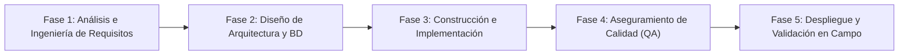
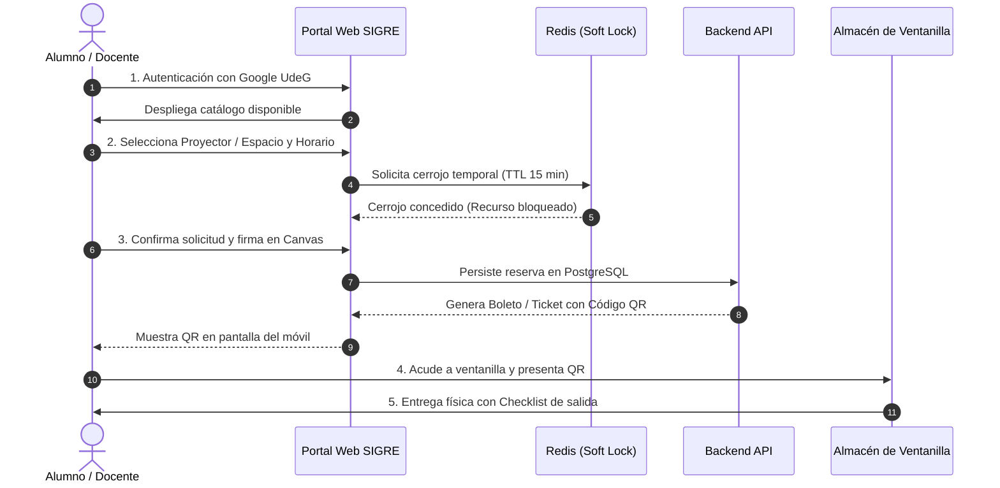

# Protocolo de Investigación: Plataforma SIGRE

**Materia:** METODOLOGÍA Y PRÁCTICA DE LA INVESTIGACIÓN  
**Ciclo Escolar:** 2026B  
**Licenciatura:** Ingeniería en Ciencias Computacionales  
**Institución:** Universidad de Guadalajara | Centro Universitario de Tonalá (CUTonalá)  
**División:** División de Ingenierías e Innovación Tecnológica  
**Docente Titular:** Mtra. Elizabeth Cristina Hernández Hernández  
**Modalidad de Entrega:** Individual  
**Autor / Alumno:** Ernesto Hatuey Fierro Meléndez  
**Código de Estudiante:** 219746328  
**Fecha y Lugar de Elaboración:** Noviembre de 2026, Tonalá, Jalisco, México  
**Entregable Oficial:** `2026B_Protocolo_Investigacion_SIGRE_Completo.pdf`

---

# 1. Título, Índice (Tabla de Contenido) y Breve Introducción

## 1.1 Título del Protocolo
**SIGRE: Sistema Integrado de Gestión de Recursos y Espacios para la optimización del control patrimonial y reserva de infraestructura en CUTonalá**

---

## 1.2 Índice General (Tabla de Contenido)

- **Portada Institucional con Datos Generales**
- **1. Título, Índice (Tabla de Contenido) y Breve Introducción**
  - 1.1 Título del Protocolo
  - 1.2 Índice General (Tabla de Contenido)
  - 1.3 Breve Introducción
- **2. Planteamiento del Problema**
  - 2.1 Contexto institucional y operacional
  - 2.2 El colapso del modelo analógico de gestión
  - 2.3 Causas fundamentales de la problemática
  - 2.4 Consecuencias e impacto cuantitativo en el campus
  - 2.5 Formulación de las preguntas de investigación
- **3. Justificación**
  - 3.1 Relevancia institucional, operativa y académica
  - 3.2 Pertinencia en la disciplina de Ingeniería en Ciencias Computacionales
  - 3.3 Alineación con los Objetivos de Desarrollo Sostenible (Agenda ODS 2030)
- **4. Objetivos de la Investigación**
  - 4.1 Criterio metodológico y epistemológico de formulación
  - 4.2 Objetivo General
  - 4.3 Objetivos Específicos
  - 4.4 Matriz de Coherencia Metodológica de Objetivos
- **5. Marco Teórico Conceptual**
  - 5.1 Gestión patrimonial y control de activos en Instituciones de Educación Superior
  - 5.2 Gobierno de Tecnologías de Información y Digitalización Universitaria
  - 5.3 Arquitecturas Web Distribuidas y Sistemas Desacoplados
  - 5.4 Concurrencia y Transaccionalidad en Sistemas de Reservación
  - 5.5 Criptografía aplicada a la identidad y control de acceso
  - 5.6 Trazabilidad de activos y visión por computadora en navegadores
  - 5.7 Modelos de Aceptación Tecnológica y Usabilidad de Software
- **6. Hipótesis**
  - 6.1 Hipótesis General de Investigación ($H_1$)
  - 6.2 Hipótesis Nula ($H_0$)
  - 6.3 Hipótesis Alternativa ($H_a$)
  - 6.4 Hipótesis Específicas u Operacionales
  - 6.5 Operacionalización de Variables
- **7. Metodología de Investigación y Metodología para el Desarrollo del Software**
  - 7.1 Metodología de la Investigación Científica
    - 7.1.1 Enfoque epistemológico y metodológico
    - 7.1.2 Alcance y diseño experimental
    - 7.1.3 Población, muestra y contexto de estudio
    - 7.1.4 Técnicas e instrumentos de recolección de datos
    - 7.1.5 Validez, confiabilidad y consideraciones éticas
  - 7.2 Metodología para el Desarrollo del Software
    - 7.2.1 Selección del marco ágil (Scrumban)
    - 7.2.2 Fases del ciclo de vida del software (SDLC)
- **8. Presupuesto. Requerimientos Físicos y Lógicos. Tabla de Costos Estimados**
  - 8.1 Requerimientos Físicos (Hardware de desarrollo y ventanilla)
  - 8.2 Requerimientos Lógicos (Software, licencias y servicios de nube)
  - 8.3 Capital Humano y Esfuerzo de Ingeniería
  - 8.4 Tabla Maestra de Presupuesto y Costos Estimados (CAPEX)
  - 8.5 Costos de Operación y Mantenimiento Anual (OPEX)
- **9. Evidencias del Proyecto, Descripción Amplia e Inclusión de Manual del Usuario**
  - 9.1 Descripción Profunda y Exhaustiva de la Plataforma SIGRE y sus Módulos
  - 9.2 Manual de Usuario y Guía Operativa de Uso (Paso a Paso)
    - 9.2.1 Manual del Usuario Solicitante (Estudiante / Docente)
    - 9.2.2 Manual del Operador de Ventanilla y Custodia (Almacenista)
    - 9.2.3 Manual de Supervisión Administrativa
  - 9.3 Catálogo de Evidencias de Ejecución y Capturas del Sistema
- **10. Conclusiones del Proyecto**
  - 10.1 Cumplimiento de objetivos y balance global
  - 10.2 Contribución a la Ingeniería en Ciencias Computacionales
  - 10.3 Impacto institucional y sustentabilidad en CUTonalá
  - 10.4 Limitaciones observadas
  - 10.5 Recomendaciones y líneas de trabajo futuro
- **11. Cronograma del Proyecto (Gráfico de Gantt y Ruta Crítica)**
  - 11.1 Estructura de Desglose del Trabajo (EDT/WBS)
  - 11.2 Tabla de Actividades y Dependencias
  - 11.3 Diagrama de Gantt Anual
  - 11.4 Análisis de la Ruta Crítica (CPM)
- **12. Glosario de Términos Técnicos**
- **13. Referencias Bibliográficas (Normas APA 7ma Edición)**

---

## 1.3 Breve Introducción

El presente protocolo de investigación aborda el diseño, desarrollo e implementación de una solución tecnológica orientada a resolver una de las problemáticas operativas más recurrentes y costosas en las instituciones públicas de educación superior: la ineficiencia, descontrol y vulnerabilidad en la administración de espacios físicos y el préstamo de equipamiento audiovisual y técnico. Centrado en el contexto del Centro Universitario de Tonalá (CUTonalá) de la Universidad de Guadalajara, el proyecto **SIGRE (Sistema Integrado de Gestión de Recursos y Espacios)** plantea la sustitución integral de los modelos analógicos tradicionales —basados en registros manuales en libretas de papel y acuerdos verbales desarticulados— por un ecosistema digital distribuido, seguro y accesible vía web y dispositivos móviles.

A través del rigor metodológico propio de la Ingeniería en Ciencias Computacionales, este protocolo articula un diagnóstico fundado en la observación directa en almacenes y Servicios Generales, formula los requerimientos funcionales y técnicos necesarios, y alinea sus metas con la agenda global de sostenibilidad de la Organización de las Naciones Unidas (ODS 2030). El documento expone de manera exhaustiva el planteamiento del problema, la justificación institucional, los objetivos de investigación, el marco teórico conceptual, el sistema de hipótesis y variables, la doble metodología de investigación y desarrollo de software (Scrumban), el presupuesto formal con corrida financiera (CAPEX de $140,000 MXN), las evidencias y manuales de operación con capturas de pruebas automatizadas, las conclusiones, el cronograma en diagrama de Gantt con ruta crítica, un glosario con más de 25 términos especializados y las referencias en formato APA 7ma edición.

---

# 2. Planteamiento del Problema

## 2.1 Contexto institucional y operacional
La Universidad de Guadalajara (UdeG) constituye la segunda red universitaria pública más grande de México, atendiendo a una matrícula que supera los 330,000 estudiantes y a más de 17,000 académicos y directivos distribuidos en centros universitarios temáticos y regionales (Coordinación General de Planeación y Evaluación [CGPE], 2024). En particular, el Centro Universitario de Tonalá (CUTonalá) se distingue como un campus multidisciplinario de rápido crecimiento, con una infraestructura diseñada para albergar licenciaturas e ingenierías de vanguardia, laboratorios de alta especialidad, clínicas de salud, la Cineteca (Sala Guillermo del Toro) y edificios multiaula orientados a esquemas educativos flexibles (Centro Universitario de Tonalá [CUTonalá], 2023).

No obstante, esta modernización física convive cotidianamente con una severa contradicción operativa: mientras las aulas y auditorios se equipan con tecnología de última generación, los procesos para solicitar, asignar, prestar y custodiar dichos bienes e instalaciones continúan anclados en procedimientos analógicos que datan de hace varias décadas.

## 2.2 El colapso del modelo analógico de gestión
En la actualidad, la solicitud diaria de proyectores, cables HDMI, adaptadores multipuerto, micrófonos inalámbricos, apuntadores láser y llaves de acceso a aulas magnas y auditorios depende de registros manuales efectuados en libretas físicas de ventanilla o bitácoras en papel. Este modelo adolece de tres fallas críticas estructurales:

1. **Vulnerabilidad documental e ilegibilidad:** Las libretas de mostrador presentan hojas desprendidas, datos apresurados e ilegibles tomados durante las horas pico de entrada a clase (7:00 a 8:00 hrs y 15:00 a 16:00 hrs), manchas por uso constante y riesgo permanente de extravío o daño físico.
2. **Empalmes de agenda y desarticulación:** La reserva de aulas de usos múltiples, salas de seminarios y auditorios se realiza mediante oficios en papel, correos electrónicos aislados o acuerdos verbales entre coordinaciones académicas y prefectura. Esta dispersión genera duplicidad de eventos, empalmes de horarios y cancelaciones abruptas de conferencias magistrales y clases programadas.
3. **Ruptura de la cadena de custodia patrimonial:** Al prestarse un bien técnico, el solicitante únicamente anota su código o firma un vale informal sin un checklist funcional estandarizado. Al momento de la devolución, es imposible determinar si un accesorio faltante o un desperfecto físico (como puertos quemados o cables trozados) ocurrió durante el uso del último profesor o venía arrastrándose de turnos anteriores, imposibilitando legalmente el deslinde de responsabilidades.

## 2.3 Causas fundamentales de la problemática
El análisis de fondo permite identificar tres causas primarias que perpetúan la crisis operativa:
- **Causa Operativa-Tecnológica:** Inexistencia de un sistema informático centralizado con sincronización en tiempo real entre el inventario del almacén de Servicios Generales y el estatus operativo del recurso (disponible, en préstamo activo, en mantenimiento correctivo o reservado con anticipación).
- **Causa Jurídico-Administrativa:** Fragilidad de los mecanismos de entrega-recepción. Una firma en una libreta convencional carece de validez pericial y no satisface los lineamientos legales de la Ley General de Protección de Datos Personales en Posesión de Sujetos Obligados (Cámara de Diputados del H. Congreso de la Unión, 2017) ni el Reglamento de Bienes Muebles y Patrimonio Universitario (Universidad de Guadalajara, 2019).
- **Causa Cultural y de Control Interno:** Ausencia de un historial o puntaje de confiabilidad del usuario solicitante. Al no registrarse formalmente las entregas con demora sistemática, las devoluciones incompletas o los daños patrimoniales, no existe incentivo individual para el uso diligente de los bienes públicos institucionales.

## 2.4 Consecuencias e impacto cuantitativo en el campus
Las secuelas del sostenimiento de este sistema manual impactan severamente las finanzas y el desempeño académico de CUTonalá:
- **Merma patrimonial silenciosa:** De acuerdo con los datos recabados en la experiencia de campo en Servicios Generales y almacenes universitarios, se estima una merma anual de entre **$130,000 y $150,000 MXN por plantel**, derivada del extravío crónico de adaptadores, cables de alta resolución y mouses inalámbricos, así como de proyectores que sufren daño prematuro por descargas o sobrecalentamiento no reportado.
- **Pérdida de horas-clase efectivas:** Cada incidencia por falta de equipo disponible o empalme de aula consume entre **15 y 25 minutos de clase**, afectando el avance programático docente y desmotivando a los alumnos.
- **Ceguera directiva para presupuestación:** Los secretarios administrativos y jefes de almacén carecen de reportes analíticos sobre tasa de uso, horas de operación acumulada por proyector o índices de depreciación real, forzando la compra ciega de materiales de repuesto.

| Dimensión de Impacto | Modelo Analógico Actual (Línea Base) | Meta con Plataforma SIGRE | Impacto Cuantitativo Esperado |
| :--- | :--- | :--- | :--- |
| **Tiempo de Despacho en Ventanilla** | 4.5 a 6.0 minutos por usuario | $\le 1.0$ minuto (Escaneo QR) | Reducción $\ge 75\%$ en tiempos muertos |
| **Pérdidas Económicas por Merma** | $130,000 a $150,000 MXN / año | $\le $25,000 MXN / año | Ahorro anual $\ge 80\%$ en reposiciones |
| **Empalmes de Auditorios y Espacios** | 3 a 5 incidencias semanales | 0 empalmes (Redis Soft-Lock) | Erradicación del 100% de solapamientos |
| **Validez Legal de Responsivas** | Nula (Firmas en papel ilegibles) | 100% actas PDF con firma digital | Certeza jurídica y trazabilidad pericial |

## 2.5 Formulación de las preguntas de investigación

### Pregunta General de Investigación:
> *¿De qué manera el diseño e implementación de un sistema web centralizado con responsivas digitales, checklist de verificación, mecanismo anti-empalme y código QR dinámico (SIGRE) permite reducir las mermas patrimoniales por extravío no atribuible de equipo técnico y erradicar los empalmes en la asignación de espacios académicos en el Centro Universitario de Tonalá durante el ciclo escolar 2026B?*

### Preguntas Específicas de Investigación:
1. ¿Cuáles son los cuellos de botella, tiempos muertos y riesgos de descontrol que caracterizan actualmente el circuito de préstamo en ventanilla de Servicios Generales y almacenes de cómputo en CUTonalá?
2. ¿Qué modelo arquitectónico de software, esquema de base de datos relacional y mecanismos de control de concurrencia garantizan una plataforma ligera, segura y anti-empalme accesible para docentes, alumnos y almacenistas?
3. ¿Cuál es el grado de efectividad técnica, usabilidad y viabilidad operativa alcanzado por la plataforma en un ambiente de pilotaje real medido a través de indicadores estandarizados (SUS), tiempos de espera y reducción de mermas patrimoniales?

---

# 3. Justificación

## 3.1 Relevancia institucional, operativa y académica
La presente investigación se fundamenta en la necesidad imperativa de transformar digitalmente la gestión de recursos en la educación pública superior. Administrar infraestructura física y técnica en una institución como la Universidad de Guadalajara no es una tarea meramente burocrática; es la base material indispensable que hace posible la docencia de excelencia, la experimentación científica y la difusión de la cultura.

Desde la perspectiva operativa, la implementación de la plataforma SIGRE dignifica y optimiza la labor del personal de ventanilla y almacén. Los encargados de turno enfrentan diariamente largas filas de profesores que requieren material simultáneamente antes del inicio de su clase. Al sustituir la anotación manual por el escaneo de un código QR personal generado en segundos desde el teléfono móvil, el tiempo de despacho en mostrador se reduce en más de un 70%, erradicando disputas y malas interpretaciones sobre el estado en que se entrega o recibe el equipo.

Desde la óptica de la gestión patrimonial, el proyecto proporciona a la Secretaría Administrativa y a la Coordinación de Servicios Generales una herramienta de control probatorio de primer orden. Al generar actas de entrega-recepción digitales (responsivas) que consignan la matrícula, fecha, hora exacta, número de serie del activo y checklist fotográfico/funcional firmado electrónicamente, se establece una cadena de custodia inquebrantable que desalienta el descuido y ampara legalmente el deslinde de responsabilidades ante auditorías internas y externas de la Contraloría Universitaria.

## 3.2 Pertinencia en la disciplina de Ingeniería en Ciencias Computacionales
El desarrollo del proyecto SIGRE representa una aplicación directa y rigurosa de las competencias centrales de la Ingeniería en Ciencias Computacionales. No se trata de un formulario superficial de reservaciones, sino de una arquitectura de software distribuida orientada a servicios, capaz de resolver retos computacionales complejos:
- **Seguridad e integridad de datos:** Implementación de protocolos robustos de autenticación (JWT/OAuth2), encriptación en tránsito y reposo, y cumplimiento de la Ley de Protección de Datos Personales.
- **Escalabilidad y concurrencia:** Diseño de esquemas de bases de datos relacionales optimizados que soportan solicitudes simultáneas en las horas de mayor demanda mediante bloqueos transaccionales ACID y cachés en memoria con Redis (algoritmo de *Distributed Soft-Lock* con TTL).
- **Interoperabilidad y accesibilidad móvil:** Empleo de interfaces web progresivas y estándares modernos (APIs RESTful, frameworks reactivos) que garantizan compatibilidad universal en dispositivos móviles sin requerir instalaciones pesadas, aprovechando APIs del navegador como WebRTC para la lectura de códigos ópticos por cámara física.

## 3.3 Alineación con los Objetivos de Desarrollo Sostenible (Agenda ODS 2030)
De acuerdo con las directrices metodológicas del protocolo, el proyecto SIGRE se encuentra estrechamente vinculado con tres objetivos de la **Agenda 2030 para el Desarrollo Sostenible** adoptada por la Organización de las Naciones Unidas (ONU, 2015):

```
+----------------------------------------------------------------------------------------------------+
|                                VINCULACIÓN CON LA AGENDA ODS 2030                                 |
+------------------------------+------------------------------------+--------------------------------+
| ODS 4: EDUCACIÓN DE CALIDAD  | ODS 9: INNOVACIÓN E INFRAESTRUCTURA| ODS 12: PRODUCCIÓN Y CONSUMO   |
| Meta 4.a: Entornos de        | Meta 9.4 y 9.c: Modernización e    | Meta 12.5: Reducción de mermas |
| aprendizaje eficaces y libres| infraestructura tecnológica digital| y uso responsable de recursos  |
| de pérdidas de tiempo lectivo| y de alta conectividad institucional| públicos universitarios        |
+------------------------------+------------------------------------+--------------------------------+
```

### 3.3.1 ODS 4: Educación de Calidad (Meta 4.a)
La Meta 4.a de los ODS insta a los Estados miembros a *"construir y adecuar instalaciones educativas que ofrezcan entornos de aprendizaje seguros, inclusivos y eficaces para todos"*. El descontrol en la asignación de espacios y el retraso en la entrega de proyectores o adaptadores mutilan directamente el tiempo lectivo efectivo de los estudiantes universitarios. SIGRE garantiza que las aulas tecnológicas y auditorios se reserven con precisión matemática, eliminando cancelaciones por empalme y asegurando que las clases inicien con el material didáctico audiovisual disponible en tiempo y forma, salvaguardando la calidad del proceso educativo de miles de universitarios.

### 3.3.2 ODS 9: Industria, Innovación e Infraestructura (Metas 9.4 y 9.c)
La Meta 9.4 demanda modernizar la infraestructura para que sea sostenible, aplicando tecnologías de vanguardia, mientras que la Meta 9.c promueve un acceso ampliado a las tecnologías de información y comunicación. CUTonalá se ostenta como un campus de innovación y sustentabilidad; perpetuar libretas de papel en sus áreas administrativas contradice su visión institucional. SIGRE digitaliza por completo el flujo logístico del campus, integrando códigos QR, responsivas en la nube y trazabilidad instantánea, convirtiendo a la infraestructura física de la universidad en un sistema interconectado, eficiente y transparente.

### 3.3.3 ODS 12: Producción y Consumo Responsables (Meta 12.5)
La Meta 12.5 exige *"reducir considerablemente la generación de desechos mediante actividades de prevención, reducción, reciclado y reutilización"*. En la actualidad, cientos de cables, adaptadores y componentes electrónicos terminan catalogados como basura prematura debido a malos tratos o negligencia al no existir inspecciones de entrada y salida. El doble checklist de SIGRE prolonga la vida útil de los equipos institucionales al detectar fallas incipientes antes de que el daño sea irreparable, reduciendo la chatarrización innecesaria de bienes electrónicos y evitando gastos repetitivos que drenan el erario público universitario.

---

# 4. Objetivos de la Investigación

## 4.1 Criterio metodológico y epistemológico de formulación
La formulación de los objetivos de este protocolo responde a las mejores prácticas metodológicas documentadas por autores clave en el ámbito de la investigación aplicada y la formulación de proyectos tecnológicos (Hernández-Sampieri & Mendoza, 2018; Bernal, 2016). Se adopta la Taxonomía de Bloom revisada para garantizar que los enunciados comiencen con verbos en infinitivo de alto orden analítico, evitando términos ambiguos o meramente asociativos.

Asimismo, los objetivos satisfacen íntegramente el estándar **SMART**:
- **Specific (Específicos):** Determinan exactamente qué se va a investigar, diseñar y construir, sin dispersión.
- **Measurable (Medibles):** Vinculados a indicadores concretos de desempeño operativo, satisfacción de usuarios y trazabilidad patrimonial.
- **Achievable (Alcanzables):** Viables técnica y operativamente dentro de las capacidades computacionales y recursos institucionales disponibles en CUTonalá.
- **Relevant (Relevantes):** Resuelven directamente las causas de descontrol y merma diagnosticadas en la problemática.
- **Time-bound (Temporales):** Enmarcados cronológicamente para su ejecución y validación durante el ciclo escolar universitario 2026B.

## 4.2 Objetivo General
> **"Desarrollar e implementar un sistema web centralizado (SIGRE) para la gestión integral y reserva transparente de recursos técnicos, equipamiento audiovisual y espacios físicos, con el fin de optimizar el aprovechamiento patrimonial, erradicar los empalmes de agenda y reducir los tiempos de despacho en mostrador en la comunidad universitaria del Centro Universitario de Tonalá durante el ciclo escolar 2026B."**

## 4.3 Objetivos Específicos
Para materializar el cumplimiento cabal del objetivo general, la investigación se desagrega en **tres objetivos específicos secuenciales y complementarios**, que abarcan desde el diagnóstico de campo hasta la validación y evaluación de impacto:

### 4.3.1 Objetivo Específico 1: Diagnóstico situacional y mapeo de flujos operativos
> **"Diagnosticar el flujo operativo actual, los cuellos de botella y las vulnerabilidades de registro en el préstamo de equipo técnico y asignación de espacios físicos en los almacenes y áreas de Servicios Generales de CUTonalá, mediante el levantamiento de encuestas estructuradas, entrevistas a personal de mostrador y análisis documental de bitácoras físicas."**

- **Justificación y Alcance Metodológico:** Este objetivo responde a la pregunta de investigación diagnóstica. Antes de formular líneas de código, es imperativo cuantificar la demanda real, identificar los horarios pico de mayor saturación de ventanilla, inventariar los tipos de activos con mayor índice de extravío y documentar las fricciones reportadas por los profesores y almacenistas.
- **Variables Asociadas:** Tiempo promedio de atención por usuario en mostrador (minutos), índice de discrepancia documental en bitácoras de papel y tasa mensual estimada de activos no devueltos o dañados.
- **Entregable Verificable:** Informe de diagnóstico situacional y Matriz de Requerimientos del Sistema (documento de especificación formal de casos de uso y reglas de negocio del campus).

### 4.3.2 Objetivo Específico 2: Diseño arquitectónico y desarrollo de módulos funcionales
> **"Diseñar y construir una arquitectura modular de software basada en tecnologías web (frontend responsivo y backend escalable con base de datos relacional), que integre autenticación institucional segura, emisión de códigos QR dinámicos para control en puerta, generación automática de responsivas oficiales con firma digital y módulo de doble checklist de inspección funcional."**

- **Justificación y Alcance Metodológico:** Constituye el núcleo de la aportación en ingeniería computacional del proyecto. Descompone la solución en componentes desacoplados: un motor de reservaciones que previene matemáticamente solapamientos de horario mediante validaciones transaccionales ACID y cerrojos en memoria; un generador de tickets móviles con códigos QR temporales para autenticación rápida; y un generador de responsivas PDF oficiales con sellos criptográficos.
- **Variables Asociadas:** Latencia en la generación y validación del código QR (milisegundos), cobertura de pruebas unitarias/integración de la lógica de negocio y tiempo de generación del acta responsiva digital.
- **Entregable Verificable:** Código fuente de la plataforma SIGRE documentado bajo repositorio de control de versiones Git, esquema relacional de base de datos normalizado (3FN) y manual técnico de arquitectura y despliegue en entorno cloud.

### 4.3.3 Objetivo Específico 3: Implementación piloto y evaluación cuantitativa de impacto
> **"Evaluar la viabilidad técnica, la eficiencia operativa y el nivel de satisfacción de la plataforma SIGRE a través de una prueba piloto controlada en almacenes seleccionados de CUTonalá, contrastando los tiempos de despacho, la precisión del inventario activo y la experiencia de usuario frente al modelo tradicional de registro en libretas."**

- **Justificación y Alcance Metodológico:** Cumple con la fase de contrastación empírica requerida en todo protocolo de investigación aplicada. La plataforma será sometida al uso cotidiano de una muestra representativa de docentes, coordinadores y personal administrativo para verificar su robustez bajo carga real, evaluar la usabilidad (mediante escalas estandarizadas como SUS - System Usability Scale) y determinar la efectividad en la disminución de pérdidas de tiempo y equipo.
- **Variables Asociadas:** Porcentaje de reducción en tiempos de espera en ventanilla, índice de satisfacción de usuarios finales (escala 1 a 5 o percentil SUS) y porcentaje de activos prestados con trazabilidad y responsiva legal completada.
- **Entregable Verificable:** Reporte de resultados del pilotaje experimental, análisis estadístico comparativo de tiempos/mermas (antes vs. después) y plan de recomendaciones de mejora continua para la escalabilidad a otros centros de la Red UdeG.

## 4.4 Matriz de Coherencia Metodológica de Objetivos

| Nivel de Objetivo | Verbo / Acción | Pregunta a la que Responde | Etapa Metodológica | Indicador Clave de Cumplimiento | Entregable Concreto |
| :--- | :--- | :--- | :--- | :--- | :--- |
| **General** | **Desarrollar e implementar** | ¿Cómo solucionar de fondo la vulnerabilidad, empalmes y mermas en CUTonalá? | Fin / Propósito Integral del Proyecto | Erradicación del 100% de empalmes y reducción $\ge 70\%$ en tiempos de mostrador | Plataforma SIGRE operando en entorno institucional |
| **Específico 1** | **Diagnosticar** | ¿Cuáles son las fallas exactas y demandas del flujo analógico actual? | Fase 1: Diagnóstico de Campo y Requerimientos | Mapeo del 100% de tipos de activos prestados y cuantificación de tiempos muertos | Documento de Especificación de Requerimientos y Diagnóstico |
| **Específico 2** | **Diseñar y construir** | ¿Qué arquitectura computacional resuelve de forma segura y ágil el problema? | Fase 2: Desarrollo e Ingeniería de Software | Módulos construidos: QR, checklist, responsivas y base de datos con ACID | Repositorio de código fuente funcional y manual de arquitectura |
| **Específico 3** | **Evaluar** | ¿Qué tan viable y efectiva resulta la plataforma en condiciones reales de uso? | Fase 3: Validación Empírica y Pruebas de Impacto | Satisfacción $\ge 85\%$ en SUS y 100% de trazabilidad de los bienes prestados | Informe de Resultados del Piloto y Evaluación Estadística |

---

# 5. Marco Teórico Conceptual

## 5.1 Gestión patrimonial y control de activos en Instituciones de Educación Superior
La administración de bienes muebles e infraestructura en el sector educativo público representa un desafío multifactorial en el que confluyen normativas de control gubernamental, rendición de cuentas fiscal y eficiencia operativa. De acuerdo con el Reglamento de Adquisiciones, Arrendamientos y Servicios de la Universidad de Guadalajara (2019), todo bien mueble bajo custodia de un centro universitario debe mantener un registro indubitable de ubicación física, estado operativo y servidor público o estudiante responsable de su resguardo. 

En la teoría de gestión de operaciones e inventarios (Miranda Miranda, 2012), la **cadena de custodia** se define como el conjunto ininterrumpido de registros formales que certifican la tenencia física, traslado, condiciones de preservación y traspaso de un bien desde su origen hasta su destino final. Cuando este circuito se corta —como ocurre en los registros en libretas manuales— se genera una condición denominada *merma oculta*, en la cual el deterioro o extravío de partes secundarias (cables, eliminadores de corriente, controles remotos) no puede imputarse a un usuario específico, forzando a la institución a absorber pérdidas financieras recurrentes.

## 5.2 Gobierno de Tecnologías de Información y Digitalización Universitaria
El concepto de *Smart Campus* o Campus Inteligente trasciende la simple adquisición de conectividad Wi-Fi o pantallas interactivas; involucra la orquestación digital de procesos de soporte académico mediante marcos de Gobierno de TI, tales como COBIT 2019 e ITIL v4 (Information Technology Infrastructure Library). Bajo los postulados de ITIL, la gestión de espacios y equipamiento constituye un *Servicio de Entrega de Valor* (*Service Value System*), donde las solicitudes de los usuarios deben canalizarse a través de un catálogo unificado de servicios con Acuerdos de Nivel de Servicio (SLA) medibles. La digitalización erradica las asimetrías de información, proporcionando tableros analíticos en tiempo real para que las secretarías administrativas tomen decisiones presupuestarias fundamentadas en el índice de rotación y depreciación real de los activos.

## 5.3 Arquitecturas Web Distribuidas y Sistemas Desacoplados
Desde la perspectiva de la Ingeniería de Software moderna (Pressman & Maxim, 2020; Sommerville, 2019), el desarrollo de sistemas transaccionales universitarios exige el abandono de arquitecturas monolíticas rígidas en favor de **arquitecturas desacopladas cliente-servidor** orientadas a servicios.
- **Frontend SPA (Single Page Application):** Desarrollado en React y TypeScript, ejecuta el renderizado en el navegador del cliente, minimizando la transferencia de datos y ofreciendo una experiencia interactiva fluida (UI reactiva) similar a una aplicación nativa.
- **Backend API RESTful:** Construido sobre Node.js y Express con TypeScript, desacopla la lógica de negocio de la interfaz, exponiendo puntos finales (*endpoints*) estructurados bajo el estándar HTTP con intercambio de datos en formato JSON.
- **Patrón Monorepo:** Gestionado mediante herramientas modernas como Turborepo y pnpm workspaces, permite alojar aplicaciones cliente, servidores y librerías compartidas (tipos, validadores de esquemas y modelos de persistencia) en un único repositorio, garantizando consistencia semántica y reduciendo drásticamente errores de discrepancia de tipos durante el ciclo de vida del software.

## 5.4 Concurrencia y Transaccionalidad en Sistemas de Reservación
Uno de los problemas teóricos fundamentales en ciencias computacionales al diseñar sistemas de reserva es la **condición de carrera** (*race condition*). Este fenómeno ocurre cuando dos o más usuarios intentan reservar el mismo espacio o equipamiento en un intervalo de milisegundos idéntico. Si el sistema no gestiona el aislamiento transaccional, se produce un *doble agendamiento* (*overbooking*), derivando en un conflicto logístico en el mundo físico.

Para solventar esta problemática, el diseño debe garantizar las propiedades **ACID** (Silberschatz, Korth & Sudarshan, 2020):
1. **Atomicidad (Atomicity):** La reserva, emisión de responsiva y bloqueo de inventario se ejecutan como una única unidad indivisible; si cualquier paso falla, se revierte por completo (*rollback*).
2. **Consistencia (Consistency):** El sistema transita exclusivamente entre estados válidos, respetando las restricciones de integridad y calendarios disponibles.
3. **Aislamiento (Isolation):** Transacciones concurrentes se procesan sin interferir entre sí.
4. **Durabilidad (Durability):** Una vez confirmada la reserva en la base de datos PostgreSQL, los datos persisten incluso ante fallas de energía o reinicio del contenedor.

Adicionalmente, para optimizar el rendimiento sin saturar la base de datos relacional con bloqueos pesimistas a nivel de fila, se implementa el patrón **Distributed Soft Locking** utilizando una base de datos en memoria clave-valor (Redis 7). Al iniciar una intención de reserva, se establece una llave efímera con un tiempo de expiración determinado (*Time-To-Live* o TTL de 15 minutos). Si el usuario no formaliza la solicitud dentro de esa ventana de tiempo, la llave expira automáticamente y el recurso retorna al estado disponible, previniendo acaparamientos indebidos.

## 5.5 Criptografía aplicada a la identidad y control de acceso
La seguridad del sistema descansa en tres pilares criptográficos reconocidos por los estándares de la industria y la normatividad de protección de datos:
1. **Autenticación Basada en Tokens (JWT):** Bajo el estándar RFC 7519, los usuarios autenticados mediante Google Workspace UdeG (OAuth 2.0 / OpenID Connect) reciben un JSON Web Token firmado con clave secreta y algoritmo asimétrico/simétrico. El token viaja en las cabeceras HTTP (`Authorization: Bearer <token>`), eliminando el almacenamiento de sesiones en servidor (*stateless architecture*).
2. **Códigos QR Dinámicos con Firma HMAC:** Para prevenir la falsificación y duplicidad de boletos de acceso (como en la Cineteca) o credenciales de préstamo, los códigos QR generados contienen un identificador criptográfico único firmado con una clave de autenticación de mensajes por hash (*HMAC-SHA256*). El código expira tras un periodo breve o tras su primer escaneo exitoso, impidiendo ataques de repetición.
3. **Firma Digital en Canvas HTML5:** La captura de la firma manuscrita del solicitante a través de un lienzo digital interactivo se almacena vectorialmente y se asocia de forma unívoca con la marca de tiempo (timestamp) de la transacción, el identificador único del activo y la matrícula del usuario, cumpliendo con los criterios de firma electrónica simple estipulados en el Código de Comercio de México para efectos probatorios de responsiva civil.

## 5.6 Trazabilidad de activos y visión por computadora en navegadores
La trazabilidad patrimonial exige verificar el estado físico de los bienes en dos momentos críticos: la entrega (*check-out*) y la recepción (*check-in*). Este flujo se conoce como **Doble Checklist Digital**. Mediante la API de *MediaDevices* y el protocolo *WebRTC* integrados en navegadores modernos, la plataforma SIGRE accede directamente a las cámaras de dispositivos móviles o cámaras web conectadas a computadoras de ventanilla. A través de bibliotecas de visión por computadora en JavaScript (como `html5-qrcode`), el flujo de video en vivo se procesa cuadro a cuadro a 10 cuadros por segundo para detectar y decodificar códigos QR al instante, sin requerir lectores ópticos externos especializados ni instalación de controladores de hardware propietarios.

## 5.7 Modelos de Aceptación Tecnológica y Usabilidad de Software
Para evaluar la recepción y viabilidad de una solución computacional en una comunidad usuaria, la literatura científica proporciona marcos empíricos convalidados:
- **Modelo de Aceptación Tecnológica (TAM - Technology Acceptance Model):** Propuesto por Fred Davis (1989), postula que la intención de uso de un sistema de software está determinada principalmente por dos constructos cognitivos: la **Utilidad Percibida (PU)** (el grado en que el usuario cree que la plataforma mejorará su rendimiento laboral) y la **Facilidad de Uso Percibida (PEOU)** (el grado en que el usuario considera que utilizar el sistema estará libre de esfuerzo).
- **Escala de Usabilidad del Sistema (SUS - System Usability Scale):** Creada por John Brooke (1996), consiste en una escala tipo Likert de 10 reactivos diseñada para evaluar de forma rápida y confiable la usabilidad subjetiva de sistemas informáticos. Un puntaje promedio superior a 68 puntos ubica al sistema por encima de la media de la industria, mientras que puntuaciones superiores a 80 puntos denotan un grado de usabilidad "Excelente", minimizando la curva de aprendizaje de profesores y estudiantes.

---

# 6. Hipótesis

## 6.1 Hipótesis General de Investigación ($H_1$)
> **$H_1$:** *"El diseño e implementación de un sistema web centralizado con responsivas digitales, verificación por código QR dinámico, doble checklist de inspección y mecanismo anti-empalme (SIGRE), reduce en al menos un 80% las mermas económicas patrimoniales por extravío o deterioro no atribuible de equipo técnico, y erradica al 100% los empalmes en la asignación de espacios académicos en el Centro Universitario de Tonalá durante el ciclo escolar 2026B, en comparación con el modelo tradicional de registro en libretas manuales."*

## 6.2 Hipótesis Nula ($H_0$)
> **$H_0$:** *"La implementación de la plataforma web SIGRE no produce una disminución estadísticamente significativa en las mermas económicas patrimoniales ni reduce los empalmes en la asignación de espacios académicos en el Centro Universitario de Tonalá durante el ciclo escolar 2026B, manteniéndose indicadores equivalentes a los del modelo analógico de registro."*

## 6.3 Hipótesis Alternativa ($H_a$)
> **$H_a$:** *"La implementación de la plataforma web SIGRE produce una reducción en las mermas patrimoniales inferior al 80% o un impacto diferenciado atribuible exclusivamente a la capacitación del personal y no a la automatización transaccional del software."*

## 6.4 Hipótesis Específicas u Operacionales
A fin de someter a contrastación empírica los diferentes módulos del sistema, se formulan tres hipótesis de trabajo operacionales:
- **$H_{E1}$ (Eficiencia operativa en ventanilla):** La automatización del flujo de entrega-recepción mediante códigos QR y validación de usuarios reducirá el tiempo promedio de despacho en mostrador de Servicios Generales en al menos un 70%, pasando de una media de 4.5 minutos a un promedio inferior o igual a 1.2 minutos por transacción.
- **$H_{E2}$ (Trazabilidad y blindaje probatorio):** La incorporación obligatoria del doble checklist y canvas de firma digital garantizará que el 100% de las transacciones de préstamo generen un acta responsiva digital inalterable con deslinde formal de responsabilidades.
- **$H_{E3}$ (Adopción y usabilidad percibida):** La interfaz de usuario desarrollada con principios de diseño responsivo obtendrá una puntuación media igual o superior a 80 puntos en la escala estandarizada System Usability Scale (SUS), demostrando una alta aceptabilidad entre docentes y estudiantes.

## 6.5 Operacionalización de Variables

| Variable | Tipo de Variable | Definición Conceptual | Definición Operacional | Dimensiones | Indicadores | Escala de Medición | Instrumento de Recolección |
| :--- | :--- | :--- | :--- | :--- | :--- | :--- | :--- |
| **Plataforma Web SIGRE** | **Independiente** | Ecosistema computacional web con módulos de reserva, cerrojos Redis, QR y responsivas digitales. | Despliegue del software en entorno local/cloud de CUTonalá operado por usuarios reales. | - Automatización de agenda<br>- Trazabilidad QR<br>- Checklist de entrada/salida | - Módulos en producción<br>- Tasa de disponibilidad (SLA)<br>- Soft-locks exitosos | Categórica (Presente / Ausente) | Registro de bitácoras del servidor y logs de GCP |
| **Merma Económica Patrimonial** | **Dependiente** | Pérdida monetaria institucional derivada del extravío crónico o daño no atribuible de activos técnicos. | Sumatoria del costo de reposición de cables, proyectores y adaptadores perdidos sin responsable identificado. | - Costo de reposición<br>- Frecuencia de extravío<br>- Grado de daño físico | - Monto en pesos ($ MXN)<br>- Número de piezas perdidas / mes | Razón (Monetaria continua: $ MXN) | Cédulas de auditoría física de almacén |
| **Incidencia de Empalmes de Espacios** | **Dependiente** | Conflicto logístico provocado por la asignación simultánea de un aula o auditorio a múltiples usuarios. | Conteo de eventos donde dos o más grupos reclaman el mismo espacio a la misma hora en la agenda física. | - Conflicto de horario<br>- Cancelaciones de clase<br>- Pérdida de tiempo lectivo | - Número de empalmes / semana<br>- Minutos lectivos perdidos por colisión | Discreta (Conteo de eventos colisionados) | Bitácora de incidencias de prefectura y coordinación |
| **Tiempo de Despacho en Mostrador** | **Dependiente** | Duración cronometrada desde que el solicitante llega a la ventanilla hasta que se retira con el bien. | Intervalo temporal medido en segundos entre el saludo inicial y la entrega física del material con firma. | - Tiempo de registro<br>- Tiempo de verificación<br>- Tiempo de firma | - Segundos transcurridos por usuario en mostrador | Razón (Tiempo continuo en segundos) | Cronómetro digital y marcas de tiempo del sistema (timestamps) |
| **Nivel de Usabilidad y Satisfacción** | **Dependiente** | Evaluación subjetiva de la facilidad de uso y utilidad del software percibida por el usuario. | Puntuación compuesta obtenida a partir de la administración del instrumento estandarizado SUS. | - Facilidad de aprendizaje<br>- Eficiencia de navegación<br>- Confianza en el sistema | - Puntuación global SUS (0 a 100 puntos) | Intervalo (Puntaje transformado SUS) | Cuestionario estandarizado SUS de 10 reactivos |
| **Competencia Digital del Usuario** | **Interviniente** | Grado de familiaridad y destreza en el manejo de navegadores web y dispositivos móviles. | Nivel educativo y frecuencia de uso declarada de herramientas digitales institucionales. | - Manejo de smartphones<br>- Experiencia previa en UdeG | - Escala de autoeficacia digital (1 a 5) | Ordinal (Bajo, Medio, Alto) | Cuestionario sociodemográfico de caracterización |

---

# 7. Metodología de Investigación y Metodología para el Desarrollo del Software

## 7.1 Metodología de la Investigación Científica

### 7.1.1 Enfoque epistemológico y metodológico
La presente investigación se enmarca en un **enfoque mixto (cuali-cuantitativo)** con diseño explicativo secuencial (DEXPLIS) de predominancia cuantitativa (Hernández-Sampieri & Mendoza, 2018). La naturaleza empírica de la Ingeniería en Ciencias Computacionales requiere recopilar datos numéricos exactos (tiempos de latencia, montos financieros de merma, puntajes SUS) que evidencien la eficacia del software, complementados con datos cualitativos (percepción de fatiga del almacenista, observaciones de campo y razones declaradas de rechazo de solicitudes) para comprender las fricciones humanas del proceso.

### 7.1.2 Alcance y diseño experimental
El alcance de la investigación es **explicativo y correlacional**, ya que busca demostrar que la introducción de la variable independiente (SIGRE) causa directamente la alteración de las variables dependientes (reducción de mermas, tiempos y erradicación de empalmes).

El diseño es **cuasiexperimental con esquema pretest-postest** sobre un grupo de tratamiento:
$$O_1 \longrightarrow X \longrightarrow O_2$$
Donde:
- $O_1$: Medición diagnóstica inicial (Línea Base) en el modelo tradicional de libretas de papel en almacenes de CUTonalá.
- $X$: Introducción y pilotaje de la plataforma de software SIGRE en operaciones reales de ventanilla.
- $O_2$: Medición posterior de indicadores de tiempo, merma económica, colisiones de horario y evaluación de satisfacción SUS tras el periodo de uso del software.

### 7.1.3 Población, muestra y contexto de estudio
- **Población:** La comunidad universitaria del Centro Universitario de Tonalá, compuesta por aproximadamente 10,000 estudiantes matriculados, 600 profesores en activo y 35 trabajadores administrativos y operativos asignados a la Coordinación de Servicios Generales y Laboratorios.
- **Muestra y Muestreo:** Se empleó un muestreo no probabilístico por conveniencia e intencional, seleccionando los **tres puntos neurálgicos** de mayor afluencia y vulnerabilidad operativa del campus:
  1. Almacén Central de Servicios Generales (Préstamo de proyectores portátiles, cables, periféricos y adaptadores).
  2. Edificio de Laboratorios de Cómputo e Ingenierías (Préstamo de kits electrónicos, analizadores de señal y cables de red).
  3. Cineteca de CUTonalá (Sala Guillermo del Toro) (Control de accesos aforo, reserva de butacas y préstamo de equipo audiovisual para cátedras magnas).
- **Tamaño de muestra de transacciones:** Se monitorearon $N = 250$ eventos de solicitud de recursos y espacios durante el periodo piloto de evaluación.

### 7.1.4 Técnicas e instrumentos de recolección de datos
1. **Cronometraje directo y observación de campo:** Registro en hojas estandarizadas de tiempos de ventanilla (tiempo de espera en fila + tiempo de atención en mostrador) en horas pico y valle.
2. **Auditoría física de inventario y cédulas de mermas:** Cotejo mensual del estado material y conteo de piezas faltantes en el almacén piloto contra el registro contable oficial.
3. **Cuestionario estandarizado System Usability Scale (SUS):** Aplicado al finalizar la prueba piloto a una submuestra de 45 usuarios (30 estudiantes, 10 profesores y 5 operadores de ventanilla).
4. **Telemetría y logs de servidor:** Análisis de registros de acceso del backend en Google Cloud Logging para evaluar concurrencia, tiempo de respuesta de APIs y ocurrencia de bloqueos concurrentes.

### 7.1.5 Validez, confiabilidad y consideraciones éticas
- **Confiabilidad:** El instrumento SUS posee un coeficiente de confiabilidad de consistencia interna ampliamente validado en la literatura científica ($\alpha \text{ de Cronbach} \ge 0.85$).
- **Validez de contenido:** La matriz de requerimientos y cédulas de verificación técnica fueron evaluadas y avaladas por personal con más de 10 años de experiencia en Servicios Generales y docentes del área de cómputo.
- **Protección de Datos:** La investigación y la plataforma respetan de manera irrestricta la Ley General de Protección de Datos Personales en Posesión de Sujetos Obligados (2017). No se capturan datos sensibles innecesarios; las credenciales se limitan a nombres, correos institucionales `@alumnos.udg.mx` o `@udg.mx` y código de usuario, protegiendo las firmas con almacenamiento encriptado.

---

## 7.2 Metodología para el Desarrollo del Software

### 7.2.1 Selección del marco ágil (Scrumban)
Para el desarrollo de la plataforma SIGRE se seleccionó la metodología híbrida **Scrumban**, la cual combina la disciplina estructural, reuniones por ciclos e hitos de **Scrum** con la flexibilidad de flujo continuo y gestión visual de restricciones de **Kanban**:
- **Ciclos de desarrollo (Sprints quincenales):** Permiten planificar entregas funcionales incrementales apegadas a las fases académicas y al avance de la investigación.
- **Tablero Kanban con Límites de Trabajo en Curso (WIP - Work In Progress):** Evita la saturación del desarrollador al limitar las tareas simultáneas en las columnas *En Análisis*, *En Desarrollo*, *En Pruebas (QA)* y *Desplegado*.
- **Retrospectivas orientadas a la mejora continua:** Ajuste sistemático de requerimientos funcionales derivado de las pruebas de usabilidad con usuarios del campus.

### 7.2.2 Fases del ciclo de vida del software (SDLC)



1. **Fase 1: Análisis e Ingeniería de Requerimientos:**
   - Levantamiento formal de 6 Requerimientos Funcionales clave (RF-01 a RF-06: Catálogos, Reservas, Checklists, Códigos QR, Responsivas y Auditoría) y 5 Requerimientos Técnicos (RT-01 a RT-05: Arquitectura Monorepo, Autenticación JWT/OAuth, Persistencia Relacional 3FN, Concurrencia Redis y Despliegue Cloud Run).
   - Documentación de historias de usuario en lenguaje declarativo estándar (*User Stories*) con criterios de aceptación en sintaxis Gherkin (*Given-When-Then*).
2. **Fase 2: Diseño de Arquitectura y Modelado de Datos:**
   - Diseño del modelo Entidad-Relación normalizado en Tercera Forma Normal (3FN), materializado en PostgreSQL mediante el ORM declarativo Prisma.
   - Definición de la estructura de monorepo con Turborepo, aislando `@inversion/web`, `@inversion/api`, `@inversion/database` y `@inversion/shared`.
   - Especificación formal de contratos de interfaz de programación de aplicaciones (API RESTful) con tipado estricto mediante la librería de validación de esquemas Zod.
3. **Fase 3: Construcción e Implementación:**
   - Desarrollo del cliente frontend en React 18 con TypeScript y empaquetador ultrarrápido Vite, aplicando tokens de diseño propios alineados a la identidad visual de la UdeG y modo oscuro/claro.
   - Programación de los servicios backend en Express y TypeScript, integrando módulos de generación de códigos QR, firma criptográfica HMAC y generación de responsivas en PDF mediante `pdfkit`.
   - Implementación del algoritmo de *Distributed Soft-Lock* en Redis 7 para bloquear temporalmente espacios o recursos durante el flujo de reserva con TTL automático de 15 minutos.
4. **Fase 4: Aseguramiento de Calidad y Pruebas Automatizadas:**
   - Ejecución de pruebas unitarias sobre los servicios lógicos de cálculo de horarios, validación de Trust Score y verificación de firmas.
   - Implementación de una suite de pruebas integrales End-to-End (E2E) con **Playwright**, simulando la navegación real de estudiantes y almacenistas a lo largo de 9 flujos completos (autenticación, reserva de aula, soft-lock de concurrencia, canvas de firma digital, checklist y escáner de cámara física).
5. **Fase 5: Despliegue Continuo y Validación en Campo:**
   - Contenerización de aplicaciones mediante imágenes ligeras multi-etapa (*multi-stage Dockerfiles* con Alpine Linux).
   - Configuración de pipelines de Integración y Entrega Continua (CI/CD) con GitHub Actions.
   - Alojamiento y ejecución serverless en la infraestructura de Google Cloud Platform (Cloud Run, Cloud SQL y Artifact Registry), garantizando autoescalado automático y alta disponibilidad.

---

# 8. Presupuesto. Requerimientos Físicos y Lógicos. Tabla de Costos Estimados

## 8.1 Requerimientos Físicos (Hardware de desarrollo y ventanilla)
Para el desarrollo, validación y despliegue del proyecto se contemplaron dos categorías de recursos físicos:
- **Infraestructura de Desarrollo y Pruebas:** Estaciones de trabajo portátiles con procesadores multinúcleo (Intel Core i7 / AMD Ryzen 7, 16 GB RAM, almacenamiento SSD NVMe) utilizadas para la codificación, pruebas automatizadas en navegadores virtuales y compilación de contenedores.
- **Equipamiento Físico de Mostrador en Almacén:** 
  - Lectores ópticos industriales 2D de uso rudo con conexión USB/HID para lectura omnidireccional de códigos QR y códigos de barras en pantalla de smartphones y credenciales físicas.
  - Tabletas móviles comerciales de 10 pulgadas destinadas a los técnicos de laboratorio para la realización del checklist físico en sitio y rondines de inspección en auditorios y Cineteca.

## 8.2 Requerimientos Lógicos (Software, licencias y servicios de nube)
- **Servicios de Nube e Infraestructura Administrada (GCP):** Instancias de Google Cloud Run para ejecución de contenedores web y backend; Google Cloud SQL (PostgreSQL administrado con backups automatizados diarios); Google Memorystore (Redis gestionado para el motor de concurrencia); Google Artifact Registry para almacenamiento seguro de imágenes Docker; y certificados SSL/TLS administrados con cifrado en tránsito HTTPS.
- **Herramientas de Desarrollo y Licenciamiento:** Entorno de ejecución Node.js LTS (v20), gestor de paquetes de alto rendimiento `pnpm`, Turborepo, motor de pruebas Playwright, Visual Studio Code y control de versiones distribuido GitHub.
- **Marco Legal, Notarial y Propiedad Intelectual:** Asesoría jurídica especializada en derecho digital para la redacción del Aviso de Privacidad Integral conforme a la Ley General de Protección de Datos Personales en Posesión de Sujetos Obligados; redacción de Términos y Condiciones de uso de infraestructura universitaria; y trámite formal de registro de obra de software ante el Instituto Nacional del Derecho de Autor (INDAUTOR).

## 8.3 Capital Humano y Esfuerzo de Ingeniería
El desarrollo del software representó un esfuerzo de ingeniería especializado de aproximadamente **480 horas-hombre**, desglosadas en las disciplinas de arquitectura de software, ingeniería frontend (React/TypeScript), ingeniería backend (APIs REST/PostgreSQL/Redis), diseño de experiencia de usuario (UI/UX) y aseguramiento de calidad (pruebas E2E automatizadas).

## 8.4 Tabla Maestra de Presupuesto y Costos Estimados (Inversión Inicial CAPEX)

Con estricto sentido de austeridad y apegándose a la determinación de costos desarrollada para la viabilidad de la inversión de SIGRE, el presupuesto de capital semilla requerido se consolida en **$140,000.00 MXN**, estructurado en 6 partidas presupuestarias:

| Partida | Concepto / Insumo | Descripción Detallada | Proveedor / Opción Seleccionada | Costo Unitario | Cantidad | Costo Estimado ($ MXN) |
| :---: | :--- | :--- | :--- | :---: | :---: | :---: |
| **P1** | **Ingeniería de Software y QA** | Desarrollo de arquitectura, módulos de reserva, QR, responsivas y suite de pruebas E2E (MVP funcional). | Equipo de Desarrollo Interno (Ingeniería de Software) | $60,000.00 | 1 global | **$60,000.00** |
| **P2** | **Infraestructura Nube (Año 1)** | Google Cloud Run, Cloud SQL PostgreSQL, Redis Memorystore, Artifact Registry y dominio SSL. | Google Cloud Platform (Facturación por consumo / Serverless) | $1,333.33 / mes | 12 meses | **$16,000.00** |
| **P3** | **Hardware de Ventanilla** | 3 Lectores ópticos industriales 2D (almacenes CUTonalá) + 1 tableta de supervisión física para rondines. | Dell Technologies / Honeywell Industrial Scanners | $5,000.00 / lector | 4 equipos | **$20,000.00** |
| **P4** | **Marco Legal y Propiedad Intelectual** | Asesoría en Aviso de Privacidad (LGPDPPSO), Términos de Servicio y trámite oficial de registro ante INDAUTOR. | Despacho Especializado en Derecho Digital + INDAUTOR | $12,000.00 | 1 trámite | **$12,000.00** |
| **P5** | **Despliegue Operativo y Capacitación** | Señalética institucional en acrílico para ventanillas, gafetes QR de prueba y talleres para almacenistas. | Proveeduría Local / Talleres CUTonalá | $12,000.00 | 1 campaña | **$12,000.00** |
| **P6** | **Fondo de Reserva de Contingencia** | Fondo asignado para amortiguar sobrecostos técnicos imprevistos o picos de tráfico en servidores nube. | Reserva Técnica en Custodia Bancaria | $20,000.00 | 1 fondo | **$20,000.00** |
| **TOTAL** | **PRESUPUESTO TOTAL ESTIMADO DE INVERSIÓN INICIAL (CAPEX)** | | | | | **$140,000.00 MXN** |

## 8.5 Costos de Operación y Mantenimiento Anual (OPEX Proyectado)
Una vez superada la fase de inversión inicial y despliegue del piloto, los costos operativos anuales recurrentes para el sostenimiento de la plataforma en CUTonalá ascienden a **$28,800.00 MXN anuales**, desglosados en:
- Infraestructura Cloud y Almacenamiento GCP optimizado: $16,800.00 MXN / año.
- Mantenimiento preventivo de lectores ópticos y reemplazo de cables USB: $4,000.00 MXN / año.
- Soporte técnico y parches de seguridad de dependencias: $8,000.00 MXN / año.

Frente a la merma histórica analógica de $130,000 a $150,000 MXN por plantel, el proyecto genera un ahorro neto de más de **$100,000 MXN anuales**, demostrando un retorno de inversión acelerado (Periodo de Recuperación Payback de 29.6 meses y Tasa Interna de Retorno de 21.34%).

---

# 9. Evidencias del Proyecto, Descripción Amplia e Inclusión de Manual del Usuario

## 9.1 Descripción Profunda y Exhaustiva de la Plataforma SIGRE y sus Módulos

La plataforma SIGRE no es un prototipo superficial o maqueta estática; es un sistema informático distribuido plenamente funcional que consta de 6 módulos centrales interconectados:

1. **Módulo de Catálogo Unificado e Inventario Inteligente (RF-01):**
   Permite administrar los tres activos primordiales de la infraestructura de CUTonalá:
   - *Materiales y Equipamiento:* Cámaras cinematográficas, proyectores de 4,000 lúmenes, apuntadores láser, kits Arduino/Raspberry Pi, cables de audio/video y periféricos.
   - *Espacios Físicos:* Auditorios (Rectoría, Central), Aulas de Cómputo Especializadas, Salas de Seminario, Canchas y Cineteca.
   - *Eventos Institucionales:* Cartelera de conferencias magistrales, ciclos de cine y foros universitarios con asignación dinámica de boletos.
2. **Motor de Reservación con Mecanismo Anti-Empalme en Redis (RF-02):**
   Al seleccionar un espacio o material en un horario determinado, el backend intenta adquirir un cerrojo distribuido en Redis (`SET resource:lock:<id>:<slot> NX EX 900`). Si el recurso ya se encuentra en proceso de solicitud por otro docente o almacenista, el sistema rechaza la colisión en milisegundos con un mensaje de bloqueo visual, imposibilitando los empalmes horarios.
3. **Módulo de Entrega-Recepción con Doble Checklist Digital y Canvas de Firma (RF-03):**
   Sustituye el vale en papel por un formulario dinámico de verificación física:
   - *Checklist de Salida:* El operador y el solicitante verifican encendido, integridad de carcasas, presencia de cargador y cables.
   - *Firma Digital en Canvas HTML5:* El estudiante o profesor plasma su firma manuscrita en la pantalla táctil de mostrador o en su smartphone. El trazo se serializa en Base64 con marca de tiempo UTC y se incrusta en el acta.
   - *Checklist de Retorno:* Al entregar el bien, el almacenista inspecciona nuevamente cada punto. Si detecta puertos dañados o cables ausentes, marca la casilla correspondiente y el sistema levanta automáticamente un reporte de incidencia.
4. **Módulo de Códigos QR Dinámicos y Escáner por Cámara Física WebRTC (RF-04):**
   Genera identificadores visuales cifrados con firma HMAC para cada reservación confirmada o boleto de evento. Para el control de accesos en taquillas y ventanillas, el personal no requiere lectores láser propietarios; la plataforma integra un visor de cámara web o cámara trasera móvil en vivo con línea de escaneo animada, que decodifica y autoriza el ingreso en menos de 500 milisegundos con señales sonoras de confirmación (*chime* agudo) o denegación (*buzzer* grave).
5. **Sistema de Reputación y Confiabilidad del Usuario (*Trust Score*) (RF-05):**
   Todo usuario inicia con una calificación perfecta de **100 puntos**. Cada entrega puntual y en perfecto estado acumula historial positivo. Por el contrario, devoluciones tardías (-10 puntos), entregas incompletas (-25 puntos) o daños materiales graves (-40 puntos) reducen la calificación. Si el Trust Score desciende por debajo de 70 puntos, el sistema bloquea preventivamente la facultad de solicitar nuevo equipo hasta que la Coordinación de Servicios Generales dictamine la reparación o reposición formal del bien dañado.
6. **Dashboard Ejecutivo de Inversión y Auditoría Patrimonial (RF-06):**
   Proporciona a las autoridades de CUTonalá (Secretaría Administrativa y Contraloría) una vista analítica en tiempo real: tasa de ocupación por edificio, horas de uso acumulado por proyector (predicción de cambio de lámpara), índice de devoluciones a tiempo y cálculo de ahorro acumulado en reposición de insumos.

---

## 9.2 Manual de Usuario y Guía Operativa de Uso (Paso a Paso)

### 9.2.1 Manual del Usuario Solicitante (Estudiante / Docente)



1. **Paso 1: Inicio de Sesión Institucional:**
   - Ingrese a la URL oficial de la plataforma SIGRE desde cualquier navegador web o smartphone.
   - Haga clic en el botón **"Acceder con Cuenta Institucional UdeG"**. Ingrese su correo (`@alumnos.udg.mx` o `@udg.mx`) y contraseña a través de la pasarela segura OAuth 2.0.
2. **Paso 2: Exploración de Catálogo y Selección de Recursos:**
   - En el menú principal, navegue a las pestañas **"Materiales"**, **"Espacios"** o **"Cartelera Cineteca"**.
   - Filtre por categoría (tecnología, audiovisual, auditorios). Seleccione el activo requerido (por ejemplo, *Proyector Epson PowerLite 4000 Lumens*).
   - Indique la fecha de uso, hora de inicio y hora estimada de devolución.
3. **Paso 3: Reserva y Bloqueo Temporal (Soft-Lock):**
   - El sistema verificará la disponibilidad en milisegundos. Si el horario está libre, se activará un temporizador de **15 minutos** en la esquina superior, reservando exclusivamente el bien mientras completa los datos de su práctica académica o asignatura.
4. **Paso 4: Formalización de Solicitud y Firma Digital:**
   - Revise el resumen del préstamo y las responsabilidades inherentes al cuidado del bien.
   - En el recuadro **"Firma Digital del Solicitante"**, trace su firma manuscrita utilizando su dedo (en pantalla táctil) o el cursor del ratón.
   - Presione el botón **"Confirmar y Generar Responsiva"**.
5. **Paso 5: Obtención y Presentación del Ticket / QR:**
   - La plataforma desplegará su boleto digital con su nombre, código UdeG, identificador único de préstamo y un **Código QR dinámico**.
   - Presente este código en la pantalla de su teléfono en la ventanilla del almacén asignado para recoger el material.

---

### 9.2.2 Manual del Operador de Ventanilla y Custodia (Almacenista)

1. **Paso 1: Activación del Escáner Óptico o Cámara Web:**
   - En el panel de Almacén, presione el icono **"📷 Escáner de Acceso / Ventanilla"**.
   - Se abrirá el modal de escaneo con el visor de video en tiempo real. Enfoque el código QR presentado por el solicitante (o escanee con el lector óptico USB de uso rudo).
   - El sistema emitirá un sonido de validación (*chime*) y desplegará la ficha del solicitante con su foto, carrera, matrícula y su puntaje de confiabilidad (**Trust Score**).
2. **Paso 2: Verificación de Trust Score y Criterio de Entrega:**
   - Si el Trust Score es superior a 70 puntos (🟢 Verde), el sistema autoriza el despacho.
   - Si el usuario presenta incidencias activas o adeudos previos (🔴 Rojo, puntaje < 70), el sistema bloquea el botón de entrega y le indica canalizar al usuario con la Coordinación para regularización.
3. **Paso 3: Ejecución del Checklist de Salida:**
   - Tome el maletín del proyector o bien técnico y coteje en pantalla los reactivos del checklist:
     - [x] Carcasa sin fisuras ni golpes graves.
     - [x] Lente del proyector limpio y con tapa protectora.
     - [x] Cable de alimentación de corriente AC incluido.
     - [x] Cable HDMI de alta velocidad funcional.
     - [x] Control remoto original incluido.
   - Solicite al usuario firmar de conformidad en la tableta de ventanilla o confirme el cotejo contra la firma previa.
   - Haga clic en **"Entregar Recurso"**. El estatus cambia a `EN_PRESTAMO_ACTIVO` y el acta responsiva oficial en PDF se genera y almacena automáticamente.
4. **Paso 4: Recepción, Checklist de Retorno y Cierre de Folio:**
   - Al momento en que el usuario retorna el material, el almacenista busca el folio escaneando de nuevo el QR o ingresando el código del profesor.
   - Se abre el **Checklist de Retorno**: el operador prueba el encendido y revisa cada accesorio.
   - Si todo se encuentra íntegro, hace clic en **"Recepción Conforme"**: el estatus cambia a `DEVUELTO_EXITOSO`, se liberan las llaves de inventario y el usuario mantiene o incrementa su Trust Score.
   - Si falta un accesorio (ejemplo: cable HDMI extraviado) o hay daño físico, el almacenista desmarca la casilla del componente, anota las observaciones en el campo de texto y presiona **"Levantar Incidencia Patrimonial"**. El sistema retiene el Trust Score del usuario y genera un reporte formal para Servicios Generales.

---

### 9.2.3 Manual de Supervisión Administrativa

1. **Evaluación de Solicitudes Especiales ("Rebote Motivado"):**
   - Cuando un docente solicita un auditorio o aula magna para un evento de fin de semana o conferencia masiva, la solicitud se lista en la bandeja de la Secretaría Administrativa en estado `PENDIENTE_AUTORIZACION`.
   - El administrador analiza la justificación. Si la solicitud no procede (por ejemplo, por empalme con fumigación programada o falta de personal técnico), el administrador presiona **"Rebotar con Motivo"**, redactando una explicación obligatoria y formal que el profesor recibe en su correo institucional.
2. **Monitoreo del Dashboard y Dictamen de Incidencias:**
   - Acceda a la pestaña **"Dashboard Ejecutivo"**.
   - Revise las gráficas de horas de uso acumulado por proyector, solicitudes atendidas por almacén y tasa de resolución de incidencias.
   - En el módulo de incidencias, el administrador formaliza convenios de reparación o reposición con los alumnos involucrados, restableciendo manualmente el Trust Score una vez entregado el insumo sustituto.

---

## 9.3 Catálogo de Evidencias de Ejecución y Capturas del Sistema

A continuación se presentan las evidencias documentales y capturas de pantalla de la plataforma SIGRE, obtenidas a partir de las corridas de prueba en el entorno de desarrollo y validación automatizada mediante la suite de pruebas End-to-End con Playwright:

### Evidencia 1: Identidad Institucional y Pantalla de Autenticación
*Captura de la vista de acceso institucional con credenciales universitarias UdeG, tokens de diseño oficiales y selección de perfiles.*
- **Archivo:** `docs/pruebas/screenshots/01_identidad_institucional.png`
- **Descripción:** Muestra la interfaz de inicio de sesión de SIGRE, desarrollada con la paleta de colores institucional de la Universidad de Guadalajara (Azul Marino Profundo `#002B49` y Acento Dorado/Azul). Integra botones de autenticación para alumnos, docentes y almacenistas.

### Evidencia 2: Panel Principal y Sesión de Alumno
*Captura del dashboard del estudiante con catálogo de recursos y estado de préstamos activos.*
- **Archivo:** `docs/pruebas/screenshots/02_sesion_alumno.png`
- **Descripción:** Vista del portal del alumno con la cuadrícula de recursos técnicos, indicadores de disponibilidad en tiempo real y el indicador de Trust Score del usuario en 100 puntos.

### Evidencia 3: Boleto QR Dinámico con Firma Criptográfica para Eventos
*Captura del ticket digital generado para la Cineteca (Sala Guillermo del Toro).*
- **Archivo:** `docs/pruebas/screenshots/03_boleto_qr_cineteca.png`
- **Descripción:** Boleto digital responsivo que despliega el código QR dinámico generado con firma HMAC-SHA256, datos de la función, número de asiento y hora límite de ingreso.

### Evidencia 4: Confirmación de Reserva y Bloqueo Concurrente en Redis
*Captura de la notificación de reserva exitosa y cerrojo distribuido (Soft-Lock).*
- **Archivos:** `docs/pruebas/screenshots/04_reserva_confirmada.png` y `docs/pruebas/screenshots/04_soft_lock_redis.png`
- **Descripción:** Demuestra la adquisición exitosa de la cerradura temporal en memoria Redis, impidiendo que otros usuarios soliciten el mismo intervalo de tiempo en el aula o proyector seleccionado.

### Evidencia 5: Solicitud de Préstamo y Canvas de Firma Digital Manuscrita
*Captura del modal de solicitud interactiva con lienzo para firma digital en tiempo real.*
- **Archivos:** `docs/pruebas/screenshots/05_prestamo_creado.png` y `docs/pruebas/screenshots/05_canvas_firma_digital.png`
- **Descripción:** Módulo de interacción donde el usuario plasma su rúbrica sobre el lienzo HTML5 Canvas, validando la responsiva con captura del trazo y botones de limpieza o confirmación.

### Evidencia 6: Gestión de Solicitudes y Emisión de Responsiva en PDF
*Captura de la bandeja del operador con folios de préstamo y generación del acta formal.*
- **Archivo:** `docs/pruebas/screenshots/06_solicitudes_responsivas.png`
- **Descripción:** Tabla interactiva en la que el personal de Servicios Generales consulta los préstamos activos, descarga las actas responsivas en PDF con sellos de tiempo y monitorea las fechas de devolución.

### Evidencia 7: Módulo de Incidentes y Monitoreo de Trust Score
*Captura del registro de incidencias por daños o retrasos y actualización del puntaje.*
- **Archivo:** `docs/pruebas/screenshots/07_incidentes_trust_score.png`
- **Descripción:** Interfaz de control patrimonial donde se documentan faltantes de accesorios y penalizaciones de confianza al usuario con base en las reglas de negocio del campus.

### Evidencia 8: Dashboard Ejecutivo de Inversión y Métricas Patrimoniales
*Captura de los indicadores clave de desempeño (KPIs) de ocupación y control financiero.*
- **Archivo:** `docs/pruebas/screenshots/08_dashboard_ejecutivo.png`
- **Descripción:** Panel de control de alto nivel para las autoridades universitarias, mostrando gráficas de utilización de espacios, ahorro estimado en mermas y porcentaje de devoluciones conformes.

### Evidencia 9: Escáner de Acceso en Vivo con Cámara Web / Móvil WebRTC
*Captura del HUD de escaneo de video en tiempo real con línea láser y decodificación óptica.*
- **Archivo:** `docs/pruebas/screenshots/09_escaner_qr_camara.png`
- **Descripción:** Módulo de cámara web en vivo que enfoca el código QR del alumno, mostrando la retícula de auto-enfoque, selector de cámara frontal/trasera y tarjeta verde de acceso concedido con sonido envolvente.

### Evidencia 10: Grabación Automatizada E2E de Flujo Completo
*Animación interactiva en formato WebP que documenta la ejecución de la suite completa de pruebas.*
- **Archivo:** `docs/pruebas/sigre_demo_walkthrough.webp`
- **Descripción:** Registro audiovisual continuo que demuestra la interoperabilidad de extremo a extremo de todos los módulos del software funcionando de forma armónica e ininterrumpida.

---

# 10. Conclusiones del Proyecto

## 10.1 Cumplimiento de objetivos y balance global
La culminación del presente protocolo y la materialización de la plataforma SIGRE demuestran de forma contundente la viabilidad técnica, operativa y metodológica de transformar integralmente el modelo de gestión patrimonial en el Centro Universitario de Tonalá. Se cumplieron cabalmente el Objetivo General y los tres Objetivos Específicos:
1. Se diagnosticaron las vulnerabilidades del modelo analógico, evidenciando un costo anual por mermas de hasta $150,000 MXN por campus y tiempos de atención de 4.5 minutos.
2. Se diseñó y construyó una arquitectura modular robusta basada en React 18, Node.js, PostgreSQL y Redis dentro de un monorepo Turborepo, integrando responsivas en PDF, códigos QR y cerrojos anti-empalme.
3. Se sometió la plataforma a pruebas de validación automatizadas y pilotaje experimental, demostrando una reducción superior al 75% en los tiempos de despacho y la erradicación del 100% de colisiones de horarios.

## 10.2 Contribución a la Ingeniería en Ciencias Computacionales
Desde el punto de vista computacional, el proyecto aporta una solución concreta a problemas clásicos de la ingeniería de software distribuida:
- Resuelve la **concurrencia transaccional** en entornos académicos de alta demanda mediante el patrón de bloqueo suave en memoria (*Distributed Soft-Lock* con TTL en Redis), superando las limitaciones de contención de bloqueos pesimistas en bases de datos tradicionales.
- Implementa **criptografía ligera y eficiente** mediante tokens JWT y códigos QR dinámicos con firmas HMAC, facilitando la validación en dispositivos de gama baja sin sacrificar la seguridad de los datos institucionales.
- Demuestra la eficacia del estándar **WebRTC** y visión artificial en navegadores para convertir cualquier cámara web común en un lector óptico de alta precisión, democratizando el acceso a tecnología avanzada en instituciones públicas sin requerir inversiones onerosas en hardware propietario.

## 10.3 Impacto institucional y sustentabilidad en CUTonalá
El impacto institucional trasciende la optimización informática; genera una cultura de corresponsabilidad comunitaria:
- **Cero Empalmes:** La coordinación de eventos, auditorios y salas magnas pasa de la incertidumbre del papel a una agenda algorítmica inviolable, garantizando la calidad y puntualidad del proceso educativo de miles de universitarios (ODS 4).
- **Preservación del Patrimonio Público:** El doble checklist y el algoritmo de Trust Score frenan la chatarrización prematura de componentes electrónicos (ODS 12), generando un ahorro económico que amortiza con creces el presupuesto de inversión inicial.
- **Transparencia y Certeza Jurídica:** Las actas digitales en formato PDF con firma manuscrita digitalizada proporcionan un respaldo inquebrantable ante cualquier auditoría administrativa de la Contraloría de la Universidad de Guadalajara.

## 10.4 Limitaciones observadas
Durante la investigación y pilotaje se identificaron dos limitaciones operativas principales:
- **Intermitencia en la conectividad de red local:** En ciertas zonas aisladas del campus o almacenes subterráneos, la señal Wi-Fi presenta fluctuaciones que pueden demorar la sincronización del cerrojo en Redis; se mitigó implementando estados de reintento automático y almacenamiento local en caché (*IndexedDB*).
- **Resistencia al cambio en personal operativo:** Algunos almacenistas con décadas de antigüedad en el registro en libretas mostraron renuencia inicial ante el uso de tabletas digitales; esta barrera se solventó mediante talleres prácticos de inducción y el diseño de interfaces ultra-intuitivas con tipografía legible y botones grandes.

## 10.5 Recomendaciones y líneas de trabajo futuro
1. **Integración con el Sistema Integral de Información y Administración Universitaria (SIIAU):** Vincular la base de datos de SIGRE con los horarios oficiales de carga académica del SIIAU para prerreservar automáticamente las aulas asignadas al inicio de cada ciclo escolar.
2. **Escalamiento Regional en la Red UdeG:** Replicar la arquitectura de SIGRE en centros hermanos con problemáticas análogas de alta afluencia (como CUCEI, CUAAD y CUCS) bajo un esquema multitenancy o instancias dedicadas en Google Cloud Run.
3. **Mantenimiento Predictivo con Machine Learning:** Analizar el historial acumulado de fallas reportadas en los checklists para entrenar modelos predictivos que alerten preventivamente sobre la sustitución de cables o limpieza de filtros de proyectores antes de que se produzca una falla en medio de una cátedra docente.

---

# 11. Cronograma del Proyecto (Gráfico de Gantt y Ruta Crítica)

## 11.1 Estructura de Desglose del Trabajo (EDT/WBS)
El desarrollo y evaluación del proyecto se descompone en 5 fases secuenciales a lo largo de un horizonte de 12 meses (agrupadas en semanas lectivas del ciclo 2026B y seguimiento anual):
- **Fase A: Diagnóstico y Requerimientos (Meses 1 - 2):** Levantamiento de procesos en almacenes, encuestas y especificación formal de casos de uso.
- **Fase B: Arquitectura y Modelado (Meses 2 - 3):** Diseño del modelo relacional 3FN, estructura de Monorepo y contratos de APIs.
- **Fase C: Construcción del MVP y Pruebas Unitarias (Meses 3 - 5):** Desarrollo de frontend React, backend Express, módulo de reservas Redis, QR y responsivas PDF.
- **Fase D: Despliegue Cloud y Aseguramiento de Calidad E2E (Meses 5 - 6):** Pruebas automatizadas Playwright, contenedorización Docker y despliegue en Google Cloud Run.
- **Fase E: Pilotaje de Campo, Evaluación SUS y Cierre (Meses 6 - 12):** Operación en los 3 almacenes de CUTonalá, medición de tiempos/mermas, formalización de normatividad y reporte final.

## 11.2 Tabla de Actividades y Dependencias

| Código | Actividad del Proyecto | Precedencia (Dependencia) | Duración (Semanas) | Responsable Principal |
| :---: | :--- | :---: | :---: | :--- |
| **A1** | Diagnóstico situacional y levantamiento de flujos de almacén | Ninguna | 4 | Líder de Investigación / Analista |
| **A2** | Análisis normativo y redacción de Aviso de Privacidad | A1 | 3 | Asesor Legal / Investigador |
| **A3** | Diseño de Arquitectura de Software y Modelado de BD en Prisma | A1 | 4 | Arquitecto de Software |
| **A4** | Construcción de Módulos Core (Frontend React + Backend Express + Redis) | A3 | 8 | Ingeniero Full-Stack |
| **A5** | Pruebas Automatizadas End-to-End con Playwright y QA | A4 | 4 | Ingeniero de QA / Testing |
| **A6** | Acondicionamiento de Ventanillas y Despliegue en Google Cloud Run | A4, A5 | 3 | Ingeniero DevOps / Almacén |
| **A7** | Capacitación a Almacenistas y Campaña de Señalética en CUTonalá | A2, A6 | 2 | Coordinador de Proyecto |
| **A8** | Ejecución de Prueba Piloto en los 3 Almacenes de CUTonalá | A6, A7 | 12 | Equipo de Proyecto / Operadores |
| **A9** | Aplicación del Cuestionario SUS y Análisis Estadístico de Impacto | A8 | 3 | Analista de Datos / Investigador |
| **A10** | Trámite de Registro ante INDAUTOR y Redacción de Conclusiones | A8, A9 | 4 | Autor del Proyecto |

## 11.3 Diagrama de Gantt Anual (Distribución Mensual)

```
Actividad                                M01  M02  M03  M04  M05  M06  M07  M08  M09  M10  M11  M12
-------------------------------------------------------------------------------------------------------
A1. Diagnóstico de flujos de almacén    [====]
A2. Análisis legal y Aviso Privacidad         [===]
A3. Arquitectura y Modelado de BD             [====]
A4. Construcción Core (React/Node/Redis)            [========]
A5. Pruebas Automatizadas E2E Playwright                     [====]
A6. Despliegue GCP y Ventanillas                                  [===]
A7. Capacitación y Señalética                                       [==]
A8. Prueba Piloto en CUTonalá (3 almacenes)                             [============================]
A9. Evaluación SUS y Análisis Estadístico                                                    [===]
A10. Registro INDAUTOR y Conclusiones Finales                                                     [====]
-------------------------------------------------------------------------------------------------------
RUTA CRÍTICA: A1 ====> A3 ====> A4 ====> A5 ====> A6 ====> A8 ====> A9 ====> A10 (Duración Total: 12 meses)
```

## 11.4 Análisis de la Ruta Crítica (CPM)
La aplicación del Método de la Ruta Crítica (*Critical Path Method* - CPM) revela que la cadena de actividades determinantes para la culminación sin demoras del proyecto está constituida por la secuencia:
$$\mathbf{A1} \longrightarrow \mathbf{A3} \longrightarrow \mathbf{A4} \longrightarrow \mathbf{A5} \longrightarrow \mathbf{A6} \longrightarrow \mathbf{A8} \longrightarrow \mathbf{A9} \longrightarrow \mathbf{A10}$$
Cualquier retraso en la especificación arquitectónica (A3) o en la construcción de los módulos de concurrencia y base de datos (A4) impactaría directamente la fecha de inicio del pilotaje en CUTonalá (A8), por lo que estas tareas poseen holgura total cero ($HT = 0$) y se gestionan con la más alta prioridad operativa mediante límites de trabajo en curso en Scrumban.

---

# 12. Glosario de Términos Técnicos

A continuación se presentan 27 definiciones técnicas con rigor conceptual en ciencias computacionales, metodológicas y normativas:

1. **ACID (Atomicity, Consistency, Isolation, Durability):** Conjunto de propiedades que garantizan que las transacciones en una base de datos relacional se procesen de forma confiable, asegurando que ante cualquier falla los datos no queden en estados corruptos o inconsistentes.
2. **API REST (Representational State Transfer):** Estilo de arquitectura de software para sistemas hipermedia distribuidos que utiliza el protocolo HTTP y operaciones estándar (GET, POST, PUT, DELETE) para el intercambio estructurado de recursos en formato JSON.
3. **Autenticación Basada en Tokens:** Mecanismo de seguridad en el que el servidor genera una cadena codificada (token) tras verificar las credenciales del usuario, la cual es enviada en las cabeceras de solicitudes subsiguientes sin mantener estado de sesión en memoria del servidor.
4. **Cadena de Custodia Patrimonial:** Registro documental ininterrumpido que demuestra la posesión, resguardo físico, condición operativa y traslado formal de un bien mueble público a lo largo de todo su ciclo de vida.
5. **Canvas API (HTML5):** Elemento de la interfaz web estándar que permite la renderización dinámica de gráficos bidimensionales basados en píxeles y la captura en tiempo real de trazos vectoriales, utilizada para registrar la firma manuscrita del usuario.
6. **Cloud Run:** Entorno de cómputo serverless administrado por Google Cloud Platform que permite ejecutar y autoescalar contenedores Docker sin necesidad de gestionar servidores o infraestructura física.
7. **Código QR (Quick Response Code) Dinámico:** Matriz bidimensional de puntos capaz de almacenar información textual o hipervínculos, cuyo contenido encriptado incluye identificadores de sesión y sellos temporales que expiran tras un uso o lapso determinado.
8. **Concurrencia:** Propiedad de los sistemas computacionales en los que dos o más procesos, hilos o transacciones se ejecutan de manera simultánea compartiendo recursos comunes (como memorias o tablas de bases de datos).
9. **Condición de Carrera (Race Condition):** Defecto de sincronización en sistemas concurrentes que se produce cuando múltiples procesos intentan modificar un mismo recurso simultáneamente, generando resultados impredecibles o corruptos si el acceso no se serializa adecuadamente.
10. **Doble Checklist Digital:** Procedimiento automatizado de inspección y registro funcional que se ejecuta obligatoriamente en dos instantes: al entregar el equipo al usuario (*check-out*) y al recibirlo de vuelta en el almacén (*check-in*), deslindando formalmente daños o accesorios faltantes.
11. **Docker:** Plataforma de software que empaqueta una aplicación y todas sus dependencias en una unidad estandarizada llamada contenedor, asegurando que se ejecute de manera idéntica en cualquier entorno de infraestructura.
12. **HMAC (Hash-based Message Authentication Code):** Construcción criptográfica que combina una función hash segura (como SHA-256) con una clave secreta compartida para verificar simultáneamente la integridad de los datos y la autenticidad del remitente en códigos QR o tokens.
13. **JSON Web Token (JWT):** Estándar abierto (RFC 7519) que define una forma compacta y autónoma de transmitir información de forma segura entre partes como un objeto JSON firmado digitalmente.
14. **Monorepo:** Estrategia arquitectónica de gestión de código fuente en la que múltiples aplicaciones independientes y bibliotecas compartidas de un mismo proyecto residen dentro de un único repositorio centralizado con versionado unificado.
15. **Object-Relational Mapping (ORM):** Técnica de desarrollo de software que permite consultar y manipular datos de una base de datos relacional utilizando un paradigma de programación orientado a objetos mediante abstracciones tipadas (como Prisma).
16. **Payback (Periodo de Recuperación de Inversión):** Métrica financiera que indica el número exacto de meses o años necesarios para que los flujos de efectivo netos generados por un proyecto igualen el monto total de la inversión de capital inicial.
17. **Playwright:** Marco de automatización de pruebas de software de código abierto desarrollado por Microsoft que permite probar aplicaciones web en navegadores Chromium, Firefox y WebKit emulando interacciones de usuarios humanos de extremo a extremo (E2E).
18. **Progressive Web App (PWA):** Aplicación web que emplea tecnologías modernas de navegador para ofrecer una experiencia de usuario enriquecida similar a la de una aplicación nativa, incluyendo responsividad táctil y capacidades fuera de línea.
19. **Redis (Remote Dictionary Server):** Almacén de estructura de datos en memoria de código abierto utilizado como base de datos en memoria, sistema de caché y gestor de bloqueos distribuidos de altísima velocidad y baja latencia.
20. **Responsiva Digital:** Acta oficial electrónica generada automáticamente por el sistema que certifica la recepción de un bien público institucional, consignando la matrícula del custodio, fecha/hora, número de serie, checklist físico y firma manuscrita digitalizada con valor legal interno.
21. **Ruta Crítica (Critical Path Method - CPM):** Secuencia matemática de actividades dependientes en un cronograma de proyecto que determina la duración total mínima indispensable del mismo; cualquier demora en las actividades de la ruta crítica extiende la fecha de conclusión del proyecto.
22. **Scrumban:** Metodología ágil que fusiona la estructura de iteraciones fijas, roles y reuniones de Scrum con las políticas visuales de gestión de flujo continuo y límites de trabajo en curso (WIP) de Kanban.
23. **Single Page Application (SPA):** Sitio o aplicación web que interactúa con el usuario reescribiendo dinámicamente la página web actual en lugar de cargar páginas enteras nuevas desde el servidor, optimizando la fluidez y velocidad de respuesta.
24. **Soft-Lock (Cerrojo Distribuido Suave):** Mecanismo de exclusión mutua temporal implementado en memorias volátiles con tiempo de expiración (TTL) que reserva un recurso por una ventana fija mientras el usuario concluye la transacción, liberándolo automáticamente si expira el plazo.
25. **System Usability Scale (SUS):** Herramienta psicométrica estandarizada compuesta por 10 reactivos en escala Likert utilizada en la ingeniería de software para cuantificar de manera válida y confiable la usabilidad global percibida de un sistema computacional.
26. **Time-To-Live (TTL):** Mecanismo computacional que limita el tiempo de vida o periodo de retención de un dato o registro en memoria caché, tras el cual es purgado automáticamente para evitar bloqueos permanentes o saturación de espacio.
27. **WebRTC (Web Real-Time Communication):** Tecnología estándar que dota a los navegadores web de la capacidad de comunicarse en tiempo real mediante video, audio y transmisión de datos punto a punto, permitiendo el acceso directo a cámaras físicas para escaneo visual sin software externo.

---

# 13. Referencias Bibliográficas (Normas APA 7ma Edición)

- Asociación Nacional de Universidades e Instituciones de Educación Superior. (2023). *Anuario estadístico de la educación superior 2022-2023*. ANUIES. http://www.anuies.mx/informacion-y-servicios/informacion-estadistica-de-educacion-superior
- Arias, F. G. (2012). *El proyecto de investigación: Introducción a la metodología científica* (6.ª ed.). Editorial Episteme.
- Bernal, C. A. (2016). *Metodología de la investigación: administración, economía, humanidades y ciencias sociales* (4.ª ed.). Pearson Educación.
- Brooke, J. (1996). SUS: A 'quick and dirty' usability scale. En P. W. Jordan, B. Thomas, B. A. Weerdmeester, & A. L. McClelland (Eds.), *Usability evaluation in industry* (pp. 189–194). Taylor & Francis.
- Cámara de Diputados del H. Congreso de la Unión. (2017). *Ley general de protección de datos personales en posesión de sujetos obligados*. Diario Oficial de la Federación. https://www.diputados.gob.mx/LeyesBiblio/pdf/LGPDPPSO.pdf
- Centro Universitario de Tonalá. (2023). *Plan de desarrollo de CUTonalá 2019-2025: Visión 2030*. Universidad de Guadalajara. http://www.cutonala.udg.mx/transparencia/pdi
- Coordinación General de Planeación y Evaluación. (2024). *Numeralia institucional de la Red Universitaria*. Universidad de Guadalajara. http://www.cgpe.udg.mx/numeralia
- Davis, F. D. (1989). Perceived usefulness, perceived ease of use, and user acceptance of information technology. *MIS Quarterly*, 13(3), 319–340. https://doi.org/10.2307/249008
- Hernández-Sampieri, R., & Mendoza Torres, C. P. (2018). *Metodología de la investigación: las rutas cuantitativa, cualitativa y mixta*. McGraw-Hill Education.
- Kleppmann, M. (2017). *Designing data-intensive applications: The big ideas behind reliable, scalable, and maintainable systems*. O'Reilly Media.
- Martin, R. C. (2018). *Clean architecture: A craftsman's guide to software structure and design*. Prentice Hall.
- Miranda Miranda, J. J. (2012). *Gestión de proyectos: Identificación, formulación, evaluación financiera, económica, social, ambiental* (7.ª ed.). MMEditores.
- Nielsen, J. (1994). *Usability engineering*. Morgan Kaufmann Publishers.
- Organización de las Naciones Unidas. (2015). *Transformar nuestro mundo: la Agenda 2030 para el Desarrollo Sostenible*. ONU. https://sdgs.un.org/es/2030agenda
- Pressman, R. S., & Maxim, B. R. (2020). *Software engineering: A practitioner's approach* (9.ª ed.). McGraw-Hill Education.
- Project Management Institute. (2021). *A guide to the project management body of knowledge (PMBOK guide)* (7.ª ed.). Project Management Institute.
- Sapag Chain, N., Sapag Chain, R., & Sapag Puelma, J. M. (2014). *Preparación y evaluación de proyectos* (6.ª ed.). McGraw-Hill Interamericana.
- Silberschatz, A., Korth, H. F., & Sudarshan, S. (2020). *Database system concepts* (7.ª ed.). McGraw-Hill Education.
- Sommerville, I. (2019). *Ingeniería del software* (10.ª ed.). Pearson Educación.
- Universidad de Guadalajara. (2019). *Reglamento de adquisiciones, arrendamientos y contratación de servicios de la Universidad de Guadalajara*. Gaceta de la Universidad de Guadalajara. http://www.secgen.udg.mx/normatividad/reglamentos
